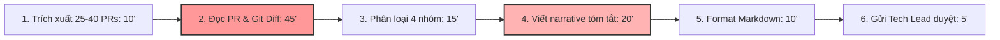

# Báo cáo cá nhân — 2A202603826_NguyenHoangTrung

> Đổi tên file theo quy tắc `MSSV_HoTen.md`, ví dụ `20241234_NguyenVanAn.md` (MSSV trước, dấu `_`, họ tên viết liền không dấu). Sửa cả dòng tiêu đề phía trên cho khớp.
> Template chi tiết và prompt mẫu cho từng mục: [docs/01-worksheet.md](../../docs/01-worksheet.md).
> Mỗi thành viên một file trong `report/individual/` trên repo nhóm: copy template này thành file mới, điền, rồi commit bằng tài khoản GitHub của bạn. Không viết hộ người khác.

## 1. Thông tin học viên

- Họ tên: Nguyễn Hoàng Trung
- MSSV: 2A202603826
- Email trường: 26ai.trungnh@vinui.edu.vn
- Tên nhóm: Nhom4Squares
- Link repo nhóm: https://github.com/S0ra1n0/K5-L3B-DAY02-Nhom4Squares-DiscoveryProblemFraming.git

---

## 2. Scan problem (CP1)

Lăng kính: **Lặp lại** · **Tốn thời gian** · **Cần đọc, tổng hợp nhiều thông tin** · **Pain từ người khác**.

| # | Lăng kính | Job Story: Khi… tôi muốn… để… | Ai chịu ảnh hưởng? | Dấu hiệu thật (thời gian, tần suất, số người, bằng chứng) |
|---:|---|---|---|---|
| 1 | Lặp lại | Khi tới chiều thứ Sáu cuối sprint release, tôi muốn có danh sách các thay đổi kỹ thuật từ các PR đã merge được phân loại rõ ràng, để viết technical release notes gửi cho Tech Lead duyệt trước 17h | Junior Backend Engineer, Tech Lead, Product Manager | Tự bấm giờ 3 đợt release gần nhất: 100, 105 và 115 phút/lần (chu kỳ 2 tuần/lần). Có 3 người trong squad chịu ảnh hưởng trực tiếp |
| 2 | Lặp lại | Khi chuẩn bị tài liệu cho buổi sprint retrospective mỗi 2 tuần, tôi muốn có sẵn bảng thống kê các task bị kéo dài quá estimate và lý do từ Jira, để không phải dò từng ticket trong buổi họp | Scrum Master, Developers trong squad (8 người) | Mỗi 2 tuần 1 lần, mất 35–45 phút copy paste từ Jira sang Confluence; 1 lần bị Tech Lead nhắc nhở vì thiếu số liệu sprint 14 |
| 3 | Lặp lại | Khi nộp bài lab lập trình hàng tuần lên GitHub LMS, tôi muốn có danh sách đối chiếu cấu trúc thư mục, quy tắc đặt tên file và checklist rubric, để đảm bảo không bị trừ điểm oan vì lỗi hình thức | Sinh viên, Trưởng nhóm bài tập lớn (khoảng 30 sinh viên cùng khóa) | 25 phút mỗi tối trước hạn 23h59; 2 tuần trước bạn cùng nhóm bị trừ 5 điểm vì sai tên file báo cáo cá nhân |
| 4 | Tốn thời gian | Khi tiếp nhận một module mã nguồn mở hoặc codebase từ thành viên khác bàn giao, tôi muốn nắm được luồng dữ liệu chính và các hàm cốt lõi, để bắt đầu viết tính năng mới mà không phải đọc từng file từ đầu đến cuối | Developer mới onboard, người bàn giao | Trung bình mất 3–4 tiếng cho mỗi module mới; tần suất 1–2 lần/tháng khi xoay vòng dự án |
| 5 | Tốn thời gian | Khi phải rà soát lỗi crash log (Sentry / CloudWatch) phát sinh trên staging server sau khi deploy, tôi muốn phân tách được lỗi mới phát sinh từ PR nào, để gán đúng người sửa mà không phải đọc hàng trăm dòng stacktrace lặp lại | On-call Engineer, Tech Lead | Mất 40–50 phút mỗi lần phân loại crash log; xảy ra 2–3 lần/tuần sau các đợt merge dồn dập |
| 6 | Cần đọc, tổng hợp nhiều thông tin | Khi đọc các bài báo nghiên cứu (Research Papers) trên arXiv cho đề tài môn học Deep Learning, tôi muốn trích xuất nhanh kiến trúc mô hình, hàm loss, baseline so sánh và link mã nguồn, để hoàn thành literature review hàng tuần | Sinh viên nghiên cứu, Giảng viên hướng dẫn | 60–90 phút cho mỗi bài báo (10–18 trang); trung bình đọc 3 bài/tuần; tuần trước mất trọn buổi chiều Chủ nhật (gần 4 tiếng) |
| 7 | Cần đọc, tổng hợp nhiều thông tin | Khi nhận được 15–20 phản hồi lỗi của người dùng thử nghiệm qua Discord và Google Form, tôi muốn trích xuất được phiên bản app, các bước tái hiện (reproduction steps) và gom các lỗi trùng lặp, để tạo bug ticket chính xác cho đội dev | Junior QA, Developer trực support | 70–85 phút mỗi đợt feedback sau bản beta; đợt trước tạo trùng 4 ticket trên GitHub Issues do 4 người dùng mô tả lỗi cùng một bản chất bằng từ ngữ khác nhau |
| 8 | Pain từ người khác | Khi Tech Lead chuẩn bị buổi demo sản phẩm với Product Owner, Tech Lead muốn biết chính xác những tính năng nào đã được verify xong và rủi ro kỹ thuật nào còn tồn đọng trong sprint, để không bị bất ngờ trước câu hỏi của PO | Tech Lead, Product Owner | Tech Lead hỏi dồn dập trong kênh Slack lúc 14h chiều thứ Sáu; mất 30 phút chat qua lại để xác nhận 5 pull request then chốt |
| 9 | Pain từ người khác | Khi frontend developer tích hợp API mới từ backend, họ muốn có danh sách các trường dữ liệu bị thay đổi kiểu dữ liệu hoặc đổi tên trong endpoint, để không bị lỗi màn hình trắng khi gọi API | Frontend Dev (3 người), Backend Dev (4 người) | 2 lần trong tháng qua frontend bị crash giao diện vì backend âm thầm đổi format timestamp từ integer Unix epoch sang ISO string mà không báo trước |
| 10 | Cần đọc, tổng hợp nhiều thông tin | Khi thành viên trong nhóm làm đồ án cần tìm lại quyết định thiết kế kiến trúc đã thống nhất trong group chat Zalo/Discord từ 2 tuần trước, họ muốn tìm được đúng tin nhắn chốt, để không code sai kiến trúc quy định | 4 thành viên trong nhóm đồ án | 15–20 phút mỗi lần tìm kiếm qua hàng nghìn tin nhắn chat; xảy ra ít nhất 3 lần trong tuần chạy nước rút dự án |

**Nếu có dùng AI để gợi ý thêm:** Sau khi tự scan 8 ý đầu tiên (#1 đến #8) từ trải nghiệm làm đồ án và thực tập, tôi dùng AI gợi ý thêm góc nhìn cho vai trò developer/sinh viên IT.
- **Ý AI gợi ý mà tôi giữ lại:** Ý #9 (Frontend đau đầu vì Backend đổi API contract) và Ý #10 (Tìm lại quyết định kiến trúc cũ trôi trong chat). Tôi giữ lại vì đây là hai nỗi đau có thật mà nhóm tôi gặp thường xuyên trong quá trình cộng tác code.
- **Ý AI gợi ý mà tôi bỏ:** Ý "AI tự động fix toàn bộ bug trong code sau khi đọc issue" và "AI Agent tự động quản lý dự án từ A-Z". Tôi bỏ vì đây là các solution viển vông đội lốt problem, không có quy trình cụ thể, phạm vi quá rộng và không khả thi trong thực tế.

---

## 3. Top 3 Problem Cards + quy trình nháp (CP2)

### Bảng chọn top 3

| Rank | Problem | Vì sao chọn | Điều còn chưa chắc |
|---:|---|---|---|
| 1 | Soạn Technical Release Notes từ danh sách Pull Requests (#1) | Quy trình lặp lại định kỳ 2 tuần/lần, tốn thời gian cố định (100–115 phút), có baseline đo lường thật bằng bấm giờ, hậu quả nghiêm trọng nếu bỏ sót breaking change (lỗi hệ thống production), actor và dữ liệu (git diff, PRs) rất rõ ràng | Liệu dev viết commit message quá cụt ngủn ("fix bug", "update") thì AI có đọc nổi git diff để hiểu đúng nghiệp vụ không? |
| 2 | Trích xuất thông tin cốt lõi từ bài báo khoa học cho Literature Review (#6) | Nhu cầu thật của sinh viên nghiên cứu, tốn nhiều thời gian đọc tài liệu dài (3–4 tiếng/tuần), quy trình phân tích bài báo có các mục tiêu rõ ràng | Chất lượng tóm tắt bài báo khó định lượng bằng một metric khách quan; sinh viên vẫn phải đọc lại bài gốc để kiểm chứng phương trình |
| 3 | Sàng lọc và gom nhóm bug report từ Discord/Google Form (#7) | Nỗi đau thật khi phát hành ứng dụng thử nghiệm, mất thời gian phân loại và dễ trùng lặp ticket | Nguồn dữ liệu từ người dùng tự do rất hỗn loạn, thiếu thông tin môi trường; khó xác định ranh giới giữa bug thật và người dùng dùng sai |

---

### Problem Card #1 — Soạn Technical Release Notes từ danh sách Pull Requests

| Trường | Nội dung |
|---|---|
| Job Story | Khi tới chiều thứ Sáu cuối sprint release, tôi muốn có danh sách các thay đổi kỹ thuật từ các PR đã merge được phân loại rõ ràng, để viết technical release notes gửi cho Tech Lead duyệt trước 17h |
| Actor | Junior Backend Engineer / Release Coordinator trong đội ngũ phát triển phần mềm (squad 8–15 người) |
| Thời điểm / bối cảnh | Chiều thứ Sáu, 2 tuần một lần, chuẩn bị cắt bản release để deploy lên Staging và Production |
| Quy trình hiện tại (3–7 bước) | 1. Trích xuất danh sách 25–40 PRs đã merge từ GitHub CLI/Web (10') · 2. Đọc từng PR description, commit title và git diff để hiểu thay đổi thực tế (45') · 3. Phân loại vào các mục: Breaking Changes, Features, Bug Fixes, Internal/Docs (15') · 4. Viết narrative tóm tắt kỹ thuật kèm cảnh báo migration (20') · 5. Review và format lại Markdown (10') · 6. Gửi Tech Lead duyệt trước khi publish (5') |
| Bottleneck (bước nào, mất bao nhiêu phút) | Bước 2 (đọc PR và git diff khi commit message cẩu thả: 45') và Bước 4 (viết narrative kỹ thuật: 20'). Tổng 2 bước chiếm 65/105 phút |
| Impact (nếu không giải thì sao) | Mất 105 phút/lần release; 3 trong 6 đợt release gần nhất bị bỏ sót 2 breaking change (đổi format trường API, sửa file migration DB) làm crash app Staging; Tech Lead phải ngồi đọc lại từ đầu |
| Success metric (baseline → target) | Tổng thời gian từ 105 phút (bấm giờ 3 đợt gần nhất) giảm xuống dưới 25 phút; 0 breaking change bị bỏ sót; Tech Lead sửa dưới 20% bản nháp |
| Phương án không dùng AI | Bắt buộc quy chuẩn Conventional Commits (`feat:`, `fix:`, `break:`) kèm PR template bắt buộc tick checklist. Chưa giải quyết được khi dev gấp rút đặt tên bừa hoặc không tóm tắt được tổng thể liên kết giữa các PR |
| Giả thuyết về AI | AI đọc commit metadata kèm tóm tắt git diff, tự động phân loại vào 4 danh mục và soạn draft narrative; engineer rà soát và bổ sung migration action trước khi gửi Tech Lead |
| Cảm nhận nhanh | **Workflow** |

Quy trình nháp hiện tại:



```text
HIỆN TẠI — 105 phút/đợt release (2 tuần/lần)

[1 Trích xuất PRs: 10'] → [2 Đọc PR & Git Diff: 45'] ← BOTTLENECK CHÍNH
→ [3 Phân loại 4 nhóm: 15'] → [4 Viết narrative tóm tắt: 20'] ← BOTTLENECK PHỤ
→ [5 Format Markdown: 10'] → [6 Gửi Tech Lead duyệt: 5']
```

---

### Problem Card #2 — Trích xuất thông tin cốt lõi từ bài báo khoa học (Literature Review)

| Trường | Nội dung |
|---|---|
| Job Story | Khi đọc các bài báo nghiên cứu (Research Papers) trên arXiv cho đề tài môn Deep Learning, tôi muốn trích xuất nhanh kiến trúc mô hình, hàm loss, baseline so sánh và mã nguồn, để hoàn thành literature review hàng tuần |
| Actor | Sinh viên nghiên cứu / Học viên cao học ngành AI/CS |
| Thời điểm / bối cảnh | Thứ Bảy hàng tuần khi chuẩn bị báo cáo tiến độ nghiên cứu cho Giảng viên hướng dẫn |
| Quy trình hiện tại (3–7 bước) | 1. Tải 3–4 bài báo PDF từ arXiv (10') · 2. Đọc lướt Abstract và Introduction để hiểu bài toán (20') · 3. Đọc phần Methodology tìm cấu trúc mô hình và hàm loss (50') · 4. Đọc Experiments so sánh bảng kết quả với baseline (40') · 5. Viết tổng hợp vào bảng Literature Review (30') |
| Bottleneck (bước nào, mất bao nhiêu phút) | Bước 3: Đọc sâu phần Methodology để trích xuất chi tiết công thức và cơ chế (mất 50 phút/bài báo vì công thức toán học và ký hiệu phức tạp) |
| Impact (nếu không giải thì sao) | Mất 150 phút cho mỗi bài báo; sinh viên thường bị quá tải, bỏ sót các bài liên quan quan trọng hoặc hiểu sai thông số thử nghiệm |
| Success metric (baseline → target) | Thời gian trích xuất thông tin từ 150 phút/bài giảm xuống dưới 45 phút/bài; bảng tổng hợp trích đúng 100% tên mô hình, hàm loss và link github |
| Phương án không dùng AI | Dùng template ghi chú cấu trúc sẵn (Zotero / Notion reading template) và skim theo keyword "loss", "dataset", "baseline" |
| Giả thuyết về AI | AI đọc file PDF hoặc LaTeX source, trích xuất cấu trúc thành bảng JSON có cấu trúc (Problem, Model, Loss, Dataset, Benchmark metrics, Github repo) |
| Cảm nhận nhanh | **Workflow** |

Quy trình nháp hiện tại:

```text
HIỆN TẠI — 150 phút/bài báo

[1 Tải PDF: 10'] → [2 Đọc Abstract/Intro: 20'] → [3 Đọc Methodology & Math: 50'] ← BOTTLENECK
→ [4 Đọc Experiment & Benchmark: 40'] → [5 Điền bảng Literature Review: 30']
```

---

### Problem Card #3 — Sàng lọc và chuẩn hóa phản hồi lỗi (Bug Report Triage).

| Trường | Nội dung |
|---|---|
| Job Story | Khi nhận được 15–20 phản hồi lỗi của người dùng thử nghiệm qua Discord và Google Form, tôi muốn trích xuất được phiên bản app, các bước tái hiện và gom các lỗi trùng lặp, để tạo bug ticket chính xác cho đội dev |
| Actor | Junior QA Engineer / Developer trực hỗ trợ kỹ thuật |
| Thời điểm / bối cảnh | Sáng thứ Hai hàng tuần sau đợt chạy thử nghiệm ứng dụng nội bộ hoặc beta release |
| Quy trình hiện tại (3–7 bước) | 1. Gom tin nhắn phản hồi từ kênh Discord #bug-report và Google Sheet (15') · 2. Đọc từng phản hồi phân tích xem là lỗi hay người dùng dùng sai (30') · 3. Dò tìm trong danh sách issue xem đã có ai báo lỗi này chưa (20') · 4. Viết lại ticket chuẩn gồm: Tên lỗi, Môi trường, Các bước tái hiện (Reproduction Steps) (20') |
| Bottleneck (bước nào, mất bao nhiêu phút) | Bước 2 (đọc hiểu mô tả không rõ ràng của người dùng: 30') và Bước 3 (dò trùng lặp giữa các ticket: 20') |
| Impact (nếu không giải thì sao) | Mất 85 phút/đợt; tạo trùng lặp ticket (tuần trước trùng 4 ticket trên GitHub); dev mất thời gian hỏi lại người dùng vì thiếu thông tin tái hiện |
| Success metric (baseline → target) | Thời gian triage từ 85 phút xuống dưới 25 phút; tỉ lệ ticket trùng lặp giảm từ 25% xuống dưới 5% |
| Phương án không dùng AI | Ép người dùng điền form mẫu nghiêm ngặt với các trường bắt buộc (Version, OS, Steps to reproduce, Screenshot). Người dùng hay bỏ qua form nếu quá dài |
| Giả thuyết về AI | AI phân tích đoạn chat tự nhiên, trích xuất các trường thông tin chuẩn và so khớp semantic similarity với các issue đã mở |
| Cảm nhận nhanh | **Workflow** |

Quy trình nháp hiện tại:

```text
HIỆN TẠI — 85 phút/đợt triage

[1 Gom feedback: 15'] → [2 Đọc & phân tích mô tả người dùng: 30'] ← BOTTLENECK
→ [3 Dò trùng lặp issue: 20'] → [4 Viết ticket chuẩn GitHub: 20']
```

---

### Card muốn pitch nhất

- Card số: **Card #1 — Soạn Technical Release Notes từ danh sách Pull Requests**
- Vì sao: Quy trình có tính chu kỳ cố định (2 tuần/lần), tốn thời gian đều đặn của kỹ sư, có baseline đo lường được ngay bằng bấm giờ thực tế. Hậu quả của việc làm ẩu rất rõ ràng (bỏ sót breaking change gây lỗi hệ thống). Dữ liệu đầu vào (git commit, git diff, PR metadata) có tính kỹ thuật cao, rất phù hợp để so sánh 4 mức No AI / Rule / Workflow / Agent.
- Câu hỏi muốn nhóm phản biện: *"Nếu dev trong team đặt tiêu đề PR cực kỳ sơ sài kiểu 'fix bug' hoặc PR quá lớn có diff hàng nghìn dòng code, làm sao đảm bảo AI không bị hallucinate và không bị tràn token context window?"*

### AI đã phản biện card thế nào

| Điểm yếu AI chỉ ra | Đồng ý? | Đã sửa gì |
|---|---|---|
| Baseline 105 phút có thể là cảm tính chủ quan của một cá nhân | Đồng ý | Tôi đã ghi lại thời gian thực tế bấm giờ qua 3 đợt release gần nhất (100', 105', 115') và hỏi thêm 2 đồng nghiệp cùng làm release |
| Chưa nói rõ cách xử lý PR lớn có hàng ngàn dòng code diff (nguy cơ tràn token LLM) | Đồng ý | Bổ sung quy tắc tiền xử lý dữ liệu: chỉ trích xuất diff của các file thay đổi logic nghiệp vụ, lược bỏ các file package-lock.json, minified assets, auto-generated code |
| Gợi ý nên dùng AI Agent tự động tạo git tag, commit changelog và deploy luôn lên Production | **Không đồng ý** | Tôi giữ vững quan điểm: Việc release liên quan trực tiếp đến độ ổn định của hệ thống. Ranh giới (boundary) bắt buộc phải có con người kiểm tra (HITL). AI chỉ dừng lại ở mức hỗ trợ soạn thảo draft (Workflow), tuyệt đối không để Agent tự quyết định release |

---

## 4. Tôi đã tham gia phần nào (CP3 → CP7)

| Hoạt động | Tôi đã làm gì? | Kết quả / ảnh hưởng tới bài nhóm |
|---|---|---|
| Pitch Problem Card | Trình bày Problem Card #1 (Soạn Release Notes) trong 2 phút; nêu rõ baseline 105' và rủi ro breaking change | Card #1 được nhóm đưa vào Shortlist 3 candidate xuất sắc nhất |
| Phản biện bài của bạn khác | Đặt câu hỏi phản biện cho Nguyễn Tuấn Dũng (bài toán Đối chiếu hồ sơ thanh toán nhà cung cấp 3-way matching): *"Nếu kế toán vẫn phải tự mắt kiểm tra lại kết quả của AI vì sợ sai số tiền thì thời gian có thực sự giảm từ 18 phút xuống 5 phút được không?"* | Thúc đẩy Dũng và nhóm phải làm rõ cơ chế hiển thị bảng đối chiếu Side-by-side và tính năng Trích dẫn Citation (số trang/điều khoản) để kế toán kiểm tra nhanh trong 1 phút |
| Nhận phản biện | Câu hỏi tôi nhận được từ Nguyễn Tuấn Dũng: *"Release Notes chỉ làm 2 tuần một lần, tần suất có đủ lớn và ảnh hưởng rộng bằng nghiệp vụ kế toán diễn ra hàng ngày (30–60 bộ/ngày) không?"* | Tôi thừa nhận bài toán kế toán có tần suất cao hơn và Business Impact lớn hơn đối với toàn thể các phòng ban trong doanh nghiệp |
| Gom cluster / cây OST | Cùng nhóm phân loại 12 candidate thành 3 cụm lớn; trực tiếp tham gia vẽ cây Opportunity Solution Tree | Xác lập rõ Outcome chung và bóc tách các Opportunity (pain point), kiên quyết gạch bỏ các giải pháp công nghệ đội lốt |
| Chọn candidate problem | Cùng chấm điểm 3 candidate theo 7 tiêu chí trong bảng chấm điểm Shortlist | Tôi hoàn toàn bị thuyết phục bởi số liệu và tính cấp thiết của bài toán **Đối chiếu hồ sơ thanh toán nhà cung cấp (3-way matching)**, đạt 35/35 điểm và được cả nhóm nhất trí chọn |
| Kiểm chứng / research | Trực tiếp tham gia thực hiện 2/5 buổi phỏng vấn sâu: Phỏng vấn #2 (Trưởng nhóm Kế toán AP) và Phỏng vấn #5 (Kế toán trưởng); tìm hiểu giải pháp Kofax AP Agility | Thu thập bằng chứng xác đáng về rủi ro xuất toán thuế và yêu cầu bắt buộc phải có trích dẫn Citation trang gốc trong hợp đồng scan |
| Quy trình nhóm | Thiết kế chi tiết sơ đồ quy trình hiện tại (As-Is: 5 bước, 18') và quy trình tương lai (To-Be: 5 bước, 2.5') bằng cú pháp Mermaid; đánh dấu rõ bước Rule, AI và Human chốt chặn | Trực quan hóa điểm nghẽn ở khâu đọc hợp đồng scan và chứng minh cách Workflow giải phóng 86% thời gian cho kế toán |
| Problem Statement | Soạn thảo Problem Statement v0 và cùng nhóm nâng cấp lên Problem Statement v1 sau khi bổ sung ranh giới an toàn và tiêu chí đánh giá | Bản Problem Statement chuẩn chỉnh, đầy đủ baseline, target và cách đo lường cụ thể |
| Mức can thiệp AI | Phân tích ma trận độ mơ hồ × độ phức tạp; cùng nhóm điền AI Canvas rút gọn và trả lời 2 câu hỏi Google PAIR | Khẳng định mức can thiệp tối ưu là **Workflow kết hợp Rule và AI**, kiên quyết từ chối Agent vì rủi ro chi sai tiền là không thể chấp nhận |
| Quyết định | Phân tích 4 rủi ro của Marty Cagan; đề xuất kế hoạch thử nghiệm pilot 2 tuần trên 50 bộ hồ sơ và thiết lập Ngưỡng dừng (Stop Threshold) đo lường được | Nhóm thống nhất kết luận **Go (pilot phạm vi nhỏ)** với cam kết dừng ngay nếu AI bỏ sót bất kỳ sai lệch số tiền nào |

---

## 5. Dùng AI

| Checkpoint | Tôi dùng AI để làm gì? | AI hữu ích ở đâu? | AI sai hoặc hời hợt ở đâu? | Tôi sửa gì bằng nhận định của mình? |
|---|---|---|---|---|
| CP1 Scan | Gợi ý thêm các vấn đề thường gặp theo 4 lăng kính trong môi trường công nghệ và đời sống | Giúp tôi nhớ ra vấn đề lệch API contract (#9) và việc tìm quyết định kiến trúc trong chat (#10) | Gợi ý các ý tưởng viển vông kiểu "AI tự động sửa mọi bug" hoặc "AI quản lý dự án toàn diện" | Bỏ qua các ý tưởng giải pháp trá hình, chỉ giữ lại các vấn đề có quy trình và hành vi lặp lại cụ thể |
| CP2 Problem Card | Đóng vai Product Manager hoài nghi để phản biện Card #1 | Chỉ ra rằng baseline 105 phút có thể là chủ quan và thiếu xử lý cho PR có diff quá lớn | Đề xuất cho AI tự động merge và release luôn lên production | Tôi từ chối đề xuất tự động hóa hoàn toàn; giữ vững boundary có con người kiểm tra (HITL); bổ sung cơ chế lọc diff file |
| CP4 Research | Tìm kiếm các giải pháp tự động hóa AP và đối chiếu chứng từ trên thị trường | Gợi ý đúng các công cụ chuyên sâu: Kofax AP Agility, AWS Textract Expense, invoice2data | Cung cấp link tài liệu cũ và khẳng định AWS Textract có thể tự đối chiếu 3 bên (thực tế chỉ bóc tách từng file riêng lẻ) | Tôi tự mở từng link kiểm chứng trên trang chủ AWS và Kofax; làm rõ điểm mù là các công cụ hiện nay chưa hỗ trợ đối chiếu hợp đồng dịch vụ scan tiếng Việt |
| CP5 Quy trình | Hỗ trợ chuyển đổi bảng quy trình của nhóm thành mã Mermaid syntax | Sinh mã Mermaid nhanh, bố cục luồng rõ ràng, dễ đọc | Tự ý gộp bước bóc tách XML hóa đơn và đọc hợp đồng scan thành một bước AI duy nhất | Tôi tách riêng thành: Bước 1 (Rule đọc XML chuẩn 100%) và Bước 2 (AI đọc hợp đồng scan phi cấu trúc) để tối ưu chi phí và độ chính xác |
| CP5–6 Problem Statement | Phản biện Problem Statement v0 để tìm lỗ hổng | Nhắc nhở rằng success metric ban đầu chỉ đo thời gian mà chưa đo rủi ro bỏ sót sai lệch số tiền và tính năng trích dẫn | Gợi ý viết lại toàn bộ Problem Statement theo văn phong quảng cáo phần mềm | Tôi giữ nguyên cấu trúc Problem Statement chuẩn không giải pháp, bổ sung metric Zero-miss sai lệch tài chính theo góp ý |
| CP6 Mức can thiệp / quyết định | Gợi ý các tiêu chí đánh giá (eval criteria) cho bản nháp đối chiếu chứng từ | Đưa ra các khía cạnh đánh giá hữu ích: tính chính xác số học, độ nhạy phát hiện sai lệch, tính truy nguyên nguồn gốc | Gợi ý tiêu chí định tính khó đo lường kiểu "mức độ hài lòng của kế toán viên" | Tôi chuyển hóa thành 4 tiêu chí kỹ thuật đo được: chính xác số liệu, bắt đúng sai lệch, có trích dẫn citation số trang, định dạng bảng chuẩn |

---

## 6. Reflection (CP7)

Trả lời bằng trải nghiệm thật của bạn, tối thiểu 200 từ cho các câu 6.1–6.6 (không tính 6.7, câu này được chấm riêng ở tiêu chí C5). **Không dùng AI để viết thay.**

**6.1. Tôi học được gì khi nghe top 3 problems của các bạn khác?**
Khi lắng nghe phần trình bày của Dũng, Khoa và Sơn, tôi nhận được một bài học sâu sắc về tư duy định giá vấn đề (Problem Valuation). Là một người thiên về kỹ thuật phần mềm, tôi từng đinh ninh rằng bài toán "Soạn Technical Release Notes" của mình là hay nhất vì nó giải quyết đúng nỗi đau git diff mà tôi đối mặt mỗi sprint. Nhưng khi nghe Dũng pitch về bài toán "Đối chiếu hồ sơ thanh toán nhà cung cấp (3-way matching)", tôi thực sự bị thuyết phục. Dũng đưa ra những con số làm tôi giật mình: 30–60 bộ hồ sơ mỗi ngày, kế toán phải tăng ca đến 20h tối cuối tháng chỉ để căng mắt đọc hợp đồng scan 30 trang, và tỷ lệ trả hồ sơ lên tới 25% làm gián đoạn dòng tiền thanh toán cho nhà cung cấp. Tôi nhận ra bài toán của Dũng có tần suất lặp lại cao gấp hàng chục lần bài của tôi, và tác động kinh tế (Business Value) của nó lan tỏa tới toàn bộ các phòng ban trong doanh nghiệp chứ không chỉ bó hẹp trong squad kỹ thuật. Tôi học được rằng khi làm Product Discovery, ta không được phép "yêu giải pháp của mình" hay chỉ nhìn quanh góc bàn làm việc quen thuộc, mà phải đặt các bài toán lên bàn cân dựa trên dữ liệu định lượng và mức độ ảnh hưởng thực tế.

**6.2. Nhóm có lúc nào bị "solution-first" (nghĩ giải pháp trước khi hiểu vấn đề) không? Lúc đó nhóm nhận ra và xử lý thế nào?**
Nhóm tôi đã bị "solution-first" rất rõ ở đầu buổi CP3 khi vừa chọn xong bài toán thanh toán. Vừa nghe Dũng nói xong, một bạn trong nhóm đã hào hứng đề xuất: *"Bọn mình làm một con Autonomous Agent AI kết nối API ngân hàng, hễ phòng ban gửi hồ sơ lên là con Agent tự đọc, tự kiểm tra, nếu thấy hợp lệ thì tự đẩy lệnh chuyển tiền luôn cho nhanh!"*. Ý tưởng nghe qua rất hiện đại và hấp dẫn. Nhưng may mắn là tôi đã lập tức đặt câu hỏi chất vấn: *"Nếu bản scan hợp đồng bị mờ, con Agent đọc nhầm 150 triệu thành 750 triệu rồi tự chuyển tiền đi thì ai chịu trách nhiệm trước pháp luật? Không một kế toán trưởng hay kiểm toán nào chấp nhận để AI tự ý ký lệnh chi tiền"*. Câu hỏi đó đã kéo cả nhóm giật mình tỉnh táo. Chúng tôi nhận ra mình đang lao vào bẫy "Agent-first" mà quên mất nguyên tắc kiểm soát nội bộ cốt lõi của ngành tài chính là Separation of Duties (phân tách trách nhiệm). Nhóm đã lập tức dừng lại, quay về phân tích bảng quy trình As-Is và thống nhất xác lập ranh giới (Boundary) nghiêm ngặt: AI tuyệt đối chỉ đóng vai trò hỗ trợ đọc tài liệu và dọn sẵn bảng đối chiếu (Augment), còn quyết định duyệt chi bắt buộc phải là con người (HITL).

**6.3. Tôi có đổi ý sau khi bị phản biện không? Kể một lần cụ thể.**
Tôi đã đổi ý hoàn toàn hai lần trong buổi lab. Lần thứ nhất là ở khâu chọn đề tài: từ việc kiên quyết bảo vệ bài toán Release Notes của mình, tôi đã chủ động bỏ phiếu ủng hộ bài toán 3-way matching của Dũng sau khi nghe phân tích về tần suất và tác động tài chính. Lần thứ hai là ở khâu thiết kế Success Metric của Problem Statement. Ban đầu, tôi đề xuất chỉ đo một chỉ số duy nhất là: *"Giảm thời gian kiểm tra từ 18 phút xuống dưới 5 phút/bộ"*. Khi đó, Khoa đã phản biện tôi: *"Nếu AI làm trong 1 phút nhưng lại đọc sót việc nhà cung cấp xuất hóa đơn đòi 100% tiền trong khi hợp đồng chỉ cho thanh toán 50% thì thời gian nhanh có ý nghĩa gì không? Lúc đó công ty mất tiền tỷ!"*. Lời phản biện của Khoa đánh trúng điểm yếu chí mạng. Tôi nhận ra trong tài chính, tính chính xác và an toàn quan trọng hơn tốc độ gấp bội. Tôi đã lập tức đổi ý và cùng nhóm bổ sung thêm hai metric chất lượng: tỷ lệ phát hiện sai lệch tài chính phải đạt tuyệt đối 100% (Zero-miss) và giảm tỷ lệ hồ sơ bị trả lại từ 25% xuống dưới 8%.

**6.4. Kết quả kiểm chứng (phỏng vấn/survey/research) có làm tôi bất ngờ không? Điều gì?**
Điều làm tôi bất ngờ nhất là kết quả phỏng vấn một bác Kế toán trưởng 12 năm kinh nghiệm (Phỏng vấn #5). Khi tôi hỏi về việc đối chiếu hóa đơn, bác nói: *"Cơ quan thuế vào thanh tra họ không chỉ soi số tiền, mà họ soi từng chữ trên hóa đơn có khớp với phạm vi công việc trong hợp đồng không. Năm ngoái công ty bác bị phạt và truy thu 80 triệu chỉ vì hóa đơn ghi tắt khác với câu chữ trong biên bản nghiệm thu"*. Hóa ra nỗi đau lớn nhất không phải là phép tính cộng trừ số học, mà là **việc so khớp ngữ nghĩa (semantic matching)** giữa mô tả dịch vụ trên hóa đơn và điều khoản hợp đồng. Đây là điều mà các công cụ Rule truyền thống hoàn toàn bất lực và chỉ có mô hình ngôn ngữ lớn (LLM) mới xử lý được. Ngược lại, một bất ngờ thứ hai là tín hiệu phản bác từ anh Giám đốc công ty 5 người (Phỏng vấn #4): anh bảo công ty nhỏ chuyển khoản luôn trên app ngân hàng trong 30 giây, chẳng ai cần đối chiếu 3 bên. Tín hiệu này giúp nhóm tôi lập tức thu hẹp phạm vi khách hàng mục tiêu, tránh việc xây dựng sản phẩm cho những đối tượng không hề có nhu cầu.

**6.5. Điều khó nhất khi viết Problem Statement là gì?**
Điều khó nhất là viết phần **Boundary (Ranh giới an toàn)** và tách bạch hoàn toàn giải pháp ra khỏi vấn đề. Là dân công nghệ, chúng tôi luôn có xu hướng viết: *"Vấn đề là công ty chưa có hệ thống AI để tự động đối chiếu..."* thay vì mô tả đúng bản chất sự việc là *"Kế toán đang mất 18 phút/bộ để đọc hợp đồng scan và 25% hồ sơ bị trả lại do sai lệch chứng từ"*. Việc xác lập Boundary cũng đòi hỏi phải hiểu sâu nghiệp vụ thực tế: AI được làm gì và tuyệt đối KHÔNG được làm gì. Chúng tôi phải tranh luận rất nhiều để đưa ra các quy tắc thép: AI không được tự suy đoán số tiền nếu bản scan mờ, và bắt buộc phải dẫn link trích dẫn (Citation) số trang cụ thể trong hợp đồng. Nếu không có những ranh giới này, bản Problem Statement sẽ trở thành một bản mô tả mơ hồ và cực kỳ rủi ro khi triển khai kỹ thuật.

**6.6. Nếu làm lại, tôi sẽ đổi gì? Tôi sẽ phản biện nhóm mạnh hơn ở điểm nào?**
Nếu được làm lại từ đầu, tôi sẽ phản biện nhóm mạnh hơn ở khâu phân tích nguồn dữ liệu Hóa đơn điện tử ngay từ CP2. Lúc đầu, cả nhóm cứ loay hoay tìm cách dùng OCR và thị giác máy tính để đọc file ảnh/PDF hóa đơn. Mãi đến khi tìm hiểu kỹ quy định Thông tư 78 của Tổng cục Thuế, chúng tôi mới nhận ra mọi hóa đơn điện tử hợp pháp tại Việt Nam đều bắt buộc có file dữ liệu gốc dạng XML có cấu trúc chuẩn 100%. Nếu nhận ra điều này sớm hơn 30 phút, nhóm đã không mất công tranh luận về việc LLM có đọc sai số tiền trên hóa đơn hay không, mà sẽ dùng ngay Rule parser để bóc tách XML với độ chính xác tuyệt đối, dành toàn bộ tài nguyên AI cho việc đọc hợp đồng PDF scan. Tôi cũng sẽ mở rộng khảo sát thêm các doanh nghiệp có vốn đầu tư nước ngoài (FDI) để xem quy trình đối chiếu hợp đồng song ngữ (Việt - Anh) có phát sinh thêm những rào cản đặc thù nào khác hay không.

**6.7. Hiểu bài:** giải thích bằng 5–8 câu, không nhìn tài liệu, chuỗi *problem → quy trình → metric → boundary → mức can thiệp AI → quyết định* của bài nhóm mình.
1. **Problem:** Nhóm xuất phát từ nỗi đau có thật của Chuyên viên Kế toán thanh toán (AP) tại các doanh nghiệp vừa và lớn khi mỗi ngày phải xử lý 30–60 bộ hồ sơ, mất 18 phút/bộ chỉ để căng mắt dò tìm điều khoản đợt thanh toán trong hợp đồng scan 10–30 trang, dẫn đến nguy cơ sai sót tài chính và 25% hồ sơ bị trả lại làm trễ hạn thanh toán.
2. **Quy trình:** Nhóm bóc tách quy trình hiện tại thành 5 bước và chỉ ra nút thắt cổ chai lớn nhất nằm ở Bước 3 (đối chiếu thủ công giữa Hợp đồng scan, Biên bản nghiệm thu và Hóa đơn: 10–12 phút) cùng Bước 5a (vòng lặp trả hồ sơ làm trễ 2–3 ngày).
3. **Metric:** Thành công được định nghĩa bằng 3 chỉ số định lượng có baseline đo thật: thời gian xử lý 1 bộ hồ sơ giảm từ 18 phút xuống dưới 5 phút, tỷ lệ hồ sơ bị trả lại giảm từ 25% xuống dưới 8%, và độ an toàn tài chính đạt 100% phát hiện sai lệch (Zero-miss sai sót).
4. **Boundary:** Ranh giới an toàn tuyệt đối được thiết lập là AI không bao giờ được tự động duyệt chi hay chuyển tiền trên ERP/Ngân hàng, không tự suy diễn con số nếu bản scan bị mờ, và bắt buộc phải hiển thị trích dẫn (Citation) số trang và câu chữ hợp đồng gốc để kế toán kiểm chứng lại.
5. **Mức can thiệp AI:** Nhóm lựa chọn mức **Workflow** kết hợp (Rule bóc tách XML hóa đơn đạt chuẩn 100% + AI đọc hiểu hợp đồng scan trích xuất citation + Rule so khớp sinh bảng đối chiếu + Con người phê duyệt chốt chặn), kiên quyết từ chối Agent vì rủi ro chi sai tiền là vi phạm nguyên tắc kiểm soát nội bộ.
6. **Quyết định:** Nhóm ra quyết định **Go (triển khai pilot nhỏ 2 tuần trên 50 bộ hồ sơ)** vì không có rủi ro nào ở mức cao, kèm theo ngưỡng dừng rõ ràng: nếu sau pilot mà AI bỏ sót 01 sai lệch số tiền nào hoặc thời gian xử lý không giảm xuống dưới 8 phút thì lập tức dừng dự án và quay về quy trình bán thủ công truyền thống.

---

## 7. Tài liệu tham khảo

1. Fitzpatrick, R. (2013). *The Mom Test: How to talk to customers & learn if your business is a good idea when everyone is lying to you*. Founder Centric.
2. Gothelf, J., & Seiden, J. (2021). *Lean UX: Designing Great Products with Agile Teams* (3rd ed.). O'Reilly Media.
3. Agrawal, A., Gans, J., & Goldfarb, A. (2018). *Prediction Machines: The Simple Economics of Artificial Intelligence*. Harvard Business Review Press.
4. Anthropic. (2024). *Building Effective Agents*. Anthropic Research. https://www.anthropic.com/research/building-effective-agents
5. Google People + AI Research (PAIR). (2021). *People + AI Guidebook*. https://pair.withgoogle.com/guidebook/
6. Cagan, M. (2017). *Inspired: How to Create Tech Products Customers Love* (2nd ed.). Wiley.
7. Bland, D. J., & Osterwalder, A. (2019). *Testing Business Ideas: A Field Guide for Rapid Experimentation*. Wiley.
8. Torres, T. (2021). *Continuous Discovery Habits: Discover Products that Create Customer Value and Business Value*. Product Talk LLC.
9. Tungsten Automation. *Kofax AP Agility Overview*. https://www.tungstenautomation.com/products/kofax-ap-agility
10. AWS Documentation. *Analyzing Invoices and Receipts with Amazon Textract*. https://docs.aws.amazon.com/textract/latest/dg/analyzing-document-expense.html
11. Invoice2Data Community. *invoice2data: Extract structured data from PDF invoices*. https://github.com/invoice-x/invoice2data
12. Tổng cục Thuế Việt Nam. *Quy định về định dạng chuẩn dữ liệu Hóa đơn điện tử (Thông tư 78/2021/TT-BTC)*.
