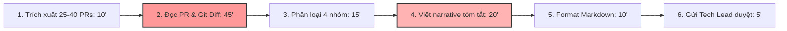

# Báo cáo cá nhân — 2A202603826_NguyenHoangTrung

> Đổi tên file theo quy tắc `MSSV_HoTen.md`, ví dụ `20241234_NguyenVanAn.md` (MSSV trước, dấu `_`, họ tên viết liền không dấu). Sửa cả dòng tiêu đề phía trên cho khớp.
> Template chi tiết và prompt mẫu cho từng mục: [docs/01-worksheet.md](../../docs/01-worksheet.md).
> Mỗi thành viên một file trong `report/individual/` trên repo nhóm: copy template này thành file mới, điền, rồi commit bằng tài khoản GitHub của bạn. Không viết hộ người khác.

## 1. Thông tin học viên

- Họ tên: Nguyễn Hoàng Trung
- MSSV: 2A202603826
- Email trường: 26ai.trungnh@vinui.edu.vn
- Tên nhóm: Nhom4Squares
- Link repo nhóm: https://github.com/S0ra1n0/K5-L3B-DAY02-Nhom4Squares-DiscoveryProblemFraming.git

---
1
## 2. Scan problem (CP1)

Lăng kính: **Lặp lại** · **Tốn thời gian** · **Cần đọc, tổng hợp nhiều thông tin** · **Pain từ người khác**.

| # | Lăng kính | Job Story: Khi… tôi muốn… để… | Ai chịu ảnh hưởng? | Dấu hiệu thật (thời gian, tần suất, số người, bằng chứng) |
|---:|---|---|---|---|
| 1 | Lặp lại | Khi tới chiều thứ Sáu cuối sprint release, tôi muốn có danh sách các thay đổi kỹ thuật từ các PR đã merge được phân loại rõ ràng, để viết technical release notes gửi cho Tech Lead duyệt trước 17h | Junior Backend Engineer, Tech Lead, Product Manager | Tự bấm giờ 3 đợt release gần nhất: 100, 105 và 115 phút/lần (chu kỳ 2 tuần/lần). Có 3 người trong team chịu ảnh hưởng trực tiếp |
| 2 | Lặp lại | Khi chuẩn bị tài liệu cho buổi sprint retrospective mỗi 2 tuần, tôi muốn có sẵn bảng thống kê các task bị kéo dài quá estimate và lý do từ Jira, để không phải dò từng ticket trong buổi họp | Scrum Master, Developers trong squad (8 người) | Mỗi 2 tuần 1 lần, mất 35–45 phút copy paste từ Jira sang Confluence; 1 lần bị Tech Lead nhắc vì thiếu dữ liệu sprint 14 |
| 3 | Lặp lại | Khi nộp bài lab lập trình hàng tuần lên GitHub LMS, tôi muốn có danh sách đối chiếu cấu trúc thư mục, quy tắc đặt tên file và checklist rubric, để đảm bảo không bị trừ điểm oan vì lỗi hình thức | Sinh viên, Trưởng nhóm bài tập lớn (khoảng 30 sinh viên cùng khóa) | 25 phút mỗi tối trước hạn 23h59; 2 tuần trước bạn cùng nhóm bị trừ 5 điểm vì sai tên file báo cáo cá nhân |
| 4 | Tốn thời gian | Khi tiếp nhận một module mã nguồn mở hoặc codebase từ thành viên khác bàn giao, tôi muốn nắm được luồng dữ liệu chính và các hàm cốt lõi, để bắt đầu viết tính năng mới mà không phải đọc từng file từ đầu đến cuối | Developer mới onboard, người bàn giao | Trung bình mất 3–4 tiếng cho mỗi module mới; tần suất 1–2 lần/tháng khi xoay vòng dự án |
| 5 | Tốn thời gian | Khi phải rà soát lỗi crash log (Sentry / CloudWatch) phát sinh trên staging server sau khi deploy, tôi muốn phân tách được lỗi mới phát sinh từ PR nào, để gán đúng người sửa mà không phải đọc hàng trăm dòng stacktrace lặp lại | On-call Engineer, Tech Lead | Mất 40–50 phút mỗi lần phân loại crash log; xảy ra 2–3 lần/tuần sau các đợt merge dồn dập |
| 6 | Cần đọc, tổng hợp nhiều thông tin | Khi đọc các bài báo nghiên cứu (Research Papers) trên arXiv cho đề tài môn học Deep Learning, tôi muốn trích xuất nhanh kiến trúc mô hình, hàm loss, baseline so sánh và link mã nguồn, để hoàn thành literature review hàng tuần | Sinh viên nghiên cứu, Giảng viên hướng dẫn | 60–90 phút cho mỗi bài báo (10–18 trang); trung bình đọc 3 bài/tuần; tuần trước mất trọn buổi chiều Chủ nhật (gần 4 tiếng) |
| 7 | Cần đọc, tổng hợp nhiều thông tin | Khi nhận được 15–20 phản hồi lỗi của người dùng thử nghiệm qua Discord và Google Form, tôi muốn trích xuất được phiên bản app, các bước tái hiện (reproduction steps) và gom các lỗi trùng lặp, để tạo bug ticket chính xác cho đội dev | Junior QA, Developer trực support | 70–85 phút mỗi đợt feedback sau bản beta; đợt trước tạo trùng 4 ticket trên GitHub Issues do 4 người dùng mô tả lỗi cùng một bản chất bằng từ ngữ khác nhau |
| 8 | Pain từ người khác | Khi Tech Lead chuẩn bị buổi demo sản phẩm với Product Owner, Tech Lead muốn biết chính xác những tính năng nào đã được verify xong và rủi ro kỹ thuật nào còn tồn đọng trong sprint, để không bị bất ngờ trước câu hỏi của PO | Tech Lead, Product Owner | Tech Lead hỏi dồn dập trong kênh Slack lúc 14h chiều thứ Sáu; mất 30 phút chat qua lại để xác nhận 5 pull request then chốt |
| 9 | Pain từ người khác | Khi frontend developer tích hợp API mới từ backend, họ muốn có danh sách các trường dữ liệu bị thay đổi kiểu dữ liệu hoặc đổi tên trong endpoint, để không bị lỗi màn hình trắng khi gọi API | Frontend Dev (3 người), Backend Dev (4 người) | 2 lần trong tháng qua frontend bị crash giao diện vì backend âm thầm đổi format timestamp từ integer Unix epoch sang ISO string mà không báo trước |
| 10 | Cần đọc, tổng hợp nhiều thông tin | Khi thành viên trong nhóm làm đồ án cần tìm lại quyết định thiết kế kiến trúc đã thống nhất trong group chat Zalo/Discord từ 2 tuần trước, họ muốn tìm được đúng tin nhắn chốt, để không code sai kiến trúc quy định | 4 thành viên trong nhóm đồ án | 15–20 phút mỗi lần tìm kiếm qua hàng nghìn tin nhắn chat; xảy ra ít nhất 3 lần trong tuần chạy nước rút dự án |

**Nếu có dùng AI để gợi ý thêm:** Sau khi tự scan 8 ý đầu tiên (#1 đến #8) từ trải nghiệm làm đồ án và thực tập, tôi dùng AI gợi ý thêm góc nhìn cho vai trò developer/sinh viên IT.
- **Ý AI gợi ý mà tôi giữ lại:** Ý #9 (Frontend đau đầu vì Backend đổi API contract) và Ý #10 (Tìm lại quyết định kiến trúc cũ trôi trong chat). Tôi giữ lại vì đây là hai nỗi đau có thật mà nhóm tôi gặp thường xuyên trong quá trình cộng tác code.
- **Ý AI gợi ý mà tôi bỏ:** Ý "AI tự động fix toàn bộ bug trong code sau khi đọc issue" và "AI Agent tự động quản lý dự án từ A-Z". Tôi bỏ vì đây là các solution viển vông đội lốt problem, không có quy trình cụ thể, phạm vi quá rộng và không khả thi trong thực tế.

---

## 3. Top 3 Problem Cards + quy trình nháp (CP2)

### Bảng chọn top 3

| Rank | Problem | Vì sao chọn | Điều còn chưa chắc |
|---:|---|---|---|
| 1 | Soạn Technical Release Notes từ danh sách Pull Requests (#1) | Quy trình lặp lại định kỳ 2 tuần/lần, tốn thời gian cố định (100–115 phút), có baseline đo lường thật bằng bấm giờ, hậu quả nghiêm trọng nếu bỏ sót breaking change (lỗi hệ thống production), actor và dữ liệu (git diff, PRs) rất rõ ràng | Liệu dev viết commit message quá cụt ngủn ("fix bug", "update") thì AI có đọc nổi git diff để hiểu đúng nghiệp vụ không? |
| 2 | Trích xuất thông tin cốt lõi từ bài báo khoa học cho Literature Review (#6) | Nhu cầu thật của sinh viên nghiên cứu, tốn nhiều thời gian đọc tài liệu dài (3–4 tiếng/tuần), quy trình phân tích bài báo có các mục tiêu rõ ràng | Chất lượng tóm tắt bài báo khó định lượng bằng một metric khách quan; sinh viên vẫn phải đọc lại bài gốc để kiểm chứng phương trình |
| 3 | Sàng lọc và gom nhóm bug report từ Discord/Google Form (#7) | Nỗi đau thật khi phát hành ứng dụng thử nghiệm, mất thời gian phân loại và dễ trùng lặp ticket | Nguồn dữ liệu từ người dùng tự do rất hỗn loạn, thiếu thông tin môi trường; khó xác định ranh giới giữa bug thật và người dùng dùng sai |

---

### Problem Card #1 — Soạn Technical Release Notes từ danh sách Pull Requests

| Trường | Nội dung |
|---|---|
| Job Story | Khi tới chiều thứ Sáu cuối sprint release, tôi muốn có danh sách các thay đổi kỹ thuật từ các PR đã merge được phân loại rõ ràng, để viết technical release notes gửi cho Tech Lead duyệt trước 17h |
| Actor | Junior Backend Engineer / Release Coordinator trong đội ngũ phát triển phần mềm (squad 8–15 người) |
| Thời điểm / bối cảnh | Chiều thứ Sáu, 2 tuần một lần, chuẩn bị cắt bản release để deploy lên Staging và Production |
| Quy trình hiện tại (3–7 bước) | 1. Trích xuất danh sách 25–40 PRs đã merge từ GitHub CLI/Web (10') · 2. Đọc từng PR description, commit title và git diff để hiểu thay đổi thực tế (45') · 3. Phân loại vào các mục: Breaking Changes, Features, Bug Fixes, Internal/Docs (15') · 4. Viết narrative tóm tắt kỹ thuật kèm cảnh báo migration (20') · 5. Review và format lại Markdown (10') · 6. Gửi Tech Lead duyệt trước khi publish (5') |
| Bottleneck (bước nào, mất bao nhiêu phút) | Bước 2 (đọc PR và git diff khi commit message cẩu thả: 45') và Bước 4 (viết narrative kỹ thuật: 20'). Tổng 2 bước chiếm 65/105 phút |
| Impact (nếu không giải thì sao) | Mất 105 phút/lần release; 3 trong 6 đợt release gần nhất bị bỏ sót 2 breaking change (đổi format trường API, sửa file migration DB) làm crash app Staging; Tech Lead phải ngồi đọc lại từ đầu |
| Success metric (baseline → target) | Tổng thời gian từ 105 phút (bấm giờ 3 đợt gần nhất) giảm xuống dưới 25 phút; 0 breaking change bị bỏ sót; Tech Lead sửa dưới 20% bản nháp |
| Phương án không dùng AI | Bắt buộc quy chuẩn Conventional Commits (`feat:`, `fix:`, `break:`) kèm PR template bắt buộc tick checklist. Chưa giải quyết được khi dev gấp rút đặt tên bừa hoặc không tóm tắt được tổng thể liên kết giữa các PR |
| Giả thuyết về AI | AI đọc commit metadata kèm tóm tắt git diff, tự động phân loại vào 4 danh mục và soạn draft narrative; engineer rà soát và bổ sung migration action trước khi gửi Tech Lead |
| Cảm nhận nhanh | **Workflow** |

Quy trình nháp hiện tại:



```text
HIỆN TẠI — 105 phút/đợt release (2 tuần/lần)

[1 Trích xuất PRs: 10'] → [2 Đọc PR & Git Diff: 45'] ← BOTTLENECK CHÍNH
→ [3 Phân loại 4 nhóm: 15'] → [4 Viết narrative tóm tắt: 20'] ← BOTTLENECK PHỤ
→ [5 Format Markdown: 10'] → [6 Gửi Tech Lead duyệt: 5']
```

---

### Problem Card #2 — Trích xuất thông tin cốt lõi từ bài báo khoa học (Literature Review)

| Trường | Nội dung |
|---|---|
| Job Story | Khi đọc các bài báo nghiên cứu (Research Papers) trên arXiv cho đề tài môn Deep Learning, tôi muốn trích xuất nhanh kiến trúc mô hình, hàm loss, baseline so sánh và mã nguồn, để hoàn thành literature review hàng tuần |
| Actor | Sinh viên nghiên cứu / Học viên cao học ngành AI/CS |
| Thời điểm / bối cảnh | Thứ Bảy hàng tuần khi chuẩn bị báo cáo tiến độ nghiên cứu cho Giảng viên hướng dẫn |
| Quy trình hiện tại (3–7 bước) | 1. Tải 3–4 bài báo PDF từ arXiv (10') · 2. Đọc lướt Abstract và Introduction để hiểu bài toán (20') · 3. Đọc phần Methodology tìm cấu trúc mô hình và hàm loss (50') · 4. Đọc Experiments so sánh bảng kết quả với baseline (40') · 5. Viết tổng hợp vào bảng Literature Review (30') |
| Bottleneck (bước nào, mất bao nhiêu phút) | Bước 3: Đọc sâu phần Methodology để trích xuất chi tiết công thức và cơ chế (mất 50 phút/bài báo vì công thức toán học và ký hiệu phức tạp) |
| Impact (nếu không giải thì sao) | Mất 150 phút cho mỗi bài báo; sinh viên thường bị quá tải, bỏ sót các bài liên quan quan trọng hoặc hiểu sai thông số thử nghiệm |
| Success metric (baseline → target) | Thời gian trích xuất thông tin từ 150 phút/bài giảm xuống dưới 45 phút/bài; bảng tổng hợp trích đúng 100% tên mô hình, hàm loss và link github |
| Phương án không dùng AI | Dùng template ghi chú cấu trúc sẵn (Zotero / Notion reading template) và skim theo keyword "loss", "dataset", "baseline" |
| Giả thuyết về AI | AI đọc file PDF hoặc LaTeX source, trích xuất cấu trúc thành bảng JSON có cấu trúc (Problem, Model, Loss, Dataset, Benchmark metrics, Github repo) |
| Cảm nhận nhanh | **Workflow** |

Quy trình nháp hiện tại:

```text
HIỆN TẠI — 150 phút/bài báo

[1 Tải PDF: 10'] → [2 Đọc Abstract/Intro: 20'] → [3 Đọc Methodology & Math: 50'] ← BOTTLENECK
→ [4 Đọc Experiment & Benchmark: 40'] → [5 Điền bảng Literature Review: 30']
```

---

### Problem Card #3 — Sàng lọc và chuẩn hóa phản hồi lỗi (Bug Report Triage)

| Trường | Nội dung |
|---|---|
| Job Story | Khi nhận được 15–20 phản hồi lỗi của người dùng thử nghiệm qua Discord và Google Form, tôi muốn trích xuất được phiên bản app, các bước tái hiện và gom các lỗi trùng lặp, để tạo bug ticket chính xác cho đội dev |
| Actor | Junior QA Engineer / Developer trực hỗ trợ kỹ thuật |
| Thời điểm / bối cảnh | Sáng thứ Hai hàng tuần sau đợt chạy thử nghiệm ứng dụng nội bộ hoặc beta release |
| Quy trình hiện tại (3–7 bước) | 1. Gom tin nhắn phản hồi từ kênh Discord #bug-report và Google Sheet (15') · 2. Đọc từng phản hồi phân tích xem là lỗi hay người dùng dùng sai (30') · 3. Dò tìm trong danh sách issue xem đã có ai báo lỗi này chưa (20') · 4. Viết lại ticket chuẩn gồm: Tên lỗi, Môi trường, Các bước tái hiện (Reproduction Steps) (20') |
| Bottleneck (bước nào, mất bao nhiêu phút) | Bước 2 (đọc hiểu mô tả không rõ ràng của người dùng: 30') và Bước 3 (dò trùng lặp giữa các ticket: 20') |
| Impact (nếu không giải thì sao) | Mất 85 phút/đợt; tạo trùng lặp ticket (tuần trước trùng 4 ticket trên GitHub); dev mất thời gian hỏi lại người dùng vì thiếu thông tin tái hiện |
| Success metric (baseline → target) | Thời gian triage từ 85 phút xuống dưới 25 phút; tỉ lệ ticket trùng lặp giảm từ 25% xuống dưới 5% |
| Phương án không dùng AI | Ép người dùng điền form mẫu nghiêm ngặt với các trường bắt buộc (Version, OS, Steps to reproduce, Screenshot). Người dùng hay bỏ qua form nếu quá dài |
| Giả thuyết về AI | AI phân tích đoạn chat tự nhiên, trích xuất các trường thông tin chuẩn và so khớp semantic similarity với các issue đã mở |
| Cảm nhận nhanh | **Workflow** |

Quy trình nháp hiện tại:

```text
HIỆN TẠI — 85 phút/đợt triage

[1 Gom feedback: 15'] → [2 Đọc & phân tích mô tả người dùng: 30'] ← BOTTLENECK
→ [3 Dò trùng lặp issue: 20'] → [4 Viết ticket chuẩn GitHub: 20']
```

---

### Card muốn pitch nhất

- Card số: **Card #1 — Soạn Technical Release Notes từ danh sách Pull Requests**
- Vì sao: Quy trình có tính chu kỳ cố định (2 tuần/lần), tốn thời gian đều đặn của kỹ sư, có baseline đo lường được ngay bằng bấm giờ thực tế. Hậu quả của việc làm ẩu rất rõ ràng (bỏ sót breaking change gây lỗi hệ thống). Dữ liệu đầu vào (git commit, git diff, PR metadata) có tính kỹ thuật cao, rất phù hợp để so sánh 4 mức No AI / Rule / Workflow / Agent.
- Câu hỏi muốn nhóm phản biện: *"Nếu dev trong team đặt tiêu đề PR cực kỳ sơ sài kiểu 'fix bug' hoặc PR quá lớn có diff hàng nghìn dòng code, làm sao đảm bảo AI không bị hallucinate và không bị tràn token context window?"*

### AI đã phản biện card thế nào

| Điểm yếu AI chỉ ra | Đồng ý? | Đã sửa gì |
|---|---|---|
| Baseline 105 phút có thể là cảm tính chủ quan của một cá nhân | Đồng ý | Tôi đã ghi lại thời gian thực tế bấm giờ qua 3 đợt release gần nhất (100', 105', 115') và hỏi thêm 2 đồng nghiệp cùng làm release |
| Chưa nói rõ cách xử lý PR lớn có hàng ngàn dòng code diff (nguy cơ tràn token LLM) | Đồng ý | Bổ sung quy tắc tiền xử lý dữ liệu: chỉ trích xuất diff của các file thay đổi logic nghiệp vụ, lược bỏ các file package-lock.json, minified assets, auto-generated code |
| Gợi ý nên dùng AI Agent tự động tạo git tag, commit changelog và deploy luôn lên Production | **Không đồng ý** | Tôi giữ vững quan điểm: Việc release liên quan trực tiếp đến độ ổn định của hệ thống. Ranh giới (boundary) bắt buộc phải có con người kiểm tra (HITL). AI chỉ dừng lại ở mức hỗ trợ soạn thảo draft (Workflow), tuyệt đối không để Agent tự quyết định release |

---

## 4. Tôi đã tham gia phần nào (CP3 → CP7)

| Hoạt động | Tôi đã làm gì? | Kết quả / ảnh hưởng tới bài nhóm |
|---|---|---|
| Pitch Problem Card | Trình bày Problem Card #1 về Soạn Technical Release Notes trong 2 phút; nêu rõ baseline 105 phút và hậu quả bỏ sót breaking change | Card #1 được nhóm thảo luận sôi nổi, đạt điểm cao nhất (34/35) và được chọn làm đề tài chung của nhóm |
| Phản biện bài của bạn khác | Đặt câu hỏi cho Lê Minh Quân (đề tài Checklist nộp bài lab): *"Nếu sinh viên chỉ cần dùng một script bash kiểm tra tên file thì có cần AI không?"* | Giúp Quân nhận ra bài toán checklist nộp bài có thể giải quyết 90% bằng Rule-based regex, thúc đẩy nhóm chọn bài toán có độ mơ hồ cao hơn |
| Nhận phản biện | Câu hỏi tôi nhận được từ Đặng Quốc Huy: *"Làm sao đo được chất lượng của Release Notes ngoài việc chỉ đo thời gian làm nhanh hơn?"* | Tôi đã bổ sung 2 metrics chất lượng vào Success Metric: (1) Số breaking change bị bỏ sót phải bằng 0; (2) Tỉ lệ Tech Lead phải sửa lại văn bản dưới 20% |
| Gom cluster / cây OST | Cùng nhóm gom 12 candidate thành 4 cụm (Tài liệu hóa kỹ thuật, Truy vết thông tin, Phân loại lỗi, Hỗ trợ lập trình); trực tiếp xây dựng cây Opportunity Solution Tree | Tách bạch rõ ràng Outcome ở gốc và các Opportunity ở nhánh, kiên quyết gạch bỏ các giải pháp công nghệ trá hình |
| Chọn candidate problem | Cùng chấm điểm 3 candidate theo 7 tiêu chí trong bảng chấm điểm shortlist | Nhóm đạt đồng thuận tuyệt đối chọn Problem #1 với 34/35 điểm |
| Kiểm chứng / research | Thực hiện 2/5 phỏng vấn người thật (Phỏng vấn 1: Junior Backend Dev; Phỏng vấn 2: Tech Lead); research công cụ GitHub Release Notes Generator & Semantic-release | Thu thập bằng chứng xác thực về việc dev tốn thời gian nhất ở khâu đọc diff; phát hiện các công cụ Rule-based hiện tại chỉ copy tiêu đề PR mà không hiểu được nội dung diff |
| Quy trình nhóm | Thiết kế chi tiết sơ đồ quy trình hiện tại (6 bước) và quy trình tương lai (5 bước) bằng cú pháp Mermaid; phân định rõ bước Rule, AI và Human | Xác lập ranh giới boundary: AI không tự publish, con người bắt buộc duyệt các mục breaking change |
| Problem Statement | Dự thảo Problem Statement v0 và cùng nhóm cập nhật lên Problem Statement v1 sau khi bổ sung ranh giới và tiêu chí đánh giá | Bản Problem Statement chặt chẽ, đầy đủ baseline, target và cách đo |
| Mức can thiệp AI | Phân tích ma trận độ mơ hồ × độ phức tạp; điền AI Canvas rút gọn; trả lời 2 câu hỏi của Google PAIR | Khẳng định mức can thiệp tối ưu là **Workflow**, giải thích vì sao Rule không đủ và Agent quá rủi ro |
| Quyết định | Phân tích 4 rủi ro (Value, Usability, Feasibility, Viability); đề xuất ngưỡng dừng và phương án pilot 2 tuần | Nhóm thống nhất kết luận **Go (phạm vi nhỏ)** với cam kết ngưỡng dừng định lượng |

---

## 5. Dùng AI

| Checkpoint | Tôi dùng AI để làm gì? | AI hữu ích ở đâu? | AI sai hoặc hời hợt ở đâu? | Tôi sửa gì bằng nhận định của mình? |
|---|---|---|---|---|
| CP1 Scan | Gợi ý thêm các vấn đề thường gặp của developer theo 4 lăng kính | Giúp tôi nhớ ra vấn đề lệch API contract giữa Frontend và Backend (#9) và việc tìm quyết định kiến trúc trong chat (#10) | Gợi ý các ý tưởng viển vông kiểu "AI tự động sửa mọi bug" hoặc "AI Agent tự code toàn bộ dự án" | Bỏ qua các ý tưởng giải pháp trá hình, chỉ giữ lại các vấn đề có quy trình và hành vi lặp lại cụ thể |
| CP2 Problem Card | Đóng vai Product Manager hoài nghi để phản biện Card #1 | Chỉ ra rằng baseline 105 phút có thể là chủ quan và thiếu xử lý cho PR có diff quá lớn | Đề xuất giải pháp cực đoan: cho AI tự động merge và deploy lên production | Tôi từ chối đề xuất tự động hóa hoàn toàn; giữ vững boundary có con người kiểm tra (HITL); bổ sung cơ chế lọc diff file |
| CP4 Research | Tìm kiếm các công cụ và pattern đã giải quyết bài toán Release Notes trên thị trường | Gợi ý đúng các công cụ phổ biến: GitHub Release Notes Generator, release-please, semantic-release | Cung cấp một đường link tài liệu bị 404; nói rằng GitHub Release Generator có thể tự tóm tắt code diff (thực tế chỉ gom label và PR title) | Tôi tự mở từng link kiểm chứng trên GitHub Docs; làm rõ điểm mù của các công cụ Rule hiện tại là không hiểu ngữ nghĩa của code diff |
| CP5 Quy trình | Hỗ trợ chuyển đổi bảng quy trình thành sơ đồ Mermaid syntax | Sinh mã Mermaid nhanh, cấu trúc luồng trực quan | Tự ý gộp bước "đọc PR diff" và "viết narrative" làm một, làm mất đi điểm nghẽn chính của quy trình | Tôi tách riêng thành 2 bước độc lập, đánh dấu rõ bước nghẽn và ghi rõ số phút cho từng bước |
| CP5–6 Problem Statement | Phản biện Problem Statement v0 để tìm lỗ hổng | Nhắc nhở rằng success metric ban đầu chỉ đo thời gian (nhanh hơn) mà chưa đo chất lượng (chính xác hơn, không sót lỗi) | Gợi ý viết lại toàn bộ Problem Statement theo văn phong quảng cáo giải pháp công nghệ | Tôi giữ nguyên cấu trúc Problem Statement không giải pháp, chỉ bổ sung metric chất lượng (0 breaking change bị sót) theo góp ý |
| CP6 Mức can thiệp / quyết định | Gợi ý các tiêu chí đánh giá (eval criteria) cho bản nháp release notes | Đưa ra các khía cạnh đánh giá hữu ích: tính chính xác, tính đầy đủ, độ súc tích | Gợi ý tiêu chí mang tính định tính khó đo kiểu "giọng văn truyền cảm hứng" | Tôi chuyển hóa thành 4 tiêu chí kỹ thuật đo được: khớp diff, không sót breaking change, không bịa đặt, dưới 40 từ/mục |

---

## 6. Reflection (CP7)

Trả lời bằng trải nghiệm thật của bạn, tối thiểu 200 từ cho các câu 6.1–6.6 (không tính 6.7, câu này được chấm riêng ở tiêu chí C5). **Không dùng AI để viết thay.**

**6.1. Tôi học được gì khi nghe top 3 problems của các bạn khác?**
Khi lắng nghe phần trình bày của Quân, Linh và Huy, tôi nhận ra một góc nhìn rất thú vị: cùng làm việc trong môi trường công nghệ nhưng mỗi vai trò lại có một "nỗi đau" hoàn toàn khác nhau. Quân rất bức xúc về chuyện nộp bài lab và quy chuẩn thư mục vì đã từng bị trừ điểm oan do lỗi format tên file. Linh lại đau đầu với việc Frontend và Backend không hiểu ý nhau mỗi khi đổi API schema. Còn Huy thì vật lộn với những cuộc họp kỹ thuật kéo dài mà sau đó action item bị rơi rụng. Điều tôi học được sâu sắc nhất là: không phải vấn đề nào làm mình khó chịu cũng cần đến AI. Ví dụ bài toán kiểm tra tên file bài nộp của Quân thực chất chỉ cần một dòng regex bash script là xong 100%, nếu lôi mô hình ngôn ngữ lớn vào thì vừa lãng phí tài nguyên vừa tăng rủi ro sinh lỗi ngẫu nhiên. Ngược lại, bài toán tổng hợp tài liệu kỹ thuật đòi hỏi việc đọc hiểu ngữ cảnh ngôn ngữ và code diff – đây mới thực sự là bài toán mà AI phát huy được thế mạnh.

**6.2. Nhóm có lúc nào bị "solution-first" (nghĩ giải pháp trước khi hiểu vấn đề) không? Lúc đó nhóm nhận ra và xử lý thế nào?**
Nhóm tôi đã bị "solution-first" rất nặng ở đầu buổi CP3. Khi tôi vừa pitch xong vấn đề tốn thời gian soạn Release Notes, Huy đã lập tức hào hứng đề xuất: *"Hay là nhóm mình xây một con Autonomous Agent dùng LangChain, cắm webhook vào GitHub repo, hễ ai merge PR là bot tự gọi LLM tóm tắt, tự commit CHANGELOG.md và tự push tag release lên server luôn!"*. Cả nhóm suýt nữa bị cuốn theo ý tưởng công nghệ nghe rất "ngầu" này. Nhưng may mắn là Linh đã kéo cả nhóm dừng lại bằng một câu hỏi rất thực tế: *"Khoan đã, nếu con bot đó đọc nhầm một PR refactor thành breaking change hoặc ngược lại, rồi tự động release lên production làm sập app của khách hàng thì ai chịu trách nhiệm?"*. Lúc đó nhóm mới giật mình nhận ra chúng tôi đang nhảy cóc sang giải pháp phức tạp nhất (Agent) mà chưa hề hiểu rủi ro của quy trình. Nhóm quyết định quay trở lại bảng quy trình, bóc tách từng bước và thống nhất rằng con người bắt buộc phải là người chốt chặn cuối cùng.

**6.3. Tôi có đổi ý sau khi bị phản biện không? Kể một lần cụ thể.**
Tôi đã đổi ý rất rõ ràng ở phần thiết lập Success Metric của Problem Statement. Ban đầu trong Problem Card cá nhân, tôi tự tin đặt mục tiêu duy nhất là: *"Giảm thời gian soạn release notes từ 105 phút xuống dưới 25 phút"*. Khi nhóm họp, Quân đã phản biện tôi rất gắt: *"Nếu mày chỉ đo thời gian, con AI có thể tóm tắt ẩu trong 2 phút nhưng bỏ sót sạch các thay đổi phá vỡ tương thích (breaking changes). Đến khi deploy lên staging làm hỏng cơ sở dữ liệu thì tiết kiệm 80 phút kia có ý nghĩa gì không?"*. Câu hỏi đó làm tôi tỉnh ngộ. Tôi nhận ra trong kỹ thuật phần mềm, tốc độ mà không đi kèm độ tin cậy là một cái bẫy chết người. Tôi đã lập tức đổi ý và cùng nhóm bổ sung thêm hai metric then chốt: số lượng breaking change bị bỏ sót phải tuyệt đối bằng 0, và tỉ lệ Tech Lead phải chỉnh sửa lại nội dung narrative phải dưới 20%.

**6.4. Kết quả kiểm chứng (phỏng vấn/survey/research) có làm tôi bất ngờ không? Điều gì?**
Điều làm tôi bất ngờ nhất là kết quả phỏng vấn một bạn Tech Lead ở công ty startup 15 người. Khi tôi hỏi về việc tự động hóa release notes, anh ấy bảo: *"Anh không sợ mất thời gian viết, cái anh sợ nhất là mấy đứa dev đặt tên PR là 'fix bug' hoặc 'update logic', làm anh không biết bên trong tụi nó sửa cái gì nếu không tự tay mở từng commit diff ra soi"*. Hóa ra nỗi đau cốt lõi không phải là việc gõ chữ format Markdown, mà là việc **phải dịch ngược từ code diff ra nghiệp vụ** khi người làm trước viết tài liệu cẩu thả. Một bất ngờ thứ hai đến từ survey: 6/24 người phản bác rằng team họ dưới 3 người thì chẳng bao giờ cần release notes, chỉ cần nhìn `git log --oneline` là đủ. Điều này đã giúp nhóm tôi nhận ra bài toán này chỉ thực sự có giá trị cao ở các team kỹ thuật có quy mô từ 8–20 người trở lên với nhiều bên liên quan.

**6.5. Điều khó nhất khi viết Problem Statement là gì?**
Điều khó khăn nhất là kiềm chế bản thân không đưa giải pháp công nghệ vào phần mô tả vấn đề. Theo thói quen của dân kỹ thuật, chúng tôi luôn muốn viết: *"Cần một công cụ AI để tự động tóm tắt..."*. Phải mất 3 lần sửa lại, tôi mới ép mình viết đúng cấu trúc chuẩn: chỉ tập trung vào Actor (ai gặp nạn), Quy trình (đang làm thế nào), Bottleneck (nghẽn ở bước cụ thể nào), Impact (hậu quả kinh doanh/kỹ thuật ra sao nếu không giải quyết), và Boundary (giới hạn an toàn). Việc định lượng Success Metric có cả baseline quá khứ và cách đo trong tương lai cũng rất thử thách, đòi hỏi phải có số liệu bấm giờ thật chứ không thể ước lượng vu vơ.

**6.6. Nếu làm lại, tôi sẽ đổi gì? Tôi sẽ phản biện nhóm mạnh hơn ở điểm nào?**
Nếu được làm lại từ đầu, tôi sẽ thiết kế bảng phân loại rủi ro của từng PR ngay trong giai đoạn lọc input. Cụ thể, thay vì đưa toàn bộ 40 PRs vào cho AI xử lý cào bằng, tôi sẽ tạo một rule đơn giản lọc trước: những PR nào chỉ sửa file Markdown, CSS hay test case thì rule tự động đưa vào mục tương ứng; AI chỉ cần tập trung đọc diff của các PR có đụng đến database schema, file cấu hình và API endpoints. Tôi cũng sẽ phản biện mạnh hơn với các bạn trong nhóm khi xây dựng kịch bản kiểm chứng: thay vì chỉ hỏi người quen, nhóm nên gửi câu hỏi khảo sát đến các open-source maintainers trên GitHub – những người phải xử lý hàng trăm pull request từ cộng đồng mỗi tuần – để có cái nhìn đa chiều và khắt khe hơn nữa.

**6.7. Hiểu bài:** giải thích bằng 5–8 câu, không nhìn tài liệu, chuỗi *problem → quy trình → metric → boundary → mức can thiệp AI → quyết định* của bài nhóm mình.
1. **Problem:** Nhóm bắt đầu từ nỗi đau có thật của Junior Backend Engineer khi mỗi đợt release định kỳ 2 tuần phải mất 105 phút đọc 25–40 PRs có mô tả cẩu thả để soạn Technical Release Notes, dẫn đến nguy cơ bỏ sót breaking change gây crash hệ thống.
2. **Quy trình:** Nhóm bóc tách quy trình hiện tại thành 6 bước cụ thể và phát hiện điểm nghẽn nghiêm trọng nhất nằm ở khâu đọc hiểu git diff (45 phút) và viết narrative tóm tắt kỹ thuật (20 phút).
3. **Metric:** Thành công không được định nghĩa chung chung mà đo bằng ba con số định lượng: tổng thời gian giảm từ 105 phút xuống dưới 25 phút, số breaking change bị bỏ sót bằng 0, và tỉ lệ Tech Lead phải sửa bản nháp dưới 20%.
4. **Boundary:** Ranh giới an toàn tuyệt đối được thiết lập là AI không bao giờ được tự ý publish release notes, không tự tạo tag trên git, và mọi mục đánh dấu breaking change bắt buộc phải có engineer đối soát thủ công.
5. **Mức can thiệp AI:** Nhóm chọn mức **Workflow** (kết hợp Rule lấy git diff, AI phân loại và soạn draft narrative, con người duyệt và publish), kiên quyết từ chối Agent vì các bước đã cố định và rủi ro tự động hóa release là quá cao.
6. **Quyết định:** Nhóm ra quyết định **Go (phạm vi pilot nhỏ trong 2 tuần)** vì không có rủi ro nào ở mức cao, kèm theo ngưỡng dừng rõ ràng: nếu sau 2 đợt pilot mà AI bỏ sót 1 breaking change hoặc kỹ sư phải viết lại trên 50% nội dung thì lập tức dừng lại và quay về quy trình bán thủ công truyền thống.

---

## 7. Tài liệu tham khảo

1. Fitzpatrick, R. (2013). *The Mom Test: How to talk to customers & learn if your business is a good idea when everyone is lying to you*. Founder Centric.
2. Gothelf, J., & Seiden, J. (2021). *Lean UX: Designing Great Products with Agile Teams* (3rd ed.). O'Reilly Media.
3. Agrawal, A., Gans, J., & Goldfarb, A. (2018). *Prediction Machines: The Simple Economics of Artificial Intelligence*. Harvard Business Review Press.
4. Anthropic. (2024). *Building Effective Agents*. Anthropic Research. https://www.anthropic.com/research/building-effective-agents
5. Google People + AI Research (PAIR). (2021). *People + AI Guidebook*. https://pair.withgoogle.com/guidebook/
6. Cagan, M. (2017). *Inspired: How to Create Tech Products Customers Love* (2nd ed.). Wiley.
7. Conventional Commits Specification (v1.0.0). https://www.conventionalcommits.org/
8. GitHub Docs. *Automatically generated release notes*. https://docs.github.com/en/repositories/releasing-projects-on-github/automatically-generated-release-notes
