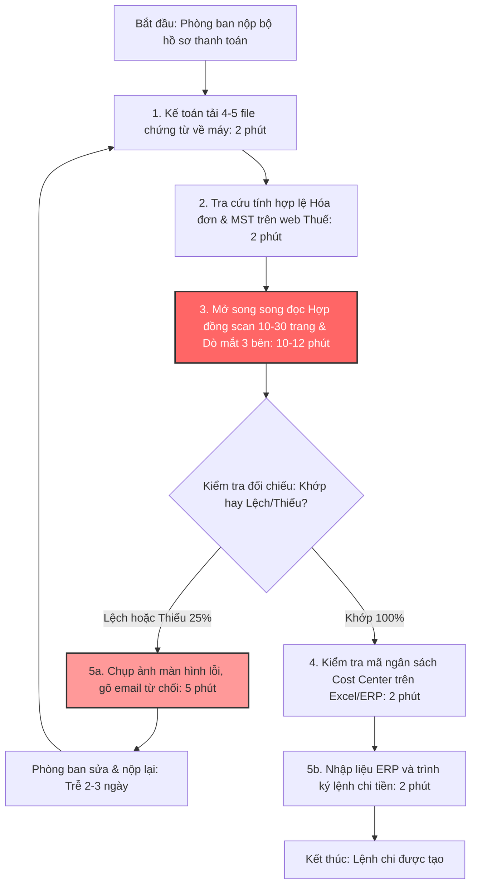
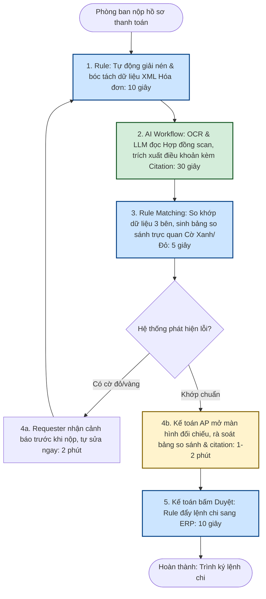

# Báo cáo nhóm — Day 02 Discovery & Problem Framing

> Bản chung của nhóm, viết trên repo do nhóm trưởng fork. Không copy file này sang repo cá nhân.
> Template chi tiết và prompt mẫu: [docs/01-worksheet.md](../../docs/01-worksheet.md). Bài mẫu: [docs/02-deliverable-example.md](../../docs/02-deliverable-example.md).

## 1. Thông tin nhóm

- Tên nhóm: **Nhom4Squares**
- Thành viên: xem [TEAM.md](../../TEAM.md)
- Candidate problem được chọn (1 câu): **Đối chiếu hồ sơ thanh toán nhà cung cấp (3-way matching): Tự động hóa kiểm tra tính đầy đủ và đối chiếu chéo thông tin giữa Hợp đồng (PDF scan), Biên bản nghiệm thu và Hóa đơn điện tử (XML/PDF) cho Kế toán thanh toán (AP).**
- Quyết định cuối: **Go (pilot phạm vi nhỏ trong 2 tuần trên 50 bộ hồ sơ thanh toán)**

---

## 2. Hội tụ nhóm (CP3)

### 2.1. Pitch

Nhóm gồm 4 thành viên, mỗi người chuẩn bị top 3 problem card, tổng cộng 12 candidate được pitch trong 15 phút.

| # | Người đưa ra | Candidate (Job Story ngắn) | Actor | Bottleneck | Câu hỏi phản biện nhận được (ai hỏi) |
|---:|---|---|---|---|---|
| 1 | Nguyễn Tuấn Dũng | Khi nhận bộ hồ sơ thanh toán cuối tháng, muốn đối chiếu nhanh Hợp đồng scan, Biên bản nghiệm thu và Hóa đơn điện tử, để duyệt chi đúng hạn SLA mà không bị xuất toán thuế | Chuyên viên Kế toán thanh toán (AP) | Đọc hợp đồng scan 10–30 trang dò mắt tìm điều khoản đợt thanh toán và trừ tạm ứng (10–12'/bộ) | *"Nếu kế toán vẫn phải tự mắt kiểm tra lại kết quả của AI vì sợ sai số tiền thì thời gian có thực sự giảm từ 18 phút xuống 5 phút được không?"* (Nguyễn Hoàng Trung) |
| 2 | Nguyễn Tuấn Dũng | Khi đối tác gửi hợp đồng mẫu riêng sang yêu cầu duyệt gấp, muốn phát hiện nhanh các điều khoản bất lợi (phạt vi phạm, bồi thường, bảo mật), để redline phản hồi kịp tiến độ ký kết | Chuyên viên Pháp chế (Legal) | Đọc toàn văn 15–40 trang đối chiếu với sổ tay quy chuẩn nội bộ (35–45'/hợp đồng) | *"Bộ phận Pháp chế đã có sẵn Playbook bằng văn bản chưa hay tất cả đang nằm trong kinh nghiệm ngầm?"* (Trần Thùy Linh) |
| 3 | Nguyễn Tuấn Dũng | Khi nhận 3–4 bảng báo giá từ các nhà cung cấp khác nhau, muốn bóc tách và quy đổi về cùng một bảng so sánh giá chuẩn (Bid Tabulation), để trình lãnh đạo duyệt mua sắm | Chuyên viên Mua hàng (Procurement) | Đọc các báo giá PDF không đồng nhất và gõ tay từng dòng vào Excel (35–40'/tờ trình) | *"Bắt nhà cung cấp điền đúng form Excel chuẩn ngay từ đầu (No AI) có giải quyết được không?"* (Đặng Quốc Huy) |
| 4 | Nguyễn Hoàng Trung | Khi tới chiều thứ Sáu cuối sprint release, muốn có danh sách các thay đổi kỹ thuật từ PRs đã merge, để soạn technical release notes cho Tech Lead duyệt trước 17h | Junior Backend Dev / Release Coordinator | Đọc hiểu 25–40 PR diffs có commit message cẩu thả ("fix bug") và viết narrative (65/105') | *"Bài toán này chỉ xảy ra 2 tuần một lần, tần suất có đủ lớn so với nghiệp vụ hàng ngày của kế toán không?"* (Nguyễn Tuấn Dũng) |
| 5 | Nguyễn Hoàng Trung | Khi đọc research papers trên arXiv cho môn Deep Learning, muốn trích xuất nhanh cấu trúc mô hình và hàm loss, để làm literature review hàng tuần | Sinh viên nghiên cứu | Đọc hiểu phần Methodology và công thức toán học phức tạp (50'/bài) | *"Chất lượng tóm tắt bài báo khó đo, sinh viên có dám tin AI mà không đọc lại bài gốc không?"* (Trần Thùy Linh) |
| 6 | Nguyễn Hoàng Trung | Khi nhận 15–20 phản hồi lỗi qua Discord/Google Form sau beta release, muốn trích xuất reproduction steps và gom lỗi trùng lặp, để tạo bug ticket chính xác | Junior QA / Dev trực support | Đọc đoạn chat tự do của người dùng và dò tìm trùng lặp giữa các issue (50/85') | *"Người dùng mô tả rất lộn xộn, nếu dữ liệu đầu vào thiếu thông tin môi trường thì AI có bị ảo giác không?"* (Lê Minh Quân) |
| 7 | Lê Minh Quân | Khi chuẩn bị nộp bài lab lập trình hàng tuần lên GitHub LMS, muốn đối chiếu cấu trúc thư mục, quy tắc đặt tên file và checklist rubric, để không bị trừ điểm oan | Sinh viên / Trưởng nhóm bài tập | Mở từng file đối chiếu thủ công với tài liệu rubric dài 5 trang (25'/lần) | *"Bài toán này chỉ cần viết một regex bash script là xong 100%, có cần đến AI không?"* (Nguyễn Hoàng Trung) |
| 8 | Lê Minh Quân | Khi cần tìm lại quyết định kiến trúc đã thống nhất trong chat từ 2 tuần trước, muốn tìm đúng tin nhắn chốt, để code đúng quy định | Thành viên nhóm đồ án | Tìm keyword rồi cuộn qua hàng nghìn tin nhắn trong Discord/Zalo (15–20'/lần) | *"Dữ liệu chat nằm ở Zalo cá nhân, làm sao lấy quyền truy cập API mà không vi phạm quyền riêng tư?"* (Đặng Quốc Huy) |
| 9 | Lê Minh Quân | Khi chuẩn bị tài liệu họp sprint retrospective, muốn có sẵn bảng thống kê các task bị kéo dài quá estimate và lý do từ Jira, để không phải dò từng ticket | Scrum Master / Dev | Dò từng ticket quá hạn và copy paste thủ công sang Confluence (40'/lần) | *"Jira Automation và dashboard có sẵn tính năng lọc, có đáng xây công cụ mới không?"* (Trần Thùy Linh) |
| 10 | Trần Thùy Linh | Khi Backend deploy phiên bản mới, Frontend dev muốn biết danh sách các endpoint bị đổi tên trường payload hoặc đổi kiểu dữ liệu, để cập nhật model kịp thời | Frontend Developer | Phải tự đọc git diff của backend hoặc nhắn tin hỏi từng backend dev (30'/lần) | *"Nếu Backend viết tài liệu Swagger chuẩn (No AI) thì Frontend có cần công cụ này không?"* (Nguyễn Tuấn Dũng) |
| 11 | Trần Thùy Linh | Khi hệ thống staging phát sinh 30–50 crash log trên Sentry sau đợt deploy, muốn phân loại lỗi mới và lỗi cũ, để gán đúng người sửa | On-call Engineer | Đọc từng stacktrace dài ngoằng và đối chiếu với PR vừa merge (45'/lần) | *"Sentry đã có sẵn tính năng gộp issue bằng rule fingerprinting, AI sẽ chen vào bước nào?"* (Lê Minh Quân) |
| 12 | Trần Thùy Linh | Khi vừa họp kỹ thuật xong, muốn trích xuất danh sách action items kèm người phụ trách từ bản ghi âm/ghi chú thô, để không ai quên việc | Scrum Master / Thư ký cuộc họp | Nghe lại bản ghi âm và tổng hợp lại ghi chú (30'/buổi họp) | *"Đã có nhiều app họp (Otter, Teams AI) làm sẵn việc này rồi, mình làm lại có gì khác biệt?"* (Đặng Quốc Huy) |

---

### 2.2. Cluster

Nhóm gom 12 candidate thành 3 cụm vấn đề có chung bản chất:

| Cluster | Các candidate | Pattern chung |
|---|---|---|
| **A — Đối chiếu & Kiểm duyệt chứng từ / văn bản dài** | #1 (Đối chiếu hồ sơ thanh toán 3-way matching), #2 (Rà soát điều khoản hợp đồng đối tác), #3 (Bóc tách so sánh báo giá nhà cung cấp) | Đọc hiểu tài liệu phi cấu trúc dài (PDF scan, hợp đồng, báo giá), đối chiếu chéo số liệu/điều khoản giữa nhiều bên để phát hiện điểm lệch và rủi ro tuân thủ trước khi phê duyệt |
| **B — Tài liệu hóa & Tóm tắt kỹ thuật** | #4 (Technical Release Notes), #5 (Literature Review bài báo arXiv), #10 (Thay đổi API contract Frontend/Backend) | Đọc hiểu khối lượng lớn thông tin kỹ thuật thô (code diff, bài báo khoa học) rồi tổng hợp và diễn đạt lại thành ngôn ngữ súc tích, mạch lạc cho người khác đọc |
| **C — Truy vết & Phân loại thông tin nội bộ** | #6 (Gom bug report Discord), #7 (Checklist nộp lab), #8 (Tìm quyết định cũ trong chat), #9 (Task Jira trễ hạn), #11 (Sentry logs), #12 (Recap action item) | Tìm kiếm, lọc và phân loại dữ liệu bán cấu trúc trong các công cụ giao tiếp/quản lý dự án nội bộ |

---

### 2.3. Opportunity Solution Tree rút gọn

*(Áp dụng framework của Teresa Torres)*

```text
OUTCOME: Giảm thời gian kiểm tra đối chiếu và loại bỏ sai lệch tài chính trong quy trình phê duyệt thanh toán nhà cung cấp
├── Opportunity A: Kế toán mất nhiều thời gian nhất ở khâu đọc hợp đồng scan (10–30 trang) để tìm điều khoản chia đợt thanh toán và tỷ lệ giữ lại bảo hành
├── Opportunity B: Tỷ lệ hồ sơ bị trả lại cao (25%) do nhân viên các phòng ban (Requester) nộp thiếu biên bản nghiệm thu hoặc hóa đơn lệch câu chữ so với hợp đồng
└── Opportunity C: Kế toán trưởng thiếu công cụ trực quan để kiểm chứng nhanh nguồn gốc số tiền (thiếu trích dẫn số trang/điều khoản) trước khi ký lệnh chi
     ✗ "Chatbot trả lời về hợp đồng thanh toán"       ← SOLUTION đội lốt, gạch bỏ khỏi cây
     ✗ "Autonomous Agent tự động chi tiền ngân hàng"   ← SOLUTION viển vông & rủi ro, gạch bỏ khỏi cây
```

---

### 2.4. Chấm điểm shortlist (1–5)

Nhóm chọn ra 3 candidate đại diện cho 3 bài toán tiềm năng nhất để chấm điểm trên thang 1–5:
1. **Candidate 1 (Cluster A):** Đối chiếu hồ sơ thanh toán nhà cung cấp (3-way matching).
2. **Candidate 4 (Cluster B):** Soạn Technical Release Notes từ danh sách PRs.
3. **Candidate 2 (Cluster A):** Rà soát điều khoản rủi ro trong hợp đồng đối tác.

| Candidate | Actor rõ | Quy trình rõ | Pain có bằng chứng | Impact đo được | Vừa sức lab | So sánh được No AI/Rule/Workflow/Agent | Nhóm hiểu domain | Tổng |
|---|---:|---:|---:|---:|---:|---:|---:|---:|
| **Candidate 1: Đối chiếu hồ sơ thanh toán (3-way matching)** | 5 | 5 | 5 | 5 | 5 | 5 | 5 | **35** |
| Candidate 4: Soạn Technical Release Notes | 5 | 5 | 4 | 4 | 5 | 5 | 4 | 32 |
| Candidate 2: Rà soát điều khoản hợp đồng đối tác | 4 | 4 | 4 | 4 | 4 | 4 | 4 | 29 |

**Candidate được chọn:** **Candidate 1 — Đối chiếu hồ sơ thanh toán nhà cung cấp (3-way matching).**

**Vì sao chọn:**
- **Tần suất và áp lực công việc vượt trội:** Diễn ra hàng ngày với số lượng lớn (30–60 bộ hồ sơ/ngày), đặc biệt căng thẳng vào tuần cuối tháng/cuối quý.
- **Quy trình và dữ liệu đầu vào cực kỳ chuẩn mực:** Gồm 3 loại chứng từ rõ ràng: Hợp đồng PDF scan, Biên bản nghiệm thu và Hóa đơn điện tử (XML/PDF). Baseline đo lường được ngay: 18 phút/bộ hồ sơ, 25% tỷ lệ hồ sơ bị trả lại.
- **Ranh giới bài toán và kiến trúc Hybrid rất đẹp:** Cho thấy sự kết hợp hoàn hảo giữa Rule (đọc file XML hóa đơn với độ chính xác 100%) và AI Workflow (đọc hợp đồng scan phi cấu trúc để trích xuất điều khoản kèm citation); đồng thời giữ chốt chặn con người (HITL) duyệt chi.

**Vì sao loại các candidate còn lại:**
- *Loại Candidate 4 (Soạn Technical Release Notes):* Dù bài toán rất hay và có quy trình rõ, nhưng tần suất diễn ra thấp hơn (2 tuần/lần), phạm vi ảnh hưởng chỉ giới hạn trong đội ngũ kỹ thuật, trong khi Candidate 1 ảnh hưởng trực tiếp đến toàn bộ các phòng ban trong công ty và dòng tiền doanh nghiệp.
- *Loại Candidate 2 (Rà soát hợp đồng đối tác):* Việc rà soát hợp đồng pháp lý phụ thuộc nhiều vào "khẩu vị rủi ro" mang tính chủ quan của từng luật sư, khó xác lập một ground truth định lượng khách quan để đánh giá trong thời lượng 4 tiếng của buổi lab.

**Xử lý bất đồng:**
Ban đầu Trung muốn chọn Candidate 4 (Release Notes) vì là thế mạnh kỹ thuật của Trung. Tuy nhiên sau khi Dũng trình bày số liệu thực tế về áp lực của kế toán (ngồi làm việc 8–10 tiếng/ngày, căng mắt dò số và nguy cơ xuất toán thuế hàng trăm triệu đồng), cả nhóm đều thấy rằng Candidate 1 có tính cấp thiết và tác động kinh tế (Business Value) lớn hơn rất nhiều. Trung đã hoàn toàn bị thuyết phục và chuyển sang ủng hộ Candidate 1, đồng thời nhận trách nhiệm thiết kế luồng quy trình và tiêu chí đánh giá.

---

## 3. Kiểm chứng + research giải pháp đã có (CP4)

### 3.1. Assumption Map

*(Áp dụng framework của David Bland — Testing Business Ideas)*

| # | Giả định | Loại | Quan trọng (1–5) | Đã có bằng chứng (1–5) | Kiểm chứng trước? |
|---:|---|---|---:|---:|:---:|
| 1 | Kế toán viên tại các doanh nghiệp mất trung bình trên 15 phút cho mỗi bộ hồ sơ thanh toán hợp đồng dịch vụ | Value | 5 | 2 | ✅ |
| 2 | Nút thắt cổ chai tốn thời gian nhất là việc đọc hiểu và tìm điều khoản đợt thanh toán trong hợp đồng scan, chứ không phải bước kiểm tra hóa đơn | Value | 5 | 2 | ✅ |
| 3 | Tỷ lệ hồ sơ bị trả lại do lệch thông tin hoặc thiếu chứng từ thực tế lên tới 20–30%, gây trễ hạn thanh toán 2–3 ngày | Value | 4 | 2 | ✅ |
| 4 | File XML của hóa đơn điện tử có thể bóc tách chính xác 100% bằng code Rule thông thường theo chuẩn Tổng cục Thuế Việt Nam | Feasibility | 5 | 4 | — (Đã rõ) |
| 5 | Các phần mềm kế toán/ERP hiện tại (SAP, MISA, Bravo) chưa có tính năng tự động đọc hiểu hợp đồng scan để đối chiếu 3 bên | Feasibility | 5 | 3 | ✅ |
| 6 | Kế toán trưởng chấp nhận kết quả đối chiếu của AI nếu hệ thống cung cấp trích dẫn trực tiếp số trang và câu chữ trong hợp đồng scan | Usability | 4 | 2 | ✅ |

Giả định nhóm tập trung kiểm chứng trong buổi này: **Giả định #1, #2, #3, #5 và #6.**

---

### 3.2. Kiểm chứng

Nhóm kết hợp hai phương pháp kiểm chứng thực tế:
1. **Phỏng vấn sâu 5 đối tượng người thật** theo 3 nguyên tắc của The Mom Test (hỏi hành vi quá khứ, không hỏi giả định). Chi tiết 5 buổi phỏng vấn được lưu tại [report/assets/cp4-interview-snapshots.md](../assets/cp4-interview-snapshots.md).
2. **Khảo sát nhanh (micro-survey)** 24 nhân sự (kế toán viên, chuyên viên mua hàng, nhân viên văn phòng).

#### Bảng tổng hợp phỏng vấn (Trích Interview Snapshot tiêu biểu — Người #1):

| Trường | Nội dung |
|---|---|
| **Người được hỏi** | Chuyên viên Kế toán thanh toán (AP Specialist, 3 năm kinh nghiệm), công ty bán lẻ 450 người |
| **Câu nói đáng nhớ nhất (nguyên văn)** | *"Cái làm chị đau mắt và mệt nhất là đọc mấy cái hợp đồng dịch vụ scan dài 20–30 trang. Nhiều khi điều khoản thanh toán nằm tít ở Phụ lục số 3, chữ scan nghiêng ngả, chị phải căng mắt dò từng dòng xem đợt này được thanh toán 30% hay 50%, có trừ tiền tạm ứng không."* |
| **Lần gần nhất gặp vấn đề này: chuyện gì đã xảy ra?** | Ngày 28 cuối tháng trước, xử lý 52 bộ hồ sơ. Mở 4 màn hình: hợp đồng PDF scan, nghiệm thu, hóa đơn và ERP. Mất 15–20 phút/bộ. 12 bộ bị reject trả lại vì phòng Marketing gửi hóa đơn đòi 100% tiền nhưng hợp đồng quy định đợt này chỉ được chi 70% sau nghiệm thu giai đoạn 1. |
| **Hiện đang xử lý bằng cách nào (workaround)?** | Dùng iTaxViewer mở XML hóa đơn, mở PDF hợp đồng gõ `Ctrl + F` tìm từ "thanh toán", "đợt". Nếu file scan dạng ảnh không search được thì phải cuộn chuột đọc từng trang. |
| **Mất bao lâu, bao lần?** | Ngày thường: 30–35 bộ/ngày (6–7 tiếng). Ngày cuối tháng: 50–60 bộ/ngày (tăng ca đến 20h tối). |
| **Insight / opportunity rút ra** | Nút thắt lớn nhất là **đọc tìm điều khoản đợt thanh toán trong hợp đồng PDF scan phi cấu trúc**. Đọc XML hóa đơn chỉ mất 1 phút, nhưng khâu đối chiếu ngữ nghĩa hợp đồng ngốn 70% thời gian. |

#### Tổng hợp tín hiệu kiểm chứng:

| Nguồn | Số mẫu | Tín hiệu xác nhận | Tín hiệu phản bác |
|---|---:|---|---|
| **Phỏng vấn sâu** | 5 | 4/5 người xác nhận quy trình 3-way matching cực kỳ mệt mỏi và tốn 15–20 phút/bộ. Kế toán trưởng (#5) khẳng định rủi ro thuế xuất toán nếu lệch 1 chữ giữa hóa đơn và hợp đồng. Chuyên viên Mua hàng (#3) xác nhận hồ sơ bị trả về làm trễ hạn thanh toán 2–5 ngày | **1 người (#4 - Giám đốc công ty 5 nhân viên)** cho biết công ty nhỏ mua gì chuyển khoản ngân hàng luôn trên app điện thoại trong 30 giây, không có quy trình đối chiếu hợp đồng |
| **Micro-survey** | 24 | - 83.3% (20/24) xác nhận quy trình 3-way matching là bắt buộc tại đơn vị.<br>- 58.3% mất từ 15–25 phút/bộ hồ sơ.<br>- 62.5% xác nhận bước đau đầu nhất là đọc tìm điều khoản thanh toán trong hợp đồng scan | **12.5% (3/24)** cho biết tại các công ty siêu nhỏ, họ chỉ cần nhìn hóa đơn và ủy nhiệm chi chuyển tiền là xong, không đối chiếu hợp đồng |

**Nhóm đã sửa problem thế nào sau kiểm chứng:**
1. **Thu hẹp chân dung Actor:** Loại bỏ hoàn toàn doanh nghiệp siêu nhỏ (dưới 10 người). Định vị chính xác Actor là **Chuyên viên Kế toán AP và Requester tại các doanh nghiệp quy mô vừa và lớn (từ 100 nhân sự trở lên)**, nơi có quy trình kiểm soát nội bộ chặt chẽ và khối lượng từ 20–30 bộ hồ sơ/ngày trở lên.
2. **Bắt buộc có tính năng Trích dẫn (Citation):** Sau phản biện của Kế toán trưởng (người #2 và #5), nhóm bổ sung yêu cầu bắt buộc: AI không được kết luận khơi khơi mà phải trích dẫn chính xác số trang và câu chữ trong hợp đồng scan để kế toán kiểm chứng lại trong 5 giây.

---

### 3.3. Research giải pháp đã có

Nhóm đã tìm kiếm và kiểm chứng thực tế 3 giải pháp trên thị trường:

| Công cụ / Pattern | Link tài liệu chính thức | Giải bước nào trong quy trình? | Điểm mạnh | Khoảng trống / Rủi ro | Bài học cho nhóm |
|---|---|---|---|---|---|
| **Kofax AP Agility** | [tungstenautomation.com](https://www.tungstenautomation.com/products/kofax-ap-agility) | Bước 1, 2, 3: OCR hóa đơn, bóc tách và đối chiếu 3-way matching với ERP | Giải pháp hàng đầu thế giới cho AP; tích hợp sâu với SAP/Oracle; đối chiếu tự động hóa đơn với Purchase Order (PO) rất tốt | **Rất đắt đỏ; chỉ khớp được với PO dạng dữ liệu có cấu trúc.** Hoàn toàn bất lực khi đối chiếu với Hợp đồng dịch vụ PDF scan phi cấu trúc có nhiều điều khoản phức tạp bằng tiếng Việt | Không cố gắng cạnh tranh ở phần PO có cấu trúc. **Tập trung vào khoảng trống thị trường: Đọc hiểu Hợp đồng dịch vụ PDF scan phi cấu trúc** |
| **AWS Textract (Analyze Expense & Queries)** | [docs.aws.amazon.com](https://docs.aws.amazon.com/textract/latest/dg/analyzing-document-expense.html) | Bước 1 & 2: Bóc tách hóa đơn và chứng từ chi phí dạng key-value | Khả năng OCR và bóc tách hóa đơn tiếng Anh/Việt rất tốt; trích xuất bảng biểu chuẩn | **Chỉ xử lý từng tài liệu rời rạc.** Không có logic đối chiếu chéo (matching) giữa 3 file Hợp đồng - Nghiệm thu - Hóa đơn; chi phí gọi API cao nếu xử lý hợp đồng 30 trang | Dùng Rule bóc tách XML hóa đơn (miễn phí), chỉ dùng OCR/LLM đọc các trang liên quan trong hợp đồng scan |
| **Open-source invoice2data** | [github.com/invoice-x](https://github.com/invoice-x/invoice2data) | Bước 1: Trích xuất dữ liệu hóa đơn dạng text | Mã nguồn mở, miễn phí, chạy offline an toàn bảo mật | **Phải viết template regex riêng cho từng mẫu hóa đơn.** Không xử lý được tài liệu scan chất lượng kém hoặc văn bản tự do | Không dùng template regex cho hóa đơn. Tận dụng định dạng XML hóa đơn điện tử chuẩn của Tổng cục Thuế Việt Nam để đạt độ chính xác 100% |

**Kết luận research:**
Thị trường hiện nay rất mạnh về **Rule bóc tách hóa đơn có cấu trúc**, nhưng đang **bỏ trống khâu đọc hiểu và đối chiếu ngữ nghĩa Hợp đồng scan tiếng Việt**. Nhóm không cần tự xây OCR hay parser từ đầu, mà kết hợp: **Rule đọc XML hóa đơn ➔ AI Workflow (OCR + LLM) đọc hợp đồng scan trích xuất citation ➔ Rule matching so sánh ➔ Kế toán duyệt.**

---

## 4. Quy trình trước/sau (CP5)

### 4.1. Quy trình hiện tại

Sơ đồ quy trình hiện tại (thực hiện thủ công hoàn toàn):



| Bước | Actor | Input | Output | Thời gian / tần suất | Ghi chú |
|---:|---|---|---|---|---|
| 1 | Kế toán AP | Hệ thống Base/e-Office | 4–5 file tải về máy (Hợp đồng scan, Nghiệm thu, Hóa đơn PDF+XML) | 2 phút / bộ | Thao tác tải file thủ công lặp lại |
| 2 | Kế toán AP | Mã số thuế, ký hiệu hóa đơn | Kết quả tra cứu trạng thái doanh nghiệp | 2 phút / bộ | Mở trang web hoadondientu.gdt.gov.vn |
| 3 | Kế toán AP | Hợp đồng scan (10–30 trang), Biên bản nghiệm thu, Hóa đơn | Kết quả đối chiếu bằng mắt (số tiền, điều khoản thanh toán đợt) | **10–12 phút** / bộ | **BOTTLENECK CHÍNH:** Căng mắt đọc hợp đồng scan, cuộn tìm phụ lục điều khoản thanh toán |
| 4 | Kế toán AP | Mã phòng ban, danh mục chi phí | Xác nhận ngân sách còn đủ | 2 phút / bộ | Kiểm tra trên file Excel theo dõi hoặc phần mềm ERP |
| 5a | Kế toán AP | Lỗi sai lệch / thiếu chứng từ | Email/ticket từ chối kèm hình ảnh bằng chứng | **5–8 phút** / bộ (khi có lỗi) | **BOTTLENECK PHỤ:** 25% hồ sơ bị trả lại, làm trễ hạn thanh toán 2–3 ngày |
| 5b | Kế toán AP | Hồ sơ hợp lệ | Lệnh chi tiền dự thảo trên phần mềm ERP | 2 phút / bộ | Gõ tay số tiền và tài khoản ngân hàng vào ERP |

**Tổng thời gian quy trình hiện tại:** **18 phút/bộ hồ sơ** (với hồ sơ khớp ngay) và phát sinh **2–3 ngày trễ hạn** (với 25% hồ sơ bị trả đi trả lại).

---

### 4.2. Quy trình tương lai

Quy trình tương lai áp dụng kiến trúc **Workflow kết hợp Rule và AI**, trong đó con người giữ vai trò chốt chặn chất lượng:



```text
TƯƠNG LAI — Khoảng 2.5 phút/bộ hồ sơ (giảm 86% thời gian), 1/5 bước thủ công

[1. Rule: Bóc tách XML Hóa đơn chuẩn 100%: 10s]
→ [2. AI: OCR + LLM trích xuất điều khoản đợt thanh toán từ Hợp đồng scan + Citation: 30s]
→ [3. Rule: Matching Engine so sánh chéo, sinh bảng Side-by-side gắn Cờ Xanh/Đỏ: 5s]
→ [4. CON NGƯỜI (HITL): Kế toán AP rà soát bảng đối chiếu & bấm xem link Citation: 1-2']
→ [5. Rule: Kế toán bấm duyệt -> Tự động đẩy dự thảo lệnh chi vào ERP: 10s]

BOUNDARY TUYỆT ĐỐI:
- AI TUYỆT ĐỐI KHÔNG tự động bấm duyệt lệnh chi trên phần mềm ERP/Ngân hàng.
- AI TUYỆT ĐỐI KHÔNG tự ý suy diễn hoặc làm tròn số tiền nếu chữ số scan bị mờ, rách hoặc đè dấu mộc.
- BẮT BUỘC hiển thị trích dẫn (Citation: Số trang, Số điều khoản, Câu trích dẫn nguyên văn) cho mọi thông tin lấy từ hợp đồng.
- Bất kỳ hồ sơ nào phát hiện Cờ Đỏ (lệch số tiền, sai MST) hoặc Cờ Vàng (OCR mờ) BẮT BUỘC phải chuyển sang trạng thái "CẦN SOÁT TAY".

PHƯƠNG ÁN QUAY VỀ (FALLBACK):
Nếu API AI gặp sự cố gián đoạn hoặc bản scan hợp đồng quá mờ không thể nhận dạng (độ tin cậy OCR < 60%), hệ thống tự động tắt luồng AI và hiển thị màn hình đối chiếu thủ công truyền thống: mở song song file PDF và dữ liệu XML hóa đơn để kế toán kiểm tra bằng mắt theo quy trình cũ.
```

---

### 4.3. Before / after

| Chỉ số | Trước (Hiện tại) | Sau (Kỳ vọng) | Ghi chú |
|---|---:|---:|---|
| **Số bước** | 5 bước | 5 bước | Tích hợp khâu tra cứu thuế và kiểm tra ngân sách vào rule tự động |
| **Tổng thời gian xử lý** | 18 phút/bộ | **khoảng 2.5 phút/bộ** | Giảm 86% thời gian kiểm tra đối chiếu |
| **Số bước thủ công** | 5/5 bước | 1/5 bước | Kế toán AP chỉ làm bước rà soát chốt chặn (1–2 phút) |
| **Bottleneck chính** | Đọc hợp đồng scan dò mắt (10–12') | Kế toán rà soát bảng đối chiếu có sẵn trích dẫn (1–2') | Chuyển điểm nghẽn từ "dò tìm cơ học" sang "phán đoán và phê duyệt chuyên môn" |
| **Tỷ lệ hồ sơ bị trả lại** | 25% | **dưới 8%** | Nhờ cơ chế Pre-check cảnh báo lỗi ngay khi Requester nộp hồ sơ |
| **Rủi ro mới phát sinh** | Mỏi mắt nhìn nhầm số tiền (1–2% lỗi); chậm trễ thanh toán | AI OCR đọc sai con số bị mờ hoặc hiểu nhầm câu chữ hợp đồng | Đã kiểm soát bằng cờ cảnh báo độ tin cậy, bắt buộc trích dẫn citation và kế toán duyệt |

---

## 5. Problem Statement v0 (CP5)

*(Xây dựng dựa trên Lean UX và Google PAIR)*

| Trường | Nội dung chi tiết |
|---|---|
| **Actor** | Chuyên viên Kế toán thanh toán (AP Specialist) và Nhân viên các phòng ban (Requester) tại các doanh nghiệp quy mô vừa và lớn (trên 100 nhân sự) |
| **Quy trình** | Phòng ban nộp hồ sơ ➔ Kế toán tải file chứng từ ➔ Tra cứu MST và hóa đơn ➔ Đọc hợp đồng scan dò mắt với nghiệm thu và hóa đơn ➔ Trả hồ sơ nếu lệch hoặc nhập ERP duyệt chi |
| **Bottleneck** | Khâu đọc hiểu hợp đồng scan 10–30 trang để tìm điều khoản thanh toán và đối chiếu 3 bên mất 10–12 phút/bộ; khâu trả hồ sơ làm trễ 2–3 ngày |
| **Impact** | Kế toán tăng ca dồn dập cuối tháng (xử lý 50–60 bộ/ngày); rủi ro nhìn nhầm số tiền 1–2%; 25% hồ sơ bị trả lại gây tranh cãi nội bộ và nhà cung cấp đòi nợ |
| **Success Metric** | Thời gian kiểm tra đối chiếu 1 bộ hồ sơ giảm từ 18 phút (bấm giờ thực tế) xuống dưới 5 phút; Tỷ lệ hồ sơ bị trả lại giảm từ 25% xuống dưới 8% |
| **Boundary** | AI không được tự động duyệt chi tiền, không tự gửi lệnh sang ngân hàng; con người bắt buộc phải rà soát và bấm duyệt |

**Phản biện nhận được:**
AI và thành viên Đặng Quốc Huy phản biện rằng Problem Statement v0 còn thiếu ranh giới xử lý khi tài liệu bị mờ (chất lượng scan kém) và chưa có chỉ số định lượng về **rủi ro bỏ sót sai lệch tài chính**. Nhóm đồng ý hoàn toàn và quyết định bổ sung quy tắc trích dẫn Citation và chỉ số Zero-miss sai lệch ở phiên bản v1.

---

## 6. Mức can thiệp AI (CP6)

### 6.1. Ma trận độ mơ hồ × độ phức tạp

- **Vị trí bài toán:** Ô **Độ mơ hồ Trung bình × Độ phức tạp Thấp–Trung bình**.
- **Vì sao:**
  - *Độ mơ hồ ở mức Trung bình:* Hóa đơn điện tử có cấu trúc cố định (độ mơ hồ = 0). Hợp đồng dịch vụ tuy là văn bản tự do nhưng các điều khoản thanh toán luôn xoay quanh các khái niệm pháp lý/tài chính cụ thể (Tỷ lệ %, Số tiền, Điều kiện nghiệm thu, Giữ lại bảo hành). AI cần hiểu ngữ nghĩa tự nhiên nhưng không quá phân tán.
  - *Độ phức tạp ở mức Thấp–Trung bình:* Luồng xử lý dữ liệu hoàn toàn tuyến tính và xác định: Input (3 files) ➔ Extract ➔ Match ➔ Review ➔ Output. Không có rẽ nhánh đa tác tử phức tạp.
  ➔ **Mức can thiệp phù hợp nhất: Workflow kết hợp Rule và AI.**

---

### 6.2. So sánh 4 mức can thiệp

| Mức | Phương án cho bài của nhóm | Đủ khi nào | Rủi ro | Chọn? |
|---|---|---|---|:---:|
| **No AI** (Sửa quy trình) | Ban hành checklist hướng dẫn các phòng ban tự kiểm tra; bắt buộc nộp kèm bảng tóm tắt hợp đồng | Khi nhân viên các phòng ban tuân thủ kỷ luật 100% | Requester vẫn làm ẩu khi gấp; không giảm được thời gian kế toán phải tự mở hợp đồng ra kiểm chứng lại | Không đủ |
| **Rule** (Code logic cố định) | Viết parser đọc file XML hóa đơn và tra cứu tự động trạng thái MST trên cổng Tổng cục Thuế | Rất tốt cho dữ liệu có cấu trúc chuẩn như Hóa đơn điện tử XML | Hoàn toàn bất lực trước file Hợp đồng PDF scan phi cấu trúc, không đọc được câu chữ tự do | **Dùng làm Bước 1 và Bước 3** |
| **Workflow** (Code định sẵn, AI làm 1 bước) | Rule đọc XML hóa đơn ➔ AI (OCR + LLM) đọc hợp đồng scan trích xuất điều khoản & citation ➔ Rule matching ➔ Kế toán duyệt | Các bước quy trình cố định; AI chỉ giải quyết bước đọc hiểu tài liệu scan phi cấu trúc | AI có thể đọc sai nếu file scan quá mờ; giải quyết bằng cờ cảnh báo độ tin cậy và kế toán soát lại | **CHỌN (Giải pháp tối ưu)** |
| **Agent** (AI tự lập luận và quyết định) | AI tự động phân tích hồ sơ, tự gửi email đòi chứng từ thiếu, tự quyết định duyệt chi và đẩy lệnh chuyển khoản ngân hàng | Khi quy trình thanh toán có giá trị siêu nhỏ và chấp nhận rủi ro mất tiền | Cực kỳ nguy hiểm về mặt pháp lý và kiểm soát tài chính; không kiểm toán nào chấp nhận AI tự chi tiền | **Kiên quyết KHÔNG chọn** |

**Mức chọn:** **Workflow.**

**Vì sao không chọn mức đơn giản hơn (No AI/Rule):** Rule thuần túy không thể đọc hiểu được các hợp đồng scan dạng ảnh có bố cục đa dạng và câu chữ diễn đạt khác nhau giữa các nhà cung cấp.
**Vì sao không chọn mức phức tạp hơn (Agent):** Trong quản trị tài chính doanh nghiệp, nguyên tắc phân tách trách nhiệm (Separation of Duties) và kiểm soát nội bộ là tối thượng. AI chỉ đóng vai trò trợ lý tổng hợp thông tin (Augment), quyền quyết định chi tiền thuộc về con người.

---

### 6.3. AI Canvas rút gọn

| Thành phần | Nội dung chi tiết |
|---|---|
| **Prediction** (AI dự đoán / tạo ra gì?) | Dự đoán và trích xuất từ Hợp đồng scan: (1) Điều khoản thanh toán đợt hiện tại; (2) Tỷ lệ % và số tiền tương ứng; (3) Điều kiện nghiệm thu/bảo lãnh kèm theo; (4) Số trang trích dẫn chính xác |
| **Judgment** (Con người cân nhắc gì?) | Kế toán AP đánh giá: Dữ liệu AI trích xuất có khớp với ý chí thực tế của hợp đồng không? Bằng chứng trích dẫn có xác đáng không? Có chấp nhận thanh toán số tiền này không? |
| **Action** (Hành động cuối cùng là gì, ai làm?) | Kế toán AP bấm nút "Duyệt" hoặc "Từ chối" trên giao diện hệ thống. Nếu duyệt, lệnh chi được tạo trên phần mềm ERP |
| **Outcome** (Đo lường kết quả bằng gì?) | - Thời gian kiểm tra đối chiếu 1 bộ hồ sơ.<br>- Tỷ lệ hồ sơ bị trả lại do sai sót thông tin.<br>- Tỷ lệ phát hiện sai lệch tài chính (Zero-miss sai sót). |
| **Input** (AI cần dữ liệu gì mỗi lần chạy?) | File PDF scan Hợp đồng, Biên bản nghiệm thu và dữ liệu bóc tách từ file XML Hóa đơn điện tử. Dữ liệu này **có sẵn 100%** trong hồ sơ thanh toán do phòng ban nộp |
| **Feedback** (Lấy phản hồi ở đâu để cải thiện?) | Các thao tác chỉnh sửa của kế toán viên khi sửa lại trích dẫn hoặc số tiền do AI gợi ý sai được lưu vào log để cải thiện prompt và bộ quy tắc |

---

### 6.4. Hai câu hỏi của Google PAIR

1. **Người dùng muốn được hỗ trợ (augment) hay giao hẳn việc (automate)?**
   - **Trả lời: Được hỗ trợ (Augment).**
   - **Bằng chứng:** 100% kế toán viên và kế toán trưởng được phỏng vấn đều từ chối việc để phần mềm tự động chi tiền. Họ chỉ cần AI dọn sẵn một bảng so sánh đối chiếu có sẵn trích dẫn để họ nhìn lướt trong 1 phút là bấm duyệt được ngay, thay vì phải mất 12 phút mở từng file tìm kiếm.

2. **AI sai kiểu nào tệ hơn, báo nhầm (False Positive) hay bỏ sót (False Negative)?**
   - **Trả lời: Bỏ sót sai lệch (False Negative) tệ hơn rất nhiều!**
   - **Phân tích:** Nếu AI báo nhầm (nói lệch tiền trong khi thực tế khớp), kế toán chỉ mất 10 giây nhìn vào citation để xác nhận lại. Nhưng nếu AI bỏ sót (hóa đơn đòi thanh toán 100% trong khi hợp đồng chỉ cho chi 50% mà AI báo "Khớp"), công ty sẽ bị chi sai hàng chục đến hàng trăm triệu đồng, kế toán chịu trách nhiệm kỷ luật và đền bù vật chất.
   - **Xử lý thiết kế:** Thiết lập luật kiểm tra cứng (Rule-based check) làm chốt chặn song song với LLM: nếu tổng tiền hóa đơn lớn hơn số tiền quy định của đợt thanh toán, hệ thống lập tức khóa nút duyệt và bật cờ cảnh báo đỏ.

---

## 7. Problem Statement v1 + tiêu chí đánh giá (CP6)

| Trường | Nội dung chi tiết |
|---|---|
| **Actor** | Chuyên viên Kế toán thanh toán (AP Specialist) và Nhân viên các phòng ban (Requester) tại các doanh nghiệp quy mô vừa và lớn (trên 100 nhân sự, phát sinh trên 20 bộ hồ sơ/ngày) |
| **Quy trình** | Rule bóc tách XML hóa đơn ➔ AI (OCR+LLM) trích xuất điều khoản hợp đồng scan kèm Citation ➔ Rule matching so sánh 3 bên ➔ Kế toán AP rà soát chốt chặn ➔ Rule đẩy lệnh chi ERP |
| **Bottleneck** | Khâu đọc hiểu hợp đồng scan 10–30 trang dò mắt tìm điều khoản đợt thanh toán và khấu trừ tạm ứng (chiếm 10–12'/bộ trong quy trình cũ) |
| **Impact** | Tốn 18 phút/bộ hồ sơ; kế toán tăng ca dồn dập cuối tháng; rủi ro chi sai 1–2% số hồ sơ; 25% hồ sơ bị trả lại gây trễ hạn thanh toán 2–3 ngày |
| **Success Metric** | **(1) Thời gian:** Giảm từ 18 phút xuống dưới 5 phút/bộ hồ sơ (đo trên 50 bộ hồ sơ pilot).<br>**(2) Tỷ lệ trả hồ sơ:** Giảm từ 25% xuống dưới 8%.<br>**(3) Độ an toàn tài chính:** 100% phát hiện các sai lệch số tiền và vi phạm điều khoản (Zero-miss sai sót tài chính). |
| **Boundary** | AI TUYỆT ĐỐI KHÔNG tự động duyệt lệnh chi trên ERP/Ngân hàng; KHÔNG tự suy đoán số tiền nếu bản scan mờ; BẮT BUỘC hiển thị Citation trích dẫn số trang và câu chữ hợp đồng gốc |
| **AI intervention point** | Nằm ở khâu đọc hiểu tài liệu phi cấu trúc (Hợp đồng scan và Biên bản nghiệm thu), trích xuất dữ liệu có cấu trúc để đưa vào Rule Matching Engine |
| **Mức chọn** | **Workflow** (kết hợp Rule + AI + Human-in-the-loop) |
| **Rủi ro & người kiểm tra** | Rủi ro OCR mờ nhận dạng sai số tiền ➔ Hệ thống gắn cờ CẦN SOÁT TAY; Kế toán viên AP là người trực tiếp đối soát và bấm phê duyệt cuối cùng |

---

### Bảng thay đổi so với v0 và lý do:

| Trường | Bản v0 | Bản v1 | Vì sao đổi |
|---|---|---|---|
| **Actor** | Doanh nghiệp nói chung | Bổ sung: Doanh nghiệp từ 100 nhân sự trở lên, phát sinh trên 20 bộ hồ sơ/ngày | Tín hiệu phản bác từ phỏng vấn: Doanh nghiệp siêu nhỏ thanh toán ngay trên app ngân hàng, không có quy trình đối chiếu |
| **Success Metric** | Chỉ đo thời gian (18' xuống 5') và tỷ lệ trả hồ sơ | Bổ sung: Độ an toàn tài chính 100% phát hiện sai lệch (Zero-miss) | Phản biện nhận được: Tốc độ nhanh mà để lọt sai sót tiền bạc thì gây thảm họa lớn hơn |
| **Boundary** | Ghi chung chung "AI không tự duyệt chi" | Bổ sung: Cấm suy diễn khi bản scan mờ, bắt buộc trích dẫn Citation trang gốc | Đảm bảo tính minh bạch và khả năng kiểm toán giải trình của hồ sơ kế toán |
| **AI intervention point** | Chưa xác định rõ | Xác định chính xác: Nằm ở bước đọc hiểu hợp đồng scan, kết hợp với Rule đọc XML | Bóc tách rõ việc gì Rule làm tốt (đọc XML) thì không lãng phí tài nguyên AI |

---

### Tiêu chí đánh giá đầu ra của AI (4 tiêu chí cốt lõi):

| # | Tiêu chí | Đạt khi | Không đạt khi |
|---:|---|---|---|
| 1 | **Độ chính xác trích xuất số liệu (Extraction Accuracy)** | 100% số tiền, tỷ lệ %, mã số thuế, số hóa đơn trích xuất khớp chính xác tuyệt đối với tài liệu gốc | Sai lệch dù chỉ 1 chữ số trong số tiền hoặc mã số thuế |
| 2 | **Bắt đúng sai lệch & rủi ro (Zero-miss Discrepancies)** | Phát hiện và gắn cờ cảnh báo (Đỏ/Vàng) cho 100% các trường hợp: lệch số tiền, xuất sai tỷ lệ đợt, sai tên pháp nhân, thiếu chứng từ điều kiện | Bỏ sót bất kỳ trường hợp sai lệch nào mà báo là "Khớp" |
| 3 | **Có trích dẫn nguồn gốc (Citation & Traceability)** | Mọi điều khoản trích xuất đều chỉ rõ số trang, số điều khoản và đoạn văn bản gốc trong hợp đồng scan | Đưa ra nhận định mà không có số trang trích dẫn hoặc trích dẫn sai vị trí |
| 4 | **Định dạng bảng chuẩn & Khuyến nghị rõ ràng** | Trình bày đúng bảng so sánh 3 bên (Hợp đồng | Hóa đơn | Kết luận) kèm khuyến nghị hành động cụ thể (Duyệt / Từ chối / Soát tay) | Trình bày dạng văn bản tự do lan man, thiếu bảng tổng hợp hoặc khuyến nghị mơ hồ |

*(Toàn bộ 10 ca kiểm thử định lượng chi tiết được lưu trữ tại file tài sản đi kèm: [report/assets/cp6-eval-dataset.md](../assets/cp6-eval-dataset.md)).*

---

## 8. Quyết định (CP6)

### 8.1. Bốn rủi ro

*(Áp dụng framework của Marty Cagan — SVPG)*

| Rủi ro | Câu hỏi | Mức độ rủi ro | Lý do / Bằng chứng thực tế |
|---|---|:---:|---|
| **Value** | Người dùng có thật sự cần và sẽ dùng không? | **Thấp** | 4/5 người phỏng vấn và 83.3% người khảo sát xác nhận đây là nỗi đau lặp lại hàng ngày. Kế toán rất mong muốn có công cụ dọn sẵn bảng đối chiếu để giải phóng khỏi việc tăng ca cuối tháng |
| **Usability** | Kế toán có dùng được, hiểu và sửa được không? | **Thấp** | Giao diện bảng đối chiếu Side-by-side kèm cờ màu Xanh/Đỏ và link citation mở đúng trang hợp đồng rất trực quan, khớp hoàn toàn với thói quen kiểm tra của kế toán viên |
| **Feasibility** | Có đủ dữ liệu, công cụ, kỹ năng để làm không? | **Thấp – TB** | Dữ liệu XML hóa đơn đọc bằng code thường đạt độ chính xác 100%. Các mô hình LLM thị giác (như Gemini 1.5 Pro / GPT-4o) đọc tiếng Việt và nhận dạng văn bản scan rất xuất sắc. Thách thức nhỏ nằm ở các bản scan quá mờ (đã có cơ chế Fallback xử lý) |
| **Viability** | Có hợp chi phí, pháp lý, quy chế công ty không? Ai vận hành? | **Thấp** | Chi phí API xử lý khoảng 5–10 trang hợp đồng chỉ tốn khoảng $0.03–$0.05/bộ hồ sơ, thấp hơn hàng chục lần so với chi phí nhân công kế toán 18 phút. Về pháp lý, không tự động duyệt chi nên hoàn toàn tuân thủ quy chế kiểm soát nội bộ |

---

### 8.2. Kết luận

**Quyết định: GO (Thực hiện thử nghiệm Pilot phạm vi nhỏ trong 2 tuần trên 50 bộ hồ sơ thanh toán).**

**Lý do:**
Không có bất kỳ rủi ro nào ở mức **Cao (Nguy hiểm)**. Ba rủi ro Value, Usability, Viability đều ở mức Thấp (An toàn). Rủi ro Feasibility ở mức Thấp–Trung bình (chất lượng bản scan) hoàn toàn kiểm soát được nhờ cơ chế gắn cờ CẦN SOÁT TAY và phương án Fallback quay về thủ công.

**Kế hoạch Pilot nhỏ nhất (2 tuần):**
- Thử nghiệm trên **50 bộ hồ sơ thanh toán dịch vụ** của Phòng Marketing và Phòng Hành chính tại một doanh nghiệp đối tác (300 nhân sự).
- Kế toán viên trực tiếp bấm giờ xử lý từng bộ hồ sơ, ghi nhận tỷ lệ phát hiện lỗi và số lần phải điều chỉnh lại kết quả của AI.

**Ngưỡng dừng (Stop Threshold — Cam kết an toàn):**
1. **Dừng ngay lập tức nếu:** Hệ thống bỏ sót bất kỳ 01 sai lệch số tiền nào mà không gắn cờ cảnh báo đỏ, dẫn đến việc kế toán duyệt nhầm số tiền.
2. **Dừng và đánh giá lại nếu:** Tỷ lệ hồ sơ mà AI không đọc được hoặc đọc sai điều khoản vượt quá 20% (chứng tỏ chất lượng scan thực tế của doanh nghiệp không đáp ứng được yêu cầu).
3. **Quay về quy trình cũ nếu:** Sau 2 tuần pilot, thời gian xử lý thực tế của kế toán không giảm xuống dưới 8 phút/bộ hồ sơ (kế toán vẫn phải mở từng trang đọc lại từ đầu vì không tin tưởng citation).

---

## 9. Hạn chế và hướng tiếp theo

- **Hạn chế hiện tại:**
  - Nghiên cứu mới khảo sát 24 người và phỏng vấn 5 đối tượng. Cần thử nghiệm thực tế trên nhiều mẫu hợp đồng scan phức tạp hơn (hợp đồng xây dựng có hàng chục phụ lục khối lượng).
  - Bản scan bị mờ mực in hoặc nghiêng lệch quá nặng vẫn cần sự can thiệp thủ công của con người.
- **Hướng tiếp theo:**
  - Hoàn thiện pilot 50 bộ hồ sơ, đo đạc chính xác thời gian và độ chính xác thực tế.
  - Tích hợp thêm tính năng Pre-check trên giao diện nộp của Requester: cảnh báo ngay lập tức nếu hóa đơn tải lên bị lệch MST hoặc thiếu file biên bản nghiệm thu trước khi hồ sơ kịp gửi sang phòng Kế toán.
  - Kết nối tự động dữ liệu sang phần mềm kế toán thông dụng (MISA AMIS, SAP Business One) qua REST API để tự động sinh dự thảo ủy nhiệm chi.

---

## 10. Tài liệu tham khảo

1. Fitzpatrick, R. (2013). *The Mom Test: How to talk to customers & learn if your business is a good idea when everyone is lying to you*. Founder Centric.
2. Gothelf, J., & Seiden, J. (2021). *Lean UX: Designing Great Products with Agile Teams* (3rd ed.). O'Reilly Media.
3. Agrawal, A., Gans, J., & Goldfarb, A. (2018). *Prediction Machines: The Simple Economics of Artificial Intelligence*. Harvard Business Review Press.
4. Anthropic. (2024). *Building Effective Agents*. Anthropic Research. https://www.anthropic.com/research/building-effective-agents
5. Google People + AI Research (PAIR). (2021). *People + AI Guidebook*. https://pair.withgoogle.com/guidebook/
6. Cagan, M. (2017). *Inspired: How to Create Tech Products Customers Love* (2nd ed.). Wiley.
7. Bland, D. J., & Osterwalder, A. (2019). *Testing Business Ideas: A Field Guide for Rapid Experimentation*. Wiley.
8. Torres, T. (2021). *Continuous Discovery Habits: Discover Products that Create Customer Value and Business Value*. Product Talk LLC.
9. Tungsten Automation. *Kofax AP Agility Overview*. https://www.tungstenautomation.com/products/kofax-ap-agility
10. AWS Documentation. *Analyzing Invoices and Receipts with Amazon Textract*. https://docs.aws.amazon.com/textract/latest/dg/analyzing-document-expense.html
11. Invoice2Data Community. *invoice2data: Extract structured data from PDF invoices*. https://github.com/invoice-x/invoice2data
12. Tổng cục Thuế Việt Nam. *Quy định về định dạng chuẩn dữ liệu Hóa đơn điện tử (Thông tư 78/2021/TT-BTC)*.
