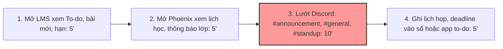
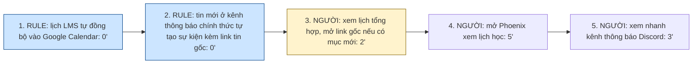

# Báo cáo nhóm — Day 02 Discovery & Problem Framing

> Bản chung của nhóm, viết trên repo do nhóm trưởng fork. Không copy file này sang repo cá nhân.
> Template chi tiết và prompt mẫu: [docs/01-worksheet.md](../../docs/01-worksheet.md). Bài mẫu: [docs/02-deliverable-example.md](../../docs/02-deliverable-example.md).

## 1. Thông tin nhóm

- Tên nhóm: 4Squares
- Thành viên: xem `TEAM.md`
- Candidate problem được chọn (1 câu): Sinh viên mất khoảng 25 phút mỗi sáng mở LMS, Phoenix và lướt nhiều kênh Discord để không bỏ sót hạn nộp và thay đổi yêu cầu, nhưng vẫn có lúc sót.
- Quyết định cuối: **Go (phạm vi nhỏ)**: pilot giải pháp Rule trong 2 tuần trên chính 4 thành viên; chưa thêm bước AI.

---

## 2. Hội tụ nhóm (CP3)

### 2.1. Pitch

Nhóm gồm 4 thành viên, mỗi người chuẩn bị top 3 problem card, tổng cộng 12 candidate được pitch trong 15 phút. Cột phản biện chỉ ghi những câu hỏi được thành viên ghi lại trong báo cáo cá nhân hoặc `TEAM.md`; ô nào không có ghi nhận thì để "Chưa ghi nhận".

| # | Người đưa ra | Candidate (Job Story ngắn) | Actor | Bottleneck | Câu hỏi phản biện nhận được (ai hỏi) |
|---:|---|---|---|---|---|
| 1 | Sơn | Bóc tách checklist và cấu trúc bài lab từ tài liệu dài | Sinh viên làm lab | Đối chiếu 4–5 file để tự lập checklist: 15–20' (tổng 45–60' đầu giờ lab) | "Nếu bài lab và Rubric thay đổi cấu trúc mỗi buổi, làm sao đảm bảo AI không bỏ sót tiêu chí quan trọng khiến sinh viên bị trừ điểm?" (Dũng) |
| 2 | Sơn | Tổng hợp thông báo và lịch từ nhiều kênh (Discord, LMS, Phoenix) | Sinh viên | Lọc thông báo thật giữa nhiều tin nhắn trên Discord: 10'/ngày (tổng 25'/ngày) | "Nếu không dùng AI mà chỉ cài rule tự gửi thông báo trên Google Calendar/Slack hoặc bắt điền form cố định thì đã giải quyết được 80% chưa?" (Sơn không ghi người hỏi) |
| 3 | Sơn | Chuẩn bị nội dung Daily Standup từ lịch sử làm việc | Thành viên làm việc nhóm | Rà commit, file đã sửa để soạn 3 dòng: 10' | Chưa ghi nhận |
| 4 | Khoa | Gom yêu cầu, nơi nộp, hạn nộp của một việc đang nằm rải rác ở 4–5 nền tảng | Sinh viên học nhiều môn/lab cùng lúc | Lục Discord/Zalo tìm thông báo thay đổi: khoảng 10'/việc (tổng khoảng 25'/việc; ước lượng, chưa bấm giờ) | Chưa ghi nhận |
| 5 | Khoa | Rà tiến độ task cuối tuần, có task bị lệch trạng thái | Người tự quản lý task | Kiểm lại task quên cập nhật trạng thái: thêm 2–3 phút/task, ngoài 5 phút/task khi rà | Chưa ghi nhận |
| 6 | Khoa | Bạn bè hỏi lại nơi nộp, format, hạn nộp | Bạn cùng lớp; Khoa là người bị hỏi | Bạn tự tìm trên LMS/Discord không chắc nên phải nhắn hỏi | Chưa ghi nhận |
| 7 | Dũng | Đối chiếu ngữ cảnh từ nhiều nguồn (Jira, Confluence, Slack, Log) khi xử lý ticket bug/task | Intern/dev tại công ty thực tập | Tìm đủ yêu cầu ở nhiều nguồn: 30–40'/ticket; khoảng 30% PR bị trả lại do hiểu thiếu yêu cầu | "Nếu AI tóm tắt yêu cầu từ Slack và Confluence, bạn có dám tin hoàn toàn để code luôn mà không mở link gốc đọc lại không?" (Sơn); rủi ro tạo thêm "app thứ 6" khiến người dùng lười áp dụng (Trung) |
| 8 | Dũng | Đọc và lập bảng tổng hợp Literature Review từ hàng chục bài báo PDF | Sinh viên làm đồ án/NCKH | Đọc Methodology/Experiments và gõ bảng: 40–50'/bài | Chưa ghi nhận |
| 9 | Dũng | Chuẩn hóa thông tin bug report từ QA/CSKH chuyển cho team Dev | QA/Tester và Dev | Thiếu thông tin trong ticket nên phải nhắn hỏi qua lại: 25–30'/bug | Chưa ghi nhận |
| 10 | Trung | Soạn Technical Release Notes từ danh sách Pull Request | Dev phụ trách release | Đọc từng PR/diff để viết release notes: 45' (tổng 100–115' mỗi 2 tuần) | "Release Notes chỉ làm 2 tuần một lần, tần suất có đủ lớn không?" (Dũng, theo báo cáo của Trung, rút gọn); "Đọc diff mất bao nhiêu, viết mất bao nhiêu, bottleneck thật nằm ở bước nào? Viết theo template PR hoặc quy ước commit thì có giảm được một nửa thời gian không?" (Khoa). Trung trả lời: đọc hiểu ngữ cảnh chiếm khoảng 70% thời gian nên template/commit chỉ tối ưu khâu viết (giảm tối đa 10–15%), không giảm được một nửa trừ khi chia PR dưới 200 dòng |
| 11 | Trung | Trích thông tin cốt lõi từ bài báo khoa học cho Literature Review | Sinh viên nghiên cứu | Đọc Methodology: 50'/bài (3–4 tiếng/tuần) | "Tóm tắt thế nào thì tính là đạt? Đã thử công cụ đọc hoặc tóm tắt bài báo nào chưa?" (Khoa) |
| 12 | Trung | Sàng lọc và gom nhóm bug report từ Discord/Google Form | Người phát hành ứng dụng thử nghiệm | Đọc mô tả và dò trùng lặp: 50' (tổng 85'/đợt) | "Bao nhiêu report mỗi tuần, tỉ lệ trùng bao nhiêu? Dựa vào đâu để phân biệt bug thật với người dùng dùng sai?" (Khoa) |

### 2.2. Cluster

| Cluster | Các candidate | Pattern chung |
|---|---|---|
| A — Thông tin học tập rải rác | #1, #2, #4, #6 | Sinh viên phải gom "làm gì, nộp ở đâu, hạn khi nào" từ nhiều kênh và tài liệu dài |
| B — Bug report / ticket thiếu ngữ cảnh | #7, #9, #12 | Thông tin lỗi hoặc yêu cầu đến tay Dev thiếu hoặc lộn xộn, phải hỏi lại hoặc làm lại |
| C — Đọc tài liệu khoa học dài | #8, #11 | Trích thông tin cốt lõi từ nhiều bài báo (Dũng và Trung đưa ra cùng một candidate) |
| D — Tổng hợp lịch sử làm việc | #3, #5, #10 | Gom các việc đã làm thành bản tóm tắt định kỳ (standup, release notes, tiến độ) |

### 2.3. Opportunity Solution Tree rút gọn

_(Áp dụng framework của Teresa Torres)_

```text
OUTCOME: Giảm thời gian sinh viên gom thông tin bài tập và số lần nộp sai hoặc trễ
├── Opportunity A: Thông báo của một bài nằm rải rác ở nhiều kênh (LMS, Outlook, Discord, Zalo, Phoenix)
├── Opportunity B: Thông báo thay đổi (đổi hạn, đổi format) bị trôi giữa nhiều tin nhắn, dễ bỏ sót
├── Opportunity C: Tài liệu bài lab dài, khó rút ra danh sách mục phải nộp
└── Opportunity D: Không chắc thông tin nên phải hỏi lại bạn bè
```

Những ý đã gạch bỏ vì là solution đội lốt opportunity:

- ✗ "Bot tổng hợp thông báo từ các kênh": đây là cách giải cho Opportunity A, không phải pain.
- ✗ "Chatbot hỏi đáp môn học": đây là cách giải cho Opportunity D, không phải pain.

Nhóm đào sâu **Opportunity A + B**, vì đã có số phút cho từng bước (card #2 của Sơn: 25'/ngày, ước lượng). Opportunity C ghi vào hướng tiếp theo.

### 2.4. Chấm điểm shortlist (1–5)

| Candidate | Actor rõ | Quy trình rõ | Pain có bằng chứng | Impact đo được | Vừa sức lab | So sánh được No AI/Rule/Workflow/Agent | Nhóm hiểu domain | Tổng |
|---|---:|---:|---:|---:|---:|---:|---:|---:|
| A — Gom thông tin bài tập từ nhiều kênh (#2 + #4) | 5 | 5 | 5 | 4 | 5 | 5 | 5 | 34/35 |
| #7 — Đối chiếu ngữ cảnh ticket từ nhiều nguồn | 4 | 4 | 4 | 4 | 3 | 5 | 3 | 27/35 |
| #10 — Release notes từ Pull Request | 4 | 4 | 3 | 3 | 4 | 3 | 3 | 24/35 |

**Candidate được chọn:** A — Gom thông tin bài tập từ nhiều kênh (#2 + #4).

**Vì sao chọn:** Cả 4 thành viên đều là actor, gặp quy trình này hằng ngày trên LMS, Phoenix và Discord của khóa học. Nhóm có thể bấm giờ đo ngay và phỏng vấn bạn học trong lớp theo The Mom Test.

**Vì sao loại các candidate còn lại:** Đối chiếu ngữ cảnh ticket (#7) có quy trình và nỗi đau rõ nhưng vướng bảo mật dữ liệu nội bộ công ty thực tập, các thành viên khác không có quyền truy cập Jira/Slack để kiểm chứng trong giờ lab. Soạn Release notes từ PR (#10) tần suất thấp (2 tuần/lần) và phần lớn giải quyết được bằng Rule đặt tên commit kết hợp tính năng tạo tự động có sẵn của GitHub.

**Xử lý bất đồng (nếu có):** Dũng ban đầu muốn chọn "#7 — Đối chiếu ngữ cảnh ticket" vì sát với công việc kỹ thuật tại doanh nghiệp hơn. Nhóm thống nhất bản chất hai bài đều là "gom và đối chiếu yêu cầu phân tán", nên ghi #7 vào hướng mở rộng tiếp theo và chọn Candidate A để cả nhóm có dữ liệu thật đo baseline và kiểm chứng được ngay.

---

## 3. Kiểm chứng + research giải pháp đã có (CP4)

### 3.1. Assumption Map

| # | Giả định | Loại (Value / Usability / Feasibility / Viability) | Quan trọng (1–5) | Đã có bằng chứng (1–5) | Kiểm chứng trước? |
|---:|---|---|---:|---:|---|
| 1 | Sinh viên khác cũng mất từ 15 phút/ngày trở lên để kiểm tra thông báo trên nhiều kênh | Value | 5 | 2 | ✅ |
| 2 | Bước tốn nhất là lọc tin trên Discord, không phải mở LMS hay Phoenix | Value | 5 | 2 | ✅ |
| 3 | Sinh viên đã từng biết thay đổi hạn hoặc format muộn, dẫn tới nộp trễ hoặc nộp sai | Value | 5 | 1 | ✅ |
| 4 | Thông báo quan trọng chủ yếu nằm ở vài kênh chính thức do coach/TA đăng (nếu đúng thì Rule là đủ, không cần AI) | Feasibility | 4 | 2 | ✅ |
| 5 | Ban tổ chức cho phép công cụ tự động đọc các kênh Discord của lớp | Viability | 5 | 1 | Hỏi BTC |

Bằng chứng hiện có: số phút của #1 và #2 mới là ước lượng của 1–2 thành viên (card #2 của Sơn: 25 phút/ngày, trong đó lướt Discord 10 phút; card #1 của Khoa: 4–5 nền tảng, khoảng 25'/việc).

Giả định cần kiểm chứng trước: **#1, #2, #3** (phỏng vấn sinh viên nhóm khác) và **#4** (đếm tin nhắn thật trên server Discord của lớp trong 1 tuần).

---

### 3.2. Kiểm chứng

Cách đã dùng: Phỏng vấn nhanh (do Sơn thực hiện).

Trong buổi lab, nhóm **chưa phỏng vấn đúng đối tượng** để kiểm các giả định #1–#3 của bài A. Bằng chứng gần nhất là 2 buổi phỏng vấn nhanh Sơn làm với học viên nhóm bên cạnh, về việc đọc tài liệu lab đầu giờ. Chủ đề này thuộc Opportunity C trong cây OST, cùng pattern "thông tin học tập rải rác". Nguồn: báo cáo cá nhân của Sơn (mục 4 và 6.4). Sơn không lưu ghi chú gốc (ngày giờ, hình thức), nên các ô dưới đây chỉ ghi đúng những gì Sơn đã thuật lại.

| Trường | Nội dung |
|---|---|
| Người được hỏi (vai trò, không ghi tên thật) | 2 học viên ở nhóm bên cạnh, cùng lớp |
| Câu nói đáng nhớ nhất (nguyên văn) | Không ghi nguyên văn |
| Lần gần nhất gặp vấn đề này: chuyện gì đã xảy ra? | Bài lab Day 01: một bạn bị trừ khoảng 20% điểm vì tiêu chí nộp bài nằm ở cuối file RULES.md mà bạn không thấy |
| Hiện đang xử lý bằng cách nào (workaround)? | Không ghi nhận |
| Mất bao lâu, bao lần? | 40–50 phút đầu mỗi buổi lab để đọc tài liệu |
| Insight / opportunity rút ra | Pain không nằm ở độ khó của tài liệu, mà ở việc thông tin bị **phân mảnh** qua nhiều file, phải mở cùng lúc mới biết cần nộp gì |

**Tổng hợp tín hiệu kiểm chứng:**

| Nguồn | Số người / số mẫu | Tín hiệu xác nhận | Tín hiệu phản bác |
|---|---:|---|---|
| Phỏng vấn nhanh của Sơn (Opportunity C) | 2 | Cả 2 mất 40–50' đọc tài liệu đầu giờ; từng bị trừ điểm vì sót mục nộp | Chưa ghi nhận |
| Phỏng vấn cho giả định #1–#3 của bài A | 0 | — | Chưa làm |
| Đếm log Discord (giả định #4) | 0 | — | Chưa làm |

**Nhóm đã sửa problem thế nào sau kiểm chứng:** Chưa có phỏng vấn đúng đối tượng, nên nhóm chưa sửa actor. Điều chỉnh đến từ research (3.3): bài toán được tách thành phần Rule có sẵn đã giải được (hạn trên LMS, email, kênh thông báo chính thức) và phần còn lại (tin dời hạn nằm ngoài kênh chính thức). Bottleneck ở Problem Statement v1 được thu hẹp về phần còn lại này.

---

### 3.3. Research giải pháp đã có

| Công cụ / case / pattern | Link | Giải bước nào trong quy trình? | Điểm mạnh | Khoảng trống / rủi ro | Bài học cho nhóm |
|---|---|---|---|---|---|
| Xuất lịch LMS (Moodle: "Get URL address") rồi thêm vào Google Calendar bằng "Add by URL" | https://docs.moodle.org/en/Calendar_export | Bước mở LMS xem hạn bài | Có sẵn, miễn phí, là Rule | Tài liệu ghi thay đổi có thể mất vài giờ mới hiện; chỉ có hạn trong LMS, không có tin trên Discord | Phần "hạn trên LMS" không cần AI |
| Lọc thư Gmail (tự gắn label, archive, forward) | https://support.google.com/mail/answer/6579?hl=en | Thông báo qua email | Có sẵn | Chỉ áp dụng cho email | Rule cho kênh email |
| Rules trong Outlook (tự chuyển thư vào thư mục) | https://support.microsoft.com/en-us/office/set-up-rules-in-outlook-75ab719a-2ce8-49a7-a214-6d62b67cbd41 | Email trường | Có sẵn | New Outlook không chạy rule cho tài khoản bên thứ ba như Gmail | Rule cho email trường |
| Zapier: tin mới ở một kênh Discord tự tạo sự kiện Google Calendar | https://zapier.com/apps/discord/integrations/google-calendar/1235308/create-google-calendar-events-for-new-discord-channel-messages | Kênh thông báo chính thức đưa vào lịch | Không cần code | Bản Free kiểm 15 phút/lần; tạo sự kiện cho mọi tin trong kênh, nên chỉ hợp với kênh chỉ có thông báo | Rule đủ nếu thông báo chỉ nằm ở kênh chính thức (giả định #4) |
| Zapier template: tóm tắt tin Discord trong ngày bằng ChatGPT rồi gửi lại Discord | https://zapier.com/templates/details/39e4fd3afe6517f8f4e5220e5f2fb00a4b06b68040e8f06cf07bcd456592cb69 | Lọc tin trong kênh thảo luận | Đúng kiến trúc Workflow: các bước định sẵn, AI làm một bước | AI có thể bỏ sót hoặc bịa; cần quyền đọc server; tin nhắn của cả lớp bị gửi ra dịch vụ ngoài | Mượn kiến trúc nhưng thêm bước người xác nhận và phải xin phép BTC (giả định #5) |

Các link trên đã được mở kiểm ngày 09/11/2026.

**Kết luận research:** phần lớn quy trình đã có Rule làm được, miễn phí (lịch LMS, lọc email, kênh thông báo đưa vào lịch). Chỉ phần "tin dời hạn nằm trong kênh thảo luận" mới cần đến AI, và phần đó còn vướng quyền đọc dữ liệu. Hướng hợp lý: làm Rule trước, chỉ thêm AI nếu đếm log (giả định #4) cho thấy Rule bỏ sót nhiều.

---

## 4. Quy trình trước/sau (CP5)

### 4.1. Quy trình hiện tại

Sơ đồ quy trình hiện tại (thủ công hoàn toàn, mỗi sáng). Số phút lấy từ Problem Card #2 của Sơn (Sơn tự ước lượng):



| Bước | Actor | Input | Output | Thời gian / tần suất | Ghi chú |
|---:|---|---|---|---|---|
| 1 | Sinh viên | LMS: mục To-do, bài tập mới | Danh sách bài và hạn nộp trên LMS | 5', mỗi sáng | Thông tin có cấu trúc, ít thay đổi |
| 2 | Sinh viên | Phoenix: lịch học, thông báo lớp | Lịch học và thông báo trong ngày | 5', mỗi sáng | Chưa rõ Phoenix có xuất lịch ra ngoài được không |
| 3 | Sinh viên | Các kênh Discord: #announcement, #general, #standup | Các tin dời hạn, đổi yêu cầu, lịch họp đột xuất | **10'**, mỗi sáng | **BOTTLENECK:** tin quan trọng lẫn giữa tin thảo luận, tâm lý sợ bỏ sót |
| 4 | Sinh viên | Kết quả bước 1–3 | Lịch và deadline trong sổ hoặc app to-do | 5', mỗi sáng | Chép tay, có thể chép sai |

Với một số môn, sinh viên còn phải kiểm thêm Outlook, Gmail hoặc Zalo (Problem Card #1 của Khoa: 4–5 nền tảng cho một việc). Các bước này chưa được bấm giờ.

**Bottleneck chính:** Bước 3, lướt Discord để lọc tin dời hạn và đổi yêu cầu lẫn trong tin thảo luận, mất 10 phút mỗi sáng.

**Tổng thời gian quy trình hiện tại:** **25 phút/ngày**, khoảng **125–150 phút/tuần** cho một sinh viên (số của Sơn). Dù vậy, thỉnh thoảng vẫn bỏ sót thay đổi lịch họp đột xuất hoặc deadline phụ.

---

### 4.2. Quy trình tương lai

Giai đoạn 1 (pilot): chỉ dùng **Rule** có sẵn ở 3.3, chưa có bước AI.



```text
TƯƠNG LAI (giai đoạn 1) — khoảng 10 phút/ngày, 3/5 bước thủ công

[1 Lịch LMS tự đồng bộ vào Google Calendar: 0']               ← RULE (có thể trễ vài giờ)
→ [2 Tin ở kênh thông báo chính thức tự thành sự kiện: 0']     ← RULE (Zapier, kiểm 15 phút/lần)
→ [3 Xem lịch tổng hợp, mở link gốc nếu có mục mới: 2']        ← CON NGƯỜI (HITL)
→ [4 Mở Phoenix xem lịch học: 5']                               ← CON NGƯỜI (chưa có cách xuất lịch)
→ [5 Xem nhanh kênh thông báo Discord: 3']                      ← CON NGƯỜI

Thay đổi chính: không lướt #general, #standup mỗi sáng nữa. Việc này dựa trên giả định #4
(thông báo quan trọng nằm ở kênh chính thức) và là rủi ro chính, được đo bằng ngưỡng dừng ở mục 8.

Bước 2 cần thêm bot Zapier vào server lớp. Chưa được BTC đồng ý (giả định #5) thì bỏ bước 2;
khi đó bước 5 vẫn làm tay như cũ.

BOUNDARY:
- Công cụ tự động không xóa hoặc sửa sự kiện người dùng tự tạo trong lịch.
- Không đăng hay nhắn tin gì vào server lớp.
- Không thêm bot vào server lớp khi BTC chưa đồng ý.
- Mỗi sự kiện tự tạo từ Discord phải kèm link tin gốc.
- Hạn trong lịch chỉ là bản sao; hạn chính thức vẫn là trên LMS hoặc trong tin gốc của coach/TA.

HITL:
- Trước khi đổi kế hoạch theo một sự kiện tự tạo, sinh viên mở link tin gốc để đối chiếu.
- Hạn nộp trong 24 giờ tới luôn được kiểm trực tiếp trên LMS (vì lịch có thể đồng bộ trễ).

PHƯƠNG ÁN QUAY VỀ:
- Đồng bộ lỗi, trễ, hoặc tạo sự kiện sai → tắt bước tự động đó, quay về quy trình 4 bước ở 4.1,
  bật thông báo cho kênh announcement.

GIAI ĐOẠN 2 (không làm trong pilot):
- Chỉ khi đếm log cho thấy từ 20% tin dời hạn trở lên nằm ngoài kênh chính thức VÀ BTC đồng ý:
  thêm một bước AI chọn tin dời hạn trong kênh thảo luận, kèm link gốc; sinh viên xác nhận
  từng mục trước khi vào lịch. AI không tự sửa lịch và không tự suy ra ngày từ câu mơ hồ
  như "tối mai".
```

---

### 4.3. Before / after

Cột "Sau" theo quy trình tương lai ở 4.2 (giai đoạn 1, chỉ Rule). Đây là con số kỳ vọng, chưa đo.

| Chỉ số | Trước | Sau (kỳ vọng) | Ghi chú |
|---|---:|---:|---|
| Số bước | 4 | 5 | 2 bước Rule chạy tự động: lịch LMS đồng bộ vào Google Calendar; tin ở kênh thông báo chính thức tự vào lịch. 3 bước người dùng: xem lịch tổng hợp, mở Phoenix, xem kênh thông báo Discord |
| Tổng thời gian | 25'/ngày | khoảng 10'/ngày | Xem lịch tổng hợp 2' + mở Phoenix 5' + xem kênh thông báo Discord 3'; 2 bước Rule mất 0' |
| Số bước thủ công | 4/4 | 3/5 | Không còn bước chép tay vào to-do |
| Bottleneck chính | Lướt Discord lọc tin (10') | Mở Phoenix (5'), chưa có cách xuất lịch | Nếu Phoenix xuất được lịch thì bước này cũng thành Rule |
| Rủi ro mới phát sinh | — | Bỏ sót tin dời hạn nằm ngoài kênh chính thức (thread, kênh thảo luận); lịch đồng bộ trễ (Zapier Free 15 phút/lần, lịch LMS có thể trễ vài giờ) | Kiểm bằng đếm log (giả định #4). Hạn trong ngày vẫn kiểm trực tiếp trên LMS |

---

## 5. Problem Statement v0 (CP5)

| Trường | Nội dung |
|---|---|
| **Actor** | Sinh viên chương trình AI20k K5 học nhiều lab/môn cùng lúc, nhận thông báo qua LMS, Phoenix, Discord (và với một số môn: Outlook, Gmail, Zalo) |
| **Quy trình** | Mỗi sáng: mở LMS (5') → mở Phoenix (5') → lướt các kênh Discord (10') → ghi hạn và lịch vào to-do (5') |
| **Bottleneck** | Lướt Discord: khoảng 10'/ngày để lọc tin dời hạn và đổi yêu cầu lẫn trong tin thảo luận, dễ sót |
| **Impact** | 25'/ngày, khoảng 125–150'/tuần cho một sinh viên (ước lượng của Sơn); thỉnh thoảng bỏ sót thay đổi lịch họp đột xuất hoặc deadline phụ; bạn bè phải nhắn hỏi lại nơi nộp, format, hạn (Khoa ước lượng 2–3 lần/tuần, chưa đếm) |
| **Success Metric** (baseline → target, cách đo) | Thời gian kiểm tra mỗi sáng: 25' (ước lượng) → ≤10'; đo bằng tự bấm giờ 5 buổi sáng liên tiếp trước pilot và trong suốt pilot |
| **Boundary** (AI không được làm gì; khi nào cần con người kiểm tra — HITL) | Không tự nộp bài; không tự sửa hay xóa lịch đã có; không đăng hay nhắn tin vào kênh lớp. HITL: mọi thay đổi hạn phải được sinh viên đối chiếu với nguồn gốc (LMS hoặc tin của coach/TA) trước khi đổi kế hoạch |

Phản biện nhận được (từ AI hoặc nhóm khác) và nhóm có đồng ý không:

- "Metric chỉ đo tốc độ. Nhanh hơn mà bỏ sót nhiều hơn thì sao?" (AI, khi rà bài) → **Đồng ý.** v1 thêm metric "số lần biết thay đổi muộn" và "số sự kiện tự tạo bị sai".
- "Baseline 25 phút mới là ước lượng của một người." (AI, khi rà bài) → **Đồng ý.** Ghi rõ là ước lượng; pilot bắt đầu bằng 5 buổi bấm giờ của cả 4 thành viên.

---

## 6. Mức can thiệp AI (CP6)

### 6.1. Ma trận độ mơ hồ × độ phức tạp

- **Vị trí bài toán:** phần chính nằm ở ô **độ phức tạp thấp × độ mơ hồ thấp** → Rule thường đủ. Riêng phần "tin dời hạn trong kênh thảo luận" nằm ở ô **độ phức tạp thấp × độ mơ hồ cao** → nếu cần thì Workflow có AI ở một bước.
- **Vì sao:**
  - _Độ phức tạp thấp:_ 4 bước cố định, không rẽ nhánh, bước sau không phụ thuộc kết quả bước trước.
  - _Độ mơ hồ thấp cho phần chính:_ hạn trên LMS có cấu trúc; tin ở kênh thông báo chính thức đều là thông báo, không cần đoán.
  - _Độ mơ hồ cao cho phần còn lại:_ câu như "bài 3 lùi sang tối mai nha" trong một thread là ngôn ngữ tự nhiên, lọc theo từ khóa dễ sót.

### 6.2. So sánh 4 mức can thiệp

| Mức | Phương án cho bài của nhóm | Đủ khi nào | Rủi ro | Chọn? |
|---|---|---|---|---|
| **No AI** (sửa quy trình) | Đề xuất BTC quy ước mọi thay đổi hạn chỉ đăng ở #announcement kèm @everyone; sinh viên bật thông báo kênh đó | Khi BTC tuân thủ quy ước, hoặc sinh viên chỉ học 1 môn | Phụ thuộc người đăng; vẫn phải mở LMS và chép tay mỗi sáng | Đề xuất song song |
| **Rule** | Lịch LMS đồng bộ Google Calendar; lọc email; kênh thông báo → lịch (Zapier) | Khi phần lớn thông báo quan trọng nằm ở nguồn có cấu trúc hoặc kênh chính thức (giả định #4) | Bỏ sót tin dời hạn trong kênh thảo luận; đồng bộ trễ 15' đến vài giờ | **Chọn** (giai đoạn 1) |
| **Workflow** | Rule gom tin → AI chọn tin dời hạn kèm link → người xác nhận → Rule ghi lịch | Khi đếm log cho thấy nhiều tin dời hạn nằm ngoài kênh chính thức | AI bỏ sót hoặc bịa; cần quyền đọc server; dữ liệu lớp gửi ra ngoài | Chỉ ở giai đoạn 2, có điều kiện |
| **Agent** | AI tự đọc mọi kênh, tự quyết thêm/sửa lịch | Khi bước tiếp theo không đoán trước được | Tự sửa lịch sai mà không ai biết; quyền truy cập rộng | Không chọn |

**Mức chọn:** **Rule** (giai đoạn 1).

**Vì sao không chọn mức đơn giản hơn (No AI):** No AI phụ thuộc vào việc BTC đổi cách đăng thông báo, và không bỏ được bước mở LMS và chép tay mỗi sáng. Rule bỏ được bước chép tay, dùng công cụ có sẵn và miễn phí (3.3).

**Vì sao chưa lên Workflow:** chưa có bằng chứng Rule bỏ sót nhiều (giả định #4 chưa kiểm), và dữ liệu đầu vào cho AI (tin nhắn trên server lớp) chưa có quyền đọc (giả định #5).

**Vì sao không chọn Agent:** không có bước nào cần AI tự quyết bước tiếp theo. Để công cụ tự sửa lịch thì một lần đọc sai là sinh viên nộp trễ mà không biết.

### 6.3. AI Canvas rút gọn

Nhóm chọn **Rule** nên không điền AI Canvas. Lý do bài toán chưa cần AI dự đoán hay tạo nội dung:

- Phần lớn thông tin (hạn trên LMS, tin ở kênh chính thức) có cấu trúc hoặc đúng/sai rõ, công cụ Rule có sẵn đã xử lý được.
- Phần duy nhất có thể cần AI (tin dời hạn trong kênh thảo luận) chưa được chứng minh là đủ lớn.
- Ô **Input** của AI chưa có: chưa có quyền đọc tin nhắn trên server lớp. Theo worksheet, chưa điền được Input thì bài toán chưa sẵn sàng cho AI.

### 6.4. Hai câu hỏi của Google PAIR

Không bắt buộc khi chọn Rule. Ghi lại để dùng nếu lên giai đoạn 2:

1. **Augment hay automate?** Nghiêng về **augment**: hạn nộp ảnh hưởng trực tiếp tới điểm của chính người dùng, nên họ cần tự xác nhận với tin gốc. Chưa có bằng chứng phỏng vấn cho câu này.
2. **Sai kiểu nào tệ hơn?** **Bỏ sót tệ hơn báo nhầm.** Bỏ sót một tin dời hạn sớm thì sinh viên nộp trễ và mất điểm; báo nhầm chỉ mất vài giây kiểm lại. Vì vậy hạn trong 24 giờ tới luôn được kiểm trực tiếp trên LMS, và kênh announcement vẫn bật thông báo.

---

## 7. Problem Statement v1 + tiêu chí đánh giá (CP6)

| Trường | Nội dung |
|---|---|
| **Actor** | Sinh viên chương trình AI20k K5 học nhiều lab/môn cùng lúc, nhận thông báo qua LMS, Phoenix, Discord (và với một số môn: Outlook, Gmail, Zalo) |
| **Quy trình** | Mỗi sáng: mở LMS (5') → mở Phoenix (5') → lướt các kênh Discord (10') → ghi hạn và lịch vào to-do (5') |
| **Bottleneck** | Lướt Discord 10'/ngày; phần khó nhất là phát hiện tin dời hạn hoặc đổi yêu cầu **nằm ngoài kênh thông báo chính thức** (thread, kênh thảo luận) |
| **Impact** | 25'/ngày, khoảng 125–150'/tuần cho một sinh viên (ước lượng); thỉnh thoảng bỏ sót thay đổi lịch hoặc deadline phụ; bạn bè phải hỏi lại |
| **Success Metric** (baseline → target, cách đo) | (1) Thời gian kiểm tra mỗi sáng: 25' → ≤10' (bấm giờ 5 buổi trước pilot và suốt pilot). (2) Số lần biết thay đổi hạn/yêu cầu muộn: đếm trong 2 tuần trước pilot → 0 trong pilot. (3) Số sự kiện tự tạo bị sai hạn hoặc sai giờ: 0 (đối chiếu với LMS cuối mỗi tuần) |
| **Boundary** | Không tự nộp bài; công cụ tự động không xóa hay sửa sự kiện người dùng tạo; không đăng hay nhắn tin vào server lớp; không thêm bot vào server khi BTC chưa đồng ý; mỗi sự kiện tự tạo phải có link tin gốc |
| **AI intervention point** | **Không có** (giai đoạn 1). Lý do: phần chính có cấu trúc và đã có Rule làm được; chưa có bằng chứng cần AI; chưa có quyền đọc dữ liệu đầu vào |
| **Mức chọn** | Rule |
| **Rủi ro & người kiểm tra** | Rule bỏ sót tin dời hạn ngoài kênh chính thức; lịch đồng bộ trễ hoặc sai giờ → mỗi sinh viên tự kiểm hạn trong 24 giờ tới trên LMS; cuối tuần đối chiếu lịch với LMS |

**Thay đổi so với v0 và lý do:**

| Trường | v0 | v1 | Vì sao đổi |
|---|---|---|---|
| Bottleneck | Lướt Discord 10'/ngày | Thu hẹp về tin dời hạn nằm ngoài kênh chính thức | Research 3.3: phần tin ở kênh chính thức, LMS và email đã có Rule làm được |
| Success Metric | Chỉ đo thời gian | Thêm số lần biết thay đổi muộn và số sự kiện tự tạo bị sai | Phản biện: nhanh hơn mà bỏ sót nhiều hơn thì không đạt |
| Boundary | Không tự nộp, không sửa lịch, không đăng tin | Thêm: không thêm bot khi BTC chưa đồng ý; sự kiện tự tạo phải có link gốc | Research: bước Zapier cần thêm bot vào server lớp (giả định #5) |
| AI intervention point, Mức chọn | (chưa có) | Không có; Rule | Kết quả so sánh 4 mức ở 6.2 |

### Tiêu chí đánh giá đầu ra của giải pháp (Rule):

| # | Tiêu chí | Đạt khi | Không đạt khi |
|---:|---|---|---|
| 1 | Đủ hạn | Mọi bài có hạn trên LMS đều xuất hiện trong Google Calendar | Thiếu dù chỉ 1 bài |
| 2 | Đúng hạn | Ngày giờ trong lịch khớp LMS (GMT+7) | Lệch ngày hoặc giờ, ví dụ do sai múi giờ |
| 3 | Có nguồn | Mỗi sự kiện tự tạo từ Discord có link tới tin gốc | Thiếu link hoặc link trỏ sai tin |
| 4 | Không trùng | Một thông báo đăng lại không tạo thêm sự kiện thứ hai | Có sự kiện trùng |
| 5 | Kịp thời | Thay đổi xuất hiện trong lịch trước buổi kiểm sáng hôm sau | Thay đổi chỉ hiện sau khi đã qua hạn |

---

## 8. Quyết định (CP6)

### 8.1. Bốn rủi ro

| Rủi ro | Câu hỏi | Mức độ rủi ro (Thấp = an toàn / TB / Cao = nguy hiểm) | Lý do / bằng chứng |
|---|---|---|---|
| **Value** | Người dùng có thật sự cần và sẽ dùng không? | Trung bình | Pain đến từ ước lượng của 2 thành viên (Sơn: 25'/ngày; Khoa: 4–5 nền tảng mỗi việc). Chưa phỏng vấn người ngoài nhóm cho bài A; 2 bạn Sơn hỏi chỉ xác nhận pain gần (tài liệu lab phân mảnh) |
| **Usability** | Người dùng có dùng được, có hiểu và sửa được đầu ra không? | Thấp | Dùng Google Calendar quen thuộc; chỉ thiết lập một lần; sự kiện sai thì xóa tay |
| **Feasibility** | Có đủ dữ liệu, công cụ, kỹ năng để làm không? | Trung bình | Moodle có xuất URL lịch, nhưng chưa xác nhận LMS của khóa có tính năng này; chưa rõ Phoenix có xuất lịch không; bước Zapier cần bot trên server |
| **Viability** | Có hợp chi phí, pháp lý, quy định tổ chức không? Ai vận hành? | Trung bình | Chi phí 0 (Zapier Free, Google Calendar). Thêm bot vào server lớp cần BTC đồng ý; không có thì bỏ bước đó. Mỗi sinh viên tự vận hành lịch của mình |

### 8.2. Kết luận

**Quyết định: Go (phạm vi nhỏ).** Pilot giải pháp Rule trong 2 tuần trên chính 4 thành viên; chưa thêm bước AI.

**Lý do:** Không có rủi ro nào ở mức Cao. Chi phí gần như bằng 0. Các rủi ro Trung bình (Value, Feasibility, Viability) đều kiểm được ngay trong pilot.

**Pilot nhỏ nhất (2 tuần):**

- Trước pilot: mỗi người bấm giờ 5 buổi sáng theo quy trình cũ và ghi lại mỗi lần biết thay đổi muộn.
- Kiểm LMS của khóa có xuất URL lịch không; thiết lập đồng bộ vào Google Calendar.
- Hỏi BTC về giả định #5. Được đồng ý thì thêm bước kênh thông báo → lịch.
- Trong pilot: bấm giờ mỗi sáng; cuối tuần chấm lịch theo 5 tiêu chí ở mục 7.
- Song song: đếm tin dời hạn trên server lớp trong 1 tuần để kiểm giả định #4.

**Ngưỡng dừng:**

1. Nếu lịch tự đồng bộ ghi sai hạn dù chỉ 1 lần mà không ai phát hiện trước hạn → dừng bước tự động đó, quay về quy trình 4 bước ở 4.1.
2. Nếu sau 2 tuần thời gian kiểm vẫn trên 15'/ngày → quay về No AI (quy ước kênh thông báo + bật thông báo), vì Rule không đáng công thiết lập.
3. Nếu có lần biết thay đổi muộn do tin nằm ngoài kênh chính thức, **và** đếm log thấy từ 20% tin dời hạn trở lên nằm ngoài kênh chính thức → cân nhắc giai đoạn 2 (Workflow), chỉ khi BTC đồng ý.

---

## 9. Hạn chế và hướng tiếp theo

- **Hạn chế hiện tại:**
  - Baseline 25'/ngày mới là ước lượng của một người (Sơn), chưa bấm giờ thật.
  - Chưa phỏng vấn đúng đối tượng cho giả định #1–#3; chưa đếm log cho giả định #4.
  - Chưa xác nhận LMS của khóa và Phoenix có xuất lịch ra ngoài được không.
- **Hướng tiếp theo:**
  - Phỏng vấn 3 bạn nhóm khác theo The Mom Test: "Sáng nay bạn kiểm tra deadline ở những đâu? Mất bao lâu? Lần gần nhất biết một thay đổi hạn muộn là khi nào?"
  - Chạy pilot ở mục 8.2.
  - Opportunity C (bóc checklist từ tài liệu lab dài, #1 của Sơn) và #7 (ngữ cảnh ticket của Dũng) cùng pattern "gom và đối chiếu thông tin phân tán", để cho vòng sau.
- **Ghi chú lịch sử:** bản đầu của mục 3–9 (commit `d02f50e`) viết cho bài toán đối chiếu hồ sơ thanh toán kế toán. Bản đó không khớp lựa chọn ở CP3 và không có minh chứng cho phỏng vấn/survey, nên đã được thay bằng bản này khi nhóm thống nhất giữ bài A.

---

## 10. Tài liệu tham khảo

1. Fitzpatrick, R. (2013). _The Mom Test: How to talk to customers & learn if your business is a good idea when everyone is lying to you_. Founder Centric.
2. Gothelf, J., & Seiden, J. (2021). _Lean UX: Designing Great Products with Agile Teams_ (3rd ed.). O'Reilly Media.
3. Agrawal, A., Gans, J., & Goldfarb, A. (2018). _Prediction Machines: The Simple Economics of Artificial Intelligence_. Harvard Business Review Press.
4. Anthropic. (2024). _Building Effective Agents_. Anthropic Research. https://www.anthropic.com/research/building-effective-agents
5. Google People + AI Research (PAIR). (2021). _People + AI Guidebook_. https://pair.withgoogle.com/guidebook/
6. Cagan, M. (2017). _Inspired: How to Create Tech Products Customers Love_ (2nd ed.). Wiley.
7. Bland, D. J., & Osterwalder, A. (2019). _Testing Business Ideas: A Field Guide for Rapid Experimentation_. Wiley.
8. Torres, T. (2021). _Continuous Discovery Habits: Discover Products that Create Customer Value and Business Value_. Product Talk LLC.
9. MoodleDocs. _Using Calendar — Calendar export_. https://docs.moodle.org/en/Calendar_export
10. Google. _Create rules to filter your emails — Gmail Help_. https://support.google.com/mail/answer/6579?hl=en
11. Microsoft. _Manage email messages by using rules in Outlook_. https://support.microsoft.com/en-us/office/set-up-rules-in-outlook-75ab719a-2ce8-49a7-a214-6d62b67cbd41
12. Zapier. _Create Google Calendar events for new Discord channel messages_. https://zapier.com/apps/discord/integrations/google-calendar/1235308/create-google-calendar-events-for-new-discord-channel-messages
13. Zapier. _Summarize daily Discord messages, create digest, generate insights with ChatGPT, and share updates in Discord_. https://zapier.com/templates/details/39e4fd3afe6517f8f4e5220e5f2fb00a4b06b68040e8f06cf07bcd456592cb69