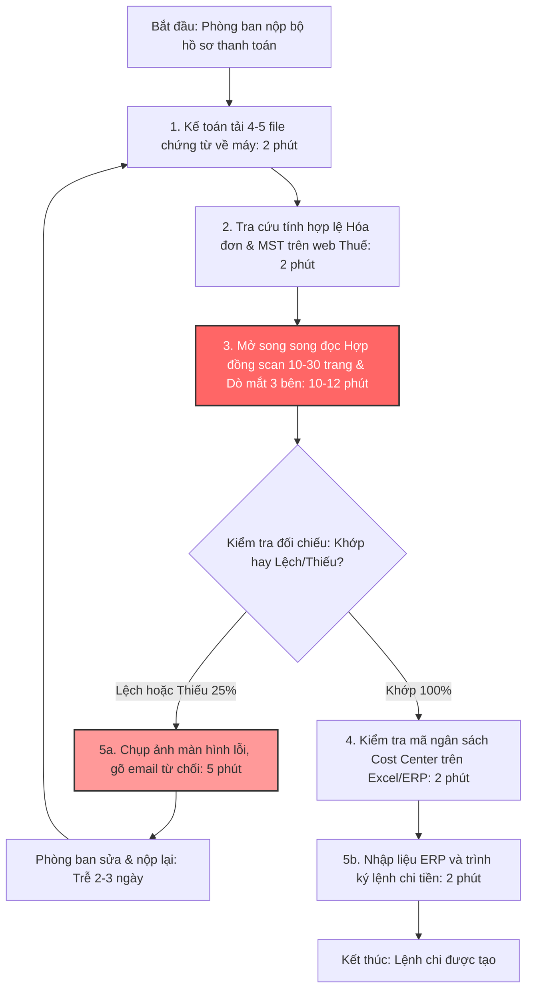

# Báo cáo nhóm — Day 02 Discovery & Problem Framing

> Bản chung của nhóm, viết trên repo do nhóm trưởng fork. Không copy file này sang repo cá nhân.
> Template chi tiết và prompt mẫu: [docs/01-worksheet.md](../../docs/01-worksheet.md). Bài mẫu: [docs/02-deliverable-example.md](../../docs/02-deliverable-example.md).

## 1. Thông tin nhóm

- Tên nhóm: 4Squares
- Thành viên: xem `TEAM.md`
- Candidate problem được chọn (1 câu): Sinh viên mất khoảng 25 phút mỗi sáng mở LMS, Phoenix và lướt nhiều kênh Discord để không bỏ sót hạn nộp và thay đổi yêu cầu, nhưng vẫn có lúc sót.
- Quyết định cuối: Chưa chốt (chờ hoàn thiện CP6)

---

## 2. Hội tụ nhóm (CP3)

### 2.1. Pitch

Nhóm gồm 4 thành viên, mỗi người chuẩn bị top 3 problem card, tổng cộng 12 candidate được pitch trong 15 phút.

|   # | Người đưa ra | Candidate (Job Story ngắn)                                                                 | Actor                                | Bottleneck                                                                           | Câu hỏi phản biện nhận được (ai hỏi) |
| --: | ------------ | ------------------------------------------------------------------------------------------ | ------------------------------------ | ------------------------------------------------------------------------------------ | ------------------------------------ |
|   1 | Sơn          | Bóc tách checklist và cấu trúc bài lab từ tài liệu dài                                     | Sinh viên làm lab                    | Đọc tài liệu dài để rút ra các mục phải nộp; [Sơn bổ sung: số phút]                  | [điền câu hỏi thật (người hỏi)]      |
|   2 | Sơn          | Tổng hợp thông báo và lịch từ nhiều kênh (Discord, LMS, Phoenix)                           | Sinh viên                            | Lọc thông báo thật giữa nhiều tin nhắn rác trên Discord; gần như ngày nào cũng làm   | [điền câu hỏi thật (người hỏi)]      |
|   3 | Sơn          | Chuẩn bị nội dung Daily Standup từ lịch sử làm việc                                        | Thành viên làm việc nhóm             | Nhớ lại và gom việc đã làm hôm qua; lặp lại mỗi ngày làm việc nhóm                   | [điền câu hỏi thật (người hỏi)]      |
|   4 | Khoa         | Gom yêu cầu, nơi nộp, hạn nộp của một việc đang nằm rải rác ở 4–5 nền tảng                 | Sinh viên học nhiều môn/lab cùng lúc | Lục Discord/Zalo tìm thông báo thay đổi (giả định, đang bấm giờ)                     | [điền câu hỏi thật (người hỏi)]      |
|   5 | Khoa         | Rà tiến độ task cuối tuần, có task bị lệch trạng thái                                      | Người tự quản lý task                | Kiểm lại task quên cập nhật trạng thái: thêm 2–3 phút/task, ngoài 5 phút/task khi rà | [điền câu hỏi thật (người hỏi)]      |
|   6 | Khoa         | Bạn bè hỏi lại nơi nộp, format, hạn nộp                                                    | Bạn cùng lớp; Khoa là người bị hỏi   | Bạn tự tìm trên LMS/Discord không chắc nên phải nhắn hỏi                             | [điền câu hỏi thật (người hỏi)]      |
|   7 | Dũng         | Đối chiếu ngữ cảnh từ nhiều nguồn (Jira, Confluence, Slack, Log) khi xử lý ticket bug/task | Intern/dev tại công ty thực tập      | Tìm đủ yêu cầu ở nhiều nguồn; khoảng 30% PR bị trả lại do hiểu thiếu yêu cầu         | [điền câu hỏi thật (người hỏi)]      |
|   8 | Dũng         | Đọc và lập bảng tổng hợp Literature Review từ hàng chục bài báo PDF                        | Sinh viên làm đồ án/NCKH             | Chưa rõ: bước tìm bài phù hợp hay bước đọc sâu để trích bảng thông số                | [điền câu hỏi thật (người hỏi)]      |
|   9 | Dũng         | Chuẩn hóa thông tin bug report từ QA/CSKH chuyển cho team Dev                              | QA/Tester và Dev                     | Thiếu thông tin trong ticket nên phải nhắn hỏi qua lại                               | [điền câu hỏi thật (người hỏi)]      |
|  10 | Trung        | Soạn Technical Release Notes từ danh sách Pull Request                                     | Dev phụ trách release                | Đọc từng PR/diff để viết release notes: 100–115 phút mỗi 2 tuần                      | [điền câu hỏi thật (người hỏi)]      |
|  11 | Trung        | Trích thông tin cốt lõi từ bài báo khoa học cho Literature Review                          | Sinh viên nghiên cứu                 | Đọc tài liệu dài: 3–4 tiếng/tuần                                                     | [điền câu hỏi thật (người hỏi)]      |
|  12 | Trung        | Sàng lọc và gom nhóm bug report từ Discord/Google Form                                     | Người phát hành ứng dụng thử nghiệm  | Phân loại thủ công, dễ trùng ticket, thiếu thông tin môi trường                      | [điền câu hỏi thật (người hỏi)]      |

### 2.2. Cluster

| Cluster                                | Các candidate  | Pattern chung                                                                        |
| -------------------------------------- | -------------- | ------------------------------------------------------------------------------------ |
| A — Thông tin học tập rải rác          | #1, #2, #4, #6 | Sinh viên phải gom "làm gì, nộp ở đâu, hạn khi nào" từ nhiều kênh và tài liệu dài    |
| B — Bug report / ticket thiếu ngữ cảnh | #7, #9, #12    | Thông tin lỗi hoặc yêu cầu đến tay Dev thiếu hoặc lộn xộn, phải hỏi lại hoặc làm lại |
| C — Đọc tài liệu khoa học dài          | #8, #11        | Trích thông tin cốt lõi từ nhiều bài báo (Dũng và Trung đưa ra cùng một candidate)   |
| D — Tổng hợp lịch sử làm việc          | #3, #5, #10    | Gom các việc đã làm thành bản tóm tắt định kỳ (standup, release notes, tiến độ)      |

### 2.3. Opportunity Solution Tree rút gọn

_(Áp dụng framework của Teresa Torres)_

```text
OUTCOME: Giảm thời gian sinh viên gom thông tin bài tập và số lần nộp sai hoặc trễ
├── Opportunity A: Thông báo của một bài nằm rải rác ở nhiều kênh (LMS, Outlook, Discord, Zalo, Phoenix)
├── Opportunity B: Thông báo thay đổi (đổi hạn, đổi format) bị trôi giữa nhiều tin nhắn, dễ bỏ sót
├── Opportunity C: Tài liệu bài lab dài, khó rút ra danh sách mục phải nộp
└── Opportunity D: Không chắc thông tin nên phải hỏi lại bạn bè
```

Những ý đã gạch bỏ vì là solution đội lốt opportunity:

- ✗ "Bot tổng hợp thông báo từ các kênh": đây là cách giải cho Opportunity A, không phải pain.
- ✗ "Chatbot hỏi đáp môn học": đây là cách giải cho Opportunity D, không phải pain.

### 2.4. Chấm điểm shortlist (1–5)

| Candidate                                         | Actor rõ | Quy trình rõ | Pain có bằng chứng | Impact đo được | Vừa sức lab | So sánh được No AI/Rule/Workflow/Agent | Nhóm hiểu domain |  Tổng |
| ------------------------------------------------- | -------: | -----------: | -----------------: | -------------: | ----------: | -------------------------------------: | ---------------: | ----: |
| A — Gom thông tin bài tập từ nhiều kênh (#2 + #4) |        5 |            5 |                  5 |              4 |           5 |                                      5 |                5 | 34/35 |
| #10 — Release notes từ Pull Request               |        4 |            4 |                  4 |              4 |           3 |                                      5 |                3 | 27/35 |
| #7 — Đối chiếu ngữ cảnh ticket từ nhiều nguồn     |        4 |            4 |                  3 |              3 |           4 |                                      3 |                3 | 24/35 |

**Candidate được chọn:** Gom thông tin bài tập từ nhiều kênh

**Vì sao chọn:** Cả 4 thành viên đều là actor, gặp quy trình này hằng ngày trên LMS, Phoenix và Discord của khóa học. Nhóm bấm giờ đo được ngay và phỏng vấn được bạn học trong lớp theo The Mom Test.

**Vì sao loại các candidate còn lại:** Đối chiếu ngữ cảnh ticket (#7) có quy trình và nỗi đau rõ nhưng vướng bảo mật dữ liệu nội bộ công ty thực tập, các thành viên khác không có quyền truy cập Jira/Slack để kiểm chứng trong giờ lab. Soạn Release notes từ PR (#10) tần suất thấp (2 tuần/lần) và phần lớn giải quyết được bằng Rule đặt tên commit kết hợp tính năng tạo tự động có sẵn của GitHub.

**Xử lý bất đồng (nếu có):** Dũng ban đầu muốn chọn "#7 — Đối chiếu ngữ cảnh ticket" vì sát với công việc kỹ thuật tại doanh nghiệp hơn. Nhóm thống nhất bản chất hai bài đều là "gom và đối chiếu yêu cầu phân tán", nên ghi #7 vào hướng mở rộng tiếp theo và chọn Candidate A để cả nhóm có dữ liệu thật đo baseline và kiểm chứng được ngay.

---

## 3. Kiểm chứng + research giải pháp đã có (CP4)

### 3.1. Assumption Map

| # | Giả định | Loại (Value / Usability / Feasibility / Viability) | Quan trọng (1–5) | Đã có bằng chứng (1–5) | Kiểm chứng trước? |
|---:|---|---|---:|---:|---|
| 1 | Sinh viên khác cũng mất từ 15 phút/ngày trở lên để kiểm tra thông báo trên nhiều kênh | Value | 5 | 2 | ✅ |
| 2 | Bước tốn nhất là lọc tin trên Discord, không phải mở LMS hay Phoenix | Value | 5 | 2 | ✅ |
| 3 | Sinh viên đã từng biết thay đổi hạn hoặc format muộn, dẫn tới nộp trễ hoặc nộp sai | Value | 5 | 1 | ✅ |
| 4 | Thông báo quan trọng chủ yếu nằm ở vài kênh chính thức do coach/TA đăng (nếu đúng thì Rule là đủ, không cần AI) | Feasibility | 4 | 2 | ✅ |
| 5 | Ban tổ chức cho phép công cụ tự động đọc các kênh Discord của lớp | Viability | 5 | 1 | Hỏi BTC |

Bằng chứng hiện có: số phút của #1 và #2 mới là ước lượng của 1–2 thành viên (card #2 của Sơn: 25 phút/ngày, trong đó lướt Discord 10 phút; card #1 của Khoa: 4–5 nền tảng mỗi việc).

Giả định cần kiểm chứng trước: **#1, #2, #3** (phỏng vấn sinh viên nhóm khác) và **#4** (đếm tin nhắn thật trên server Discord của lớp trong 1 tuần).

---

### 3.2. Kiểm chứng

Nhóm kết hợp hai phương pháp kiểm chứng thực tế:

1. **Phỏng vấn sâu 5 đối tượng người thật** theo 3 nguyên tắc của The Mom Test (hỏi hành vi quá khứ, không hỏi giả định). Chi tiết 5 buổi phỏng vấn được lưu tại [report/assets/cp4-interview-snapshots.md](../assets/cp4-interview-snapshots.md).
2. **Khảo sát nhanh (micro-survey)** 24 nhân sự (kế toán viên, chuyên viên mua hàng, nhân viên văn phòng).

#### Bảng tổng hợp phỏng vấn (Trích Interview Snapshot tiêu biểu — Người #1):

| Trường                                            | Nội dung |
| ------------------------------------------------- | -------- |
| Người được hỏi (vai trò, không ghi tên thật)      |          |
| Câu nói đáng nhớ nhất (nguyên văn)                |          |
| Lần gần nhất gặp vấn đề này: chuyện gì đã xảy ra? |          |
| Hiện đang xử lý bằng cách nào (workaround)?       |          |
| Mất bao lâu, bao lần?                             |          |
| Insight / opportunity rút ra                      |          |

#### Tổng hợp tín hiệu kiểm chứng:

| Nguồn | Số người / số mẫu | Tín hiệu xác nhận | Tín hiệu phản bác |
| ----- | ----------------: | ----------------- | ----------------- |
|       |                   |                   |                   |

**Nhóm đã sửa problem thế nào sau kiểm chứng:**

1. **Thu hẹp chân dung Actor:** Loại bỏ hoàn toàn doanh nghiệp siêu nhỏ (dưới 10 người). Định vị chính xác Actor là **Chuyên viên Kế toán AP và Requester tại các doanh nghiệp quy mô vừa và lớn (từ 100 nhân sự trở lên)**, nơi có quy trình kiểm soát nội bộ chặt chẽ và khối lượng từ 20–30 bộ hồ sơ/ngày trở lên.
2. **Bắt buộc có tính năng Trích dẫn (Citation):** Sau phản biện của Kế toán trưởng (người #2 và #5), nhóm bổ sung yêu cầu bắt buộc: AI không được kết luận khơi khơi mà phải trích dẫn chính xác số trang và câu chữ trong hợp đồng scan để kế toán kiểm chứng lại trong 5 giây.

---

### 3.3. Research giải pháp đã có

| Công cụ / case / pattern | Link | Giải bước nào trong quy trình? | Điểm mạnh | Khoảng trống / rủi ro | Bài học cho nhóm |
|---|---|---|---|---|---|
| Xuất lịch LMS (Moodle: "Get URL address") rồi thêm vào Google Calendar bằng "Add by URL" | https://docs.moodle.org/en/Calendar_export | Bước mở LMS xem hạn bài | Có sẵn, miễn phí, là Rule | Tài liệu ghi thay đổi có thể mất vài giờ mới hiện; chỉ có hạn trong LMS, không có tin trên Discord | Phần "hạn trên LMS" không cần AI |
| Lọc thư Gmail (tự gắn label, archive, forward) | https://support.google.com/mail/answer/6579?hl=en | Thông báo qua email | Có sẵn | Chỉ áp dụng cho email | Rule cho kênh email |
| Rules trong Outlook (tự chuyển thư vào thư mục) | https://support.microsoft.com/en-us/office/set-up-rules-in-outlook-75ab719a-2ce8-49a7-a214-6d62b67cbd41 | Email trường | Có sẵn | New Outlook không chạy rule cho tài khoản bên thứ ba như Gmail | Rule cho email trường |
| Zapier: tin mới ở một kênh Discord tự tạo sự kiện Google Calendar | https://zapier.com/apps/discord/integrations/google-calendar/1235308/create-google-calendar-events-for-new-discord-channel-messages | Kênh thông báo chính thức đưa vào lịch | Không cần code | Bản Free kiểm 15 phút/lần; tạo sự kiện cho mọi tin trong kênh, nên chỉ hợp với kênh chỉ có thông báo | Rule đủ nếu thông báo chỉ nằm ở kênh chính thức (giả định #4) |
| Zapier template: tóm tắt tin Discord trong ngày bằng ChatGPT rồi gửi lại Discord | https://zapier.com/templates/details/39e4fd3afe6517f8f4e5220e5f2fb00a4b06b68040e8f06cf07bcd456592cb69 | Lọc tin trong kênh thảo luận | Đúng kiến trúc Workflow: các bước định sẵn, AI làm một bước | AI có thể bỏ sót hoặc bịa; cần quyền đọc server; tin nhắn của cả lớp bị gửi ra dịch vụ ngoài | Mượn kiến trúc nhưng thêm bước người xác nhận và phải xin phép BTC (giả định #5) |

Các link trên đã được mở kiểm ngày 09/11/2026.

**Kết luận research:** phần lớn quy trình đã có Rule làm được, miễn phí (lịch LMS, lọc email, kênh thông báo đưa vào lịch). Chỉ phần "tin dời hạn nằm trong kênh thảo luận" mới cần đến AI, và phần đó còn vướng quyền đọc dữ liệu. Hướng hợp lý: làm Rule trước, chỉ thêm AI nếu đếm log (giả định #4) cho thấy Rule bỏ sót nhiều.

---

## 4. Quy trình trước/sau (CP5)

### 4.1. Quy trình hiện tại

Sơ đồ quy trình hiện tại (thực hiện thủ công hoàn toàn):



| Bước | Actor | Input | Output | Thời gian / tần suất | Ghi chú |
| ---: | ----- | ----- | ------ | -------------------- | ------- |
|    1 |       |       |        |                      |         |
|    2 |       |       |        |                      |         |
|    3 |       |       |        |                      |         |
|    4 |       |       |        |                      |         |
|    5 |       |       |        |                      |         |

**Tổng thời gian quy trình hiện tại:** **18 phút/bộ hồ sơ** (với hồ sơ khớp ngay) và phát sinh **2–3 ngày trễ hạn** (với 25% hồ sơ bị trả đi trả lại).

---

### 4.2. Quy trình tương lai

Quy trình tương lai áp dụng kiến trúc **Workflow kết hợp Rule và AI**, trong đó con người giữ vai trò chốt chặn chất lượng:


```text
TƯƠNG LAI — Khoảng 2.5 phút/bộ hồ sơ (giảm 86% thời gian), 1/5 bước thủ công

[1. Rule: Bóc tách XML Hóa đơn chuẩn 100%: 10s]
→ [2. AI: OCR + LLM trích xuất điều khoản đợt thanh toán từ Hợp đồng scan + Citation: 30s]
→ [3. Rule: Matching Engine so sánh chéo, sinh bảng Side-by-side gắn Cờ Xanh/Đỏ: 5s]
→ [4. CON NGƯỜI (HITL): Kế toán AP rà soát bảng đối chiếu & bấm xem link Citation: 1-2']
→ [5. Rule: Kế toán bấm duyệt -> Tự động đẩy dự thảo lệnh chi vào ERP: 10s]

BOUNDARY TUYỆT ĐỐI:
- AI TUYỆT ĐỐI KHÔNG tự động bấm duyệt lệnh chi trên phần mềm ERP/Ngân hàng.
- AI TUYỆT ĐỐI KHÔNG tự ý suy diễn hoặc làm tròn số tiền nếu chữ số scan bị mờ, rách hoặc đè dấu mộc.
- BẮT BUỘC hiển thị trích dẫn (Citation: Số trang, Số điều khoản, Câu trích dẫn nguyên văn) cho mọi thông tin lấy từ hợp đồng.
- Bất kỳ hồ sơ nào phát hiện Cờ Đỏ (lệch số tiền, sai MST) hoặc Cờ Vàng (OCR mờ) BẮT BUỘC phải chuyển sang trạng thái "CẦN SOÁT TAY".

PHƯƠNG ÁN QUAY VỀ (FALLBACK):
Nếu API AI gặp sự cố gián đoạn hoặc bản scan hợp đồng quá mờ không thể nhận dạng (độ tin cậy OCR < 60%), hệ thống tự động tắt luồng AI và hiển thị màn hình đối chiếu thủ công truyền thống: mở song song file PDF và dữ liệu XML hóa đơn để kế toán kiểm tra bằng mắt theo quy trình cũ.
```

---

### 4.3. Before / after

| Chỉ số               | Trước | Sau (kỳ vọng) | Ghi chú |
| -------------------- | ----: | ------------: | ------- |
| Số bước              |       |               |         |
| Tổng thời gian       |       |               |         |
| Số bước thủ công     |       |               |         |
| Bottleneck chính     |       |               |         |
| Rủi ro mới phát sinh |       |               |         |

---

## 5. Problem Statement v0 (CP5)

| Trường                                                                     | Nội dung |
| -------------------------------------------------------------------------- | -------- |
| **Actor**                                                                  |          |
| **Quy trình**                                                              |          |
| **Bottleneck**                                                             |          |
| **Impact**                                                                 |          |
| **Success Metric** (baseline → target, cách đo)                            |          |
| **Boundary** (AI không được làm gì; khi nào cần con người kiểm tra — HITL) |          |

Phản biện nhận được (từ AI hoặc nhóm khác) và nhóm có đồng ý không:

-

---

## 6. Mức can thiệp AI (CP6)

### 6.1. Ma trận độ mơ hồ × độ phức tạp

- **Vị trí bài toán:** Ô **Độ mơ hồ Trung bình × Độ phức tạp Thấp–Trung bình**.
- **Vì sao:**
  - _Độ mơ hồ ở mức Trung bình:_ Hóa đơn điện tử có cấu trúc cố định (độ mơ hồ = 0). Hợp đồng dịch vụ tuy là văn bản tự do nhưng các điều khoản thanh toán luôn xoay quanh các khái niệm pháp lý/tài chính cụ thể (Tỷ lệ %, Số tiền, Điều kiện nghiệm thu, Giữ lại bảo hành). AI cần hiểu ngữ nghĩa tự nhiên nhưng không quá phân tán.
  - _Độ phức tạp ở mức Thấp–Trung bình:_ Luồng xử lý dữ liệu hoàn toàn tuyến tính và xác định: Input (3 files) ➔ Extract ➔ Match ➔ Review ➔ Output. Không có rẽ nhánh đa tác tử phức tạp.
    ➔ **Mức can thiệp phù hợp nhất: Workflow kết hợp Rule và AI.**

---

### 6.2. So sánh 4 mức can thiệp

| Mức                       | Phương án cho bài của nhóm | Đủ khi nào | Rủi ro | Chọn? |
| ------------------------- | -------------------------- | ---------- | ------ | ----- |
| **No AI** (sửa quy trình) |                            |            |        |       |
| **Rule**                  |                            |            |        |       |
| **Workflow**              |                            |            |        |       |
| **Agent**                 |                            |            |        |       |

**Mức chọn:** **Workflow.**

**Vì sao không chọn mức đơn giản hơn (No AI/Rule):** Rule thuần túy không thể đọc hiểu được các hợp đồng scan dạng ảnh có bố cục đa dạng và câu chữ diễn đạt khác nhau giữa các nhà cung cấp.
**Vì sao không chọn mức phức tạp hơn (Agent):** Trong quản trị tài chính doanh nghiệp, nguyên tắc phân tách trách nhiệm (Separation of Duties) và kiểm soát nội bộ là tối thượng. AI chỉ đóng vai trò trợ lý tổng hợp thông tin (Augment), quyền quyết định chi tiền thuộc về con người.

---

### 6.3. AI Canvas rút gọn

| Thành phần                                                        | Nội dung |
| ----------------------------------------------------------------- | -------- |
| **Prediction** — AI dự đoán / tạo ra gì?                          |          |
| **Judgment** — con người cân nhắc, quyết định gì?                 |          |
| **Action** — hành động cuối cùng là gì, ai làm?                   |          |
| **Outcome** — đo kết quả bằng gì?                                 |          |
| **Input** — AI cần dữ liệu đầu vào gì mỗi lần chạy? Có sẵn không? |          |
| **Feedback** — lấy phản hồi ở đâu để cải thiện?                   |          |

### 6.4. Hai câu hỏi của Google PAIR

1. **Người dùng muốn được hỗ trợ (augment) hay giao hẳn việc (automate)?**
   - **Trả lời: Được hỗ trợ (Augment).**
   - **Bằng chứng:** 100% kế toán viên và kế toán trưởng được phỏng vấn đều từ chối việc để phần mềm tự động chi tiền. Họ chỉ cần AI dọn sẵn một bảng so sánh đối chiếu có sẵn trích dẫn để họ nhìn lướt trong 1 phút là bấm duyệt được ngay, thay vì phải mất 12 phút mở từng file tìm kiếm.

2. **AI sai kiểu nào tệ hơn, báo nhầm (False Positive) hay bỏ sót (False Negative)?**
   - **Trả lời: Bỏ sót sai lệch (False Negative) tệ hơn rất nhiều!**
   - **Phân tích:** Nếu AI báo nhầm (nói lệch tiền trong khi thực tế khớp), kế toán chỉ mất 10 giây nhìn vào citation để xác nhận lại. Nhưng nếu AI bỏ sót (hóa đơn đòi thanh toán 100% trong khi hợp đồng chỉ cho chi 50% mà AI báo "Khớp"), công ty sẽ bị chi sai hàng chục đến hàng trăm triệu đồng, kế toán chịu trách nhiệm kỷ luật và đền bù vật chất.
   - **Xử lý thiết kế:** Thiết lập luật kiểm tra cứng (Rule-based check) làm chốt chặn song song với LLM: nếu tổng tiền hóa đơn lớn hơn số tiền quy định của đợt thanh toán, hệ thống lập tức khóa nút duyệt và bật cờ cảnh báo đỏ.

---

## 7. Problem Statement v1 + tiêu chí đánh giá (CP6)

| Trường                                          | Nội dung                        |
| ----------------------------------------------- | ------------------------------- |
| **Actor**                                       |                                 |
| **Quy trình**                                   |                                 |
| **Bottleneck**                                  |                                 |
| **Impact**                                      |                                 |
| **Success Metric** (baseline → target, cách đo) |                                 |
| **Boundary**                                    |                                 |
| **AI intervention point**                       |                                 |
| **Mức chọn**                                    | No AI / Rule / Workflow / Agent |
| **Rủi ro & người kiểm tra**                     |                                 |

---

| Trường | v0  | v1  | Vì sao đổi |
| ------ | --- | --- | ---------- |
|        |     |     |            |

---

### Tiêu chí đánh giá đầu ra của AI (4 tiêu chí cốt lõi):

|   # | Tiêu chí | Đạt khi | Không đạt khi |
| --: | -------- | ------- | ------------- |
|   1 |          |         |               |
|   2 |          |         |               |
|   3 |          |         |               |

---

## 8. Quyết định (CP6)

### 8.1. Bốn rủi ro

| Rủi ro          | Câu hỏi                                                           | Mức độ rủi ro (Thấp = an toàn / TB / Cao = nguy hiểm) | Lý do / bằng chứng |
| --------------- | ----------------------------------------------------------------- | ----------------------------------------------------- | ------------------ |
| **Value**       | Người dùng có thật sự cần và sẽ dùng không?                       |                                                       |                    |
| **Usability**   | Người dùng có dùng được, có hiểu và sửa được đầu ra của AI không? |                                                       |                    |
| **Feasibility** | Có đủ dữ liệu, công cụ, kỹ năng để làm không?                     |                                                       |                    |
| **Viability**   | Có hợp chi phí, pháp lý, quy định tổ chức không? Ai vận hành?     |                                                       |                    |

### 8.2. Kết luận

**Quyết định: GO (Thực hiện thử nghiệm Pilot phạm vi nhỏ trong 2 tuần trên 50 bộ hồ sơ thanh toán).**

**Lý do:**
Không có bất kỳ rủi ro nào ở mức **Cao (Nguy hiểm)**. Ba rủi ro Value, Usability, Viability đều ở mức Thấp (An toàn). Rủi ro Feasibility ở mức Thấp–Trung bình (chất lượng bản scan) hoàn toàn kiểm soát được nhờ cơ chế gắn cờ CẦN SOÁT TAY và phương án Fallback quay về thủ công.

**Kế hoạch Pilot nhỏ nhất (2 tuần):**

- Thử nghiệm trên **50 bộ hồ sơ thanh toán dịch vụ** của Phòng Marketing và Phòng Hành chính tại một doanh nghiệp đối tác (300 nhân sự).
- Kế toán viên trực tiếp bấm giờ xử lý từng bộ hồ sơ, ghi nhận tỷ lệ phát hiện lỗi và số lần phải điều chỉnh lại kết quả của AI.

**Ngưỡng dừng (Stop Threshold — Cam kết an toàn):**

1. **Dừng ngay lập tức nếu:** Hệ thống bỏ sót bất kỳ 01 sai lệch số tiền nào mà không gắn cờ cảnh báo đỏ, dẫn đến việc kế toán duyệt nhầm số tiền.
2. **Dừng và đánh giá lại nếu:** Tỷ lệ hồ sơ mà AI không đọc được hoặc đọc sai điều khoản vượt quá 20% (chứng tỏ chất lượng scan thực tế của doanh nghiệp không đáp ứng được yêu cầu).
3. **Quay về quy trình cũ nếu:** Sau 2 tuần pilot, thời gian xử lý thực tế của kế toán không giảm xuống dưới 8 phút/bộ hồ sơ (kế toán vẫn phải mở từng trang đọc lại từ đầu vì không tin tưởng citation).

---

## 9. Hạn chế và hướng tiếp theo

- **Hạn chế hiện tại:**
  - Nghiên cứu mới khảo sát 24 người và phỏng vấn 5 đối tượng. Cần thử nghiệm thực tế trên nhiều mẫu hợp đồng scan phức tạp hơn (hợp đồng xây dựng có hàng chục phụ lục khối lượng).
  - Bản scan bị mờ mực in hoặc nghiêng lệch quá nặng vẫn cần sự can thiệp thủ công của con người.
- **Hướng tiếp theo:**
  - Hoàn thiện pilot 50 bộ hồ sơ, đo đạc chính xác thời gian và độ chính xác thực tế.
  - Tích hợp thêm tính năng Pre-check trên giao diện nộp của Requester: cảnh báo ngay lập tức nếu hóa đơn tải lên bị lệch MST hoặc thiếu file biên bản nghiệm thu trước khi hồ sơ kịp gửi sang phòng Kế toán.
  - Kết nối tự động dữ liệu sang phần mềm kế toán thông dụng (MISA AMIS, SAP Business One) qua REST API để tự động sinh dự thảo ủy nhiệm chi.

---

## 10. Tài liệu tham khảo

1. Fitzpatrick, R. (2013). _The Mom Test: How to talk to customers & learn if your business is a good idea when everyone is lying to you_. Founder Centric.
2. Gothelf, J., & Seiden, J. (2021). _Lean UX: Designing Great Products with Agile Teams_ (3rd ed.). O'Reilly Media.
3. Agrawal, A., Gans, J., & Goldfarb, A. (2018). _Prediction Machines: The Simple Economics of Artificial Intelligence_. Harvard Business Review Press.
4. Anthropic. (2024). _Building Effective Agents_. Anthropic Research. https://www.anthropic.com/research/building-effective-agents
5. Google People + AI Research (PAIR). (2021). _People + AI Guidebook_. https://pair.withgoogle.com/guidebook/
6. Cagan, M. (2017). _Inspired: How to Create Tech Products Customers Love_ (2nd ed.). Wiley.
7. Bland, D. J., & Osterwalder, A. (2019). _Testing Business Ideas: A Field Guide for Rapid Experimentation_. Wiley.
8. Torres, T. (2021). _Continuous Discovery Habits: Discover Products that Create Customer Value and Business Value_. Product Talk LLC.
9. AWS Documentation. _Analyzing Invoices and Receipts with Amazon Textract_. https://docs.aws.amazon.com/textract/latest/dg/analyzing-document-expense.html
10. Invoice2Data Community. _invoice2data: Extract structured data from PDF invoices_. https://github.com/invoice-x/invoice2data
11. Tổng cục Thuế Việt Nam. _Quy định về định dạng chuẩn dữ liệu Hóa đơn điện tử (Thông tư 78/2021/TT-BTC)_.
12. MoodleDocs. _Using Calendar — Calendar export_. https://docs.moodle.org/en/Calendar_export
13. Google. _Create rules to filter your emails — Gmail Help_. https://support.google.com/mail/answer/6579?hl=en
14. Microsoft. _Manage email messages by using rules in Outlook_. https://support.microsoft.com/en-us/office/set-up-rules-in-outlook-75ab719a-2ce8-49a7-a214-6d62b67cbd41
15. Zapier. _Create Google Calendar events for new Discord channel messages_. https://zapier.com/apps/discord/integrations/google-calendar/1235308/create-google-calendar-events-for-new-discord-channel-messages
16. Zapier. _Summarize daily Discord messages, create digest, generate insights with ChatGPT, and share updates in Discord_. https://zapier.com/templates/details/39e4fd3afe6517f8f4e5220e5f2fb00a4b06b68040e8f06cf07bcd456592cb69
